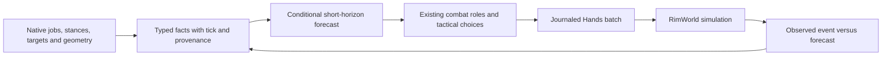

# Predictable opponents, uncertain outcomes: a combat research agenda for RimGovernor

[Documentation](../../README.md) · [Combat mechanics](combat-game-ai.md) · [Architecture](overview.md)

Research assessment, 11 October 2026. Source baseline: RimGovernor
`2ffac39852342aae992551d1bf3165861ad468ba`. This is a source-based research
paper and experiment proposal, not a report of improved combat performance.

## Abstract

Knowledge of RimWorld's combat AI can give RimGovernor a tactical advantage,
but does not make enemy actions exactly predictable. The useful advantage is
short-horizon knowledge: who is preparing to attack, which actions remain
legal, where a pawn is going, and which changes invalidate that intent.
Target acquisition is partly randomized; a shooting job's lifetime is not a
period during which its target cannot change. Exact outcomes also depend on
projectiles, injuries, pathing, interrupts and other pawns.

RimGovernor already contains substantial tactical policy. The largest
opportunities identified here are to carry existing native timing facts into
policy, distinguish actual attack intent from job targets, replace geometric
breach guesses with observed intent where available, and selectively coordinate
fire when the expected benefit exceeds the cost of interrupting native combat.
These changes should extend the existing pure policy and Hands execution path.
A bounded forecast supplies the first observations and validation cases for a
second research track: a fast, mechanics-faithful Go combat simulator. Thousands
of simulated trials per second would enable tactical search and policy tuning
that live-game experimentation cannot practically supply at that scale. This is
a throughput objective to benchmark, not a measured capability. RimWorld remains
the reference for legality and outcomes; simulator fidelity is an engineering
problem to measure and improve, not a reason to reject the approach.

## 1. Method and scope

The assessment combines production Go/C# inspection, direct decompilation of
the installed game assembly, existing acceptance-case definitions and issue
history. Labels used below distinguish **verified code behavior**, **inference**
and **hypothesis requiring gameplay evidence**. No native match was run for this
paper, and no win-rate improvement or superiority over expert humans is claimed.
Existing baseline JSON files are historical artifacts, not fresh measurements.

The inspected `Assembly-CSharp.dll` has file version `1.6.9676.17735` and SHA-256
`5CF1B5BE399D5B1C9C56CA72C9D35B4ECF307FEACF5859D04AC5A1AA5926356A`.
File version identifies this binary; it is not a claim about the latest public
game release. Classes were inspected with local `ilspycmd` 11.0.0. No game
assembly or decompiled game source is added to the repository.

Primary native sources, referred to as N1–N6:

| ID | Class and relevant methods | Question answered |
| --- | --- | --- |
| N1 | `RimWorld.JobGiver_AIFightEnemy`: `TryGiveJob`, `UpdateEnemyTarget`, `ShouldLoseTarget` | Acquisition, job lifetime and target loss |
| N2 | `Verse.AI.AttackTargetFinder`: `GetAvailableShootingTargetsByScore`, `GetRandomShootingTargetByScore`, `GetShootingTargetScore` | Scores, eligible alternatives and randomness |
| N3 | `Verse.AI.JobDriver_Wait`: `MakeNewToils`, `Notify_StanceChanged`, `CheckForAutoAttack` | Autonomous attacks while holding position |
| N4 | `Verse.ShotReport`: `HitReportFor`, `TotalEstimatedHitChance` | Native estimates of ranged hit chance |
| N5 | `RimWorld.LordJob_AssaultColony.CreateGraph` | Raid-level states and exit conditions |
| N6 | `RimWorld.Trigger_FractionColonyDamageTaken.ActivateOn` | What the colony-damage exit trigger measures |

To reproduce an inspection against a licensed local installation:

```powershell
ilspycmd -t RimWorld.JobGiver_AIFightEnemy '<managed-directory>\Assembly-CSharp.dll'
Get-FileHash '<managed-directory>\Assembly-CSharp.dll' -Algorithm SHA256
```

Assembly inspection does not account for runtime Harmony patches or every
subclass and think-tree configuration. Pin expansion and mod manifests for
experiments. Combat-mod compatibility needs its own qualification. Official
release history documents changes to raid mix and breacher targeting, which is
reason enough to version assumptions rather than treat familiar tactics as
permanent rules. [Ludeon, update 1.3.3200](https://ludeon.com/blog/2021/12/update-1-3-3200-improves-defense-tools-and-raid-strategies/)

## 2. What knowing the AI actually buys

Combat operates at several interacting levels: raid Lords choose broad duties;
think trees and job givers choose jobs; job drivers and verbs acquire targets
and execute attacks; pathing and physical simulation determine outcomes. An
accurate prediction at one level does not freeze the others.

### 2.1 Target choice is a distribution, sometimes sharply concentrated

N2 starts the shooting score at 60, subtracts distance capped at 40, adds 10
when the candidate is aiming at the searcher, and adds 40 for the last attacked
target within 300 ticks. Cover, combatant status, downing, weapon-specific
preferences, friendly fire and target priority modify it further.

The ranged selection branch does **not** simply choose the largest score. If
the best score is at least 1, shootable candidates within 30 points of the best
enter a weighted draw. Their weights interpolate from zero at best-minus-30
to one at the best. When the best score is below 1, the implementation instead
returns the best available candidate with weight one. Other search branches
use different logic; this is not a universal target-selection formula.

For illustration, final scores of 80, 65 and 40 yield weights 1, 0.5 and 0:
conditional selection probabilities of two-thirds, one-third and zero in this
branch. The example is arithmetic, not an observed encounter. A 40-point
recent-target bonus can exclude alternatives entirely, but range, visibility,
priority and other changes can undo that advantage immediately.

**Inference:** a protected pawn that already attracts enemy fire may allow
teammates to reposition with less exposure. **Hypothesis:** controlled target
attraction improves survival. It is not a taunt guarantee, and intentionally
offering a weak pawn is not justified by a target score alone.

### 2.2 The often-cited eight-second window is not a lock

N1 assigns ordinary successful ranged jobs an expiry interval of 450–550 ticks,
or 7.5–9.17 nominal simulation seconds at 60 ticks/second. These are simulation
units, not guaranteed wall-clock durations. The class has different intervals
for melee and abilities, and subclasses/configuration may differ.

N3 checks auto-attack on a four-tick interval and when the stance becomes mobile,
subject to full-body-busy, capability, fire-mode and other guards. It can acquire
a shooting target without changing the enclosing `Wait_Combat` job. Therefore,
job expiry is evidence about a job's reconsideration horizon, not an eight-second
promise of unchanged targeting or inactivity. Nor does every four-tick check
produce a shot or a target switch.

The better opening is an **observed stance and remaining duration**, combined
with a valid attack target and path to protection. Even this is conditional:
an interrupt, alternate verb, burst already underway or third enemy can make
a seemingly safe move unsafe.

### 2.3 Geometry and tempo matter more than nominal weapon range

N4 estimates hit chance from shooter, equipment, distance, target size/posture,
cover, weather, gas and applicable darkness effects. Its clamped product is a
hit estimate, not expected injury, armor penetration or probability of downing.
Forced-miss weapons, explosions and projectile interactions need their own
semantics. A strong tactical cell must combine incoming exposure, outgoing
effectiveness, travel time and a reachable exit.

**Inference:** the best cover cell against an idle short-range enemy may be
worse than a modestly covered cell outside an imminent high-damage shot.
Treat native geometry and estimates as facts; keep tactical comparisons in Go.
Do not relocate live pawns temporarily to query hypothetical shots or run a
stateful target picker as if it were a read-only oracle.

### 2.4 Raid resolution is an objective, not necessarily extermination

N5 gives eligible humanlike assaults timeout exits, filtered on map exitability:
26,000–38,000 ticks for ordinary assault and 33,000–38,000 for sapper/breacher
configurations. Kidnapping, stealing and specialist states matter separately.
The 25–35% trigger in this graph measures **damage suffered by the colony**,
with a minimum damage threshold of 900 in this constructor (N6). It is not a
claim that killing 25–35% of raiders universally makes the raid flee.

Raider casualty/flee mechanisms beyond these inspected methods require
separate tracing. Do not generalize this humanlike exit path to mechanoids or
all encounters. Waiting can still lose buildings, captives, medical time or
the colony's ability to recover.

**Hypothesis:** objective-aware containment can outperform pursuit once a raid
is leaving, provided kidnappers and remaining threats are handled. A sealed
base that waits successfully against one raid class proves little about siege,
breach, drop-pod or overlapping threats.

## 3. RimGovernor's current ability

The production centerpiece is [DecideCombat](../../../go/internal/policy/combat_decide.go).
It separates formation from reactions, retains roles, emits changed orders,
and normally avoids interrupting warmup/cooldown except for retreat, rescue
and explicit safety transitions. This is a sound base for forecasting.

| Capability | Verified implementation | Research opportunity or limit |
| --- | --- | --- |
| Native hold and retarget | [stationaryRangedHold](../../../go/internal/policy/combat_native_hold.go) delegates eligible ordinary firing-line holders to `Wait_Combat`; `DecideCombat` clears their policy target | Explicit focus-fire policy is not universally controlling ordinary holders. Preserve autonomous fire as the comparison baseline |
| Focus and priorities | [rankThreats/focusFire](../../../go/internal/policy/combat_threat.go) rank threat tiers and preserve a prior live in-range target | No per-volley damage allocation here; stable focus can overcommit or retain a target after a more urgent threat appears |
| Cover and friendly fire | [CoverScore](../../../go/internal/policy/combat_cover.go) compares mean own/enemy cover; [clearLines/holdFire](../../../go/internal/policy/combat_fire.go) handle blocked lines and friendly melee | Cover averages do not express time-varying threat, armor or exposure during travel |
| Kiting and flanking | [kite](../../../go/internal/policy/combat_kite.go), [flank](../../../go/internal/policy/combat_flank.go) and group roles exist | Kiting eligibility uses speed/range thresholds; path, door delay and attack-cycle timing offer a more specific feasibility test |
| Breach defense | [predictBreach](../../../go/internal/policy/combat_sapper.go) uses sapper centroid, nearest room center and nearest wall | It is a geometric guess, not observation of the game's chosen breach path; multiple groups can make their centroid misleading |
| Specialized responses | Siege, pods, manhunters, infestations, explosives, shielded melee, rescue, drugs and permits are branches of `DecideCombat` | Presence of a branch does not establish tactical quality or successful composition with another branch |
| EMP and abilities | [EMP policy](../../../go/internal/policy/combat_mech_emp.go) tracks inferred adaptation and disengagement; [castCalls](../../../go/internal/policy/combat_cast.go) recognizes five psycast families | These are existing capabilities, not blank slates. Adaptation inference and narrow effect categories should not become universal native facts |
| Write ownership | [sendCombatBatch](../../../go/internal/buildingruntime/rounds_combat.go) commits a combat batch and calls `hands.RunBatch`; uncertain receipts are explicit | The older bypass description is stale for this revision. [#2502](https://github.com/davidarcher/rimgovernor/issues/2502) is closed; do not propose rebuilding this completed work |

Two observation details deserve priority over new tactics:

1. [CombatMirror.Project](../../../integrations/rimgovernor-native/src/Bridge/CombatMirror.cs)
   writes `StanceTicksLeft`, `WeaponWarmupTicks` and `WeaponCooldownTicks`, but
   `combatPawnStates` and `CombatPawnState` do not carry these timing fields into
   tactical policy. Prefer completing this existing path over adding another
   poller. Base weapon warmup is not necessarily actual remaining pawn warmup.
2. `TargetId` is projected from `CurJob.targetA.Thing`. That is a job target,
   not a general contract for the verb's current attack target, warmup focus,
   or `mindState.enemyTarget`. The native shot event reads `Verb.CurrentTarget`
   separately. Predictions that assume these are interchangeable need a typed
   distinction and native evidence, especially for autonomous `Wait_Combat`.

There are also legacy optimistic unknowns: `inRange` treats unknown position
or range as in range, and kiter eligibility does not reject unknown armor.
Native legality checks reduce illegal-order risk but do not prove tactical
safety. New predictive admission must not inherit unknown-as-safe semantics.

## 4. Tactical advantages worth testing

These are prioritized hypotheses, not measured gains. Each should first be
tested against the existing tactic it intends to improve.

| Priority | Advantage and mechanism | Required facts / abort condition | Falsifiable experiment |
| --- | --- | --- | --- |
| First | **Timed protection:** leave a threatened cell or interrupt a dangerous warmup before the attack completes | Actual aim target, remaining stance, frame age, route and movement capability; abort prediction when any changes | Prepared shooter/defender scene; compare damage and time to cover against current reactive retreat across varied warmup offsets |
| First | **Breach pre-positioning:** defend the wall enemies actually intend to attack | Observed job target cell/thing, duty and path evidence; unknown or conflicting groups require conservative formation | Asymmetric rooms, rock and two separated sapper groups; compare predicted/actual breach cell and defender arrival-before-breach |
| Next | **Selective coordinated fire:** remove the next dangerous actor without wasting the whole squad's volley | Native legal shots, timing, victim vulnerability and attacks already committed; preserve aim unless avoided harm justifies cancellation | Two threats, one imminent explosive shot and one nearly downed enemy; compare native hold, current explicit focus and coordinated assignment |
| Next | **Target attraction and covered rotation:** exploit concentrated enemy target probability while moving others | Actual targeting, score support, health/shield reserves and safe exits; abandon bait when retargeted or overwhelmed | Two defenders behind different cover; vary recent target, distance and third-party fire; measure switching and total injuries |
| Next | **Kiting with a route budget:** fire only when approach time exceeds attack plus escape time | Native path costs, move capability, attack cycle, collision/door constraints and route exposure | Faster pawn with several weapons on open, rough and doorway routes; count contacts, useful shots and failed escapes |
| Later | **Timed control:** coordinate stun/EMP, melee disengagement and ability use around dangerous actions | Native effect state, real duration, adaptation, heat/focus and ally blast exposure | Staggered mech arrival with mixed stun sources; measure harmful attacks prevented per consumable and injuries after stun ends |
| Later | **Raid-state exploitation:** switch from fighting to containment, rescue or stopping abduction at the right transition | Lord state, faction/objective, actual exit path and captive ownership | Exit-enabled human raid and kidnapping variant; compare survival, captive loss, structures and time back to work |
| Later | **Deliberate geometry:** design crossfire and retreat routes that exploit likely approaches | Separate normal, sapper, breacher and pod models; construction demand and evacuation capacity | Hold resources constant across layouts and held-out arrival directions; measure worst-case survival as well as mean damage |

A useful toy calculation illustrates timing admission. Suppose an observed
enemy warmup has 90 ticks left, the frame is 12 ticks old, the estimated move
to cover takes 45 ticks and dispatch consumes 8 simulation ticks. The nominal
slack is `90 - 12 - 45 - 8 = 25 ticks`. This is an illustrative estimate, not
a safety guarantee: route delay, another shooter, a projectile already in
flight and uncertainty can consume it. A planner should require positive
conservative slack and reject an unknown bound. When the game is paused,
wall-clock planning time must not be subtracted as simulated progress.

For target assignment, use the question “which committed attack prevents the
most imminent harm?” before “which target has the highest tier?”. Avoid a
single nominal DPS score that equates a rocketeer about to fire, a distant
melee pawn and a nearly downed harmless target. Armor and health summaries
are insufficient to promise exact shots-to-kill. Use estimates/ranges and
reobserve after meaningful effects.

## 5. A bounded forecast inside the existing architecture

The initial forecast extends pure policy. The simulator in section 5.1 expands
that forecast into sampled futures while retaining the same execution owner.



Begin with forecasts such as “this pawn is warming up at this target” and
“this route is expected to reach cover before that warmup ends.” Represent
an earliest/latest tick or explicit unknown, the supporting observation tick,
and invalidating facts. A job target, aim target and last-shot target need
separate meanings; absence is not proof that a pawn will not attack.

Native reads expose state or pure engine-derived measurements. Go owns
choice, risk comparison and forecast calibration. Inspect native helper
side effects before reuse: N2's random picker consumes randomness and uses
shared temporary collections, so merely calling it to “predict” can alter
the game or create unsafe reentrancy. Do not clone RNG state to peek at future
shots, write fake positions, or run speculative native jobs. Derive a bounded
candidate distribution from inspected semantics only where that read can be
made pure and versioned; otherwise report alternatives without probabilities.
An isolated simulator can implement those inspected selection rules using its
own explicitly seeded RNG. It must not call a stateful native picker during
rollouts or advance the live game's random stream.

Use existing geometry batching and named limits. If a candidate budget is
insufficient, expose that incompleteness; omitted enemies are not harmless.
At most a short list of existing actions needs comparison initially: retain
the order, move to validated protection, select an urgent legal target, or use
a known valid interrupt. Respect owned drafts, Manual, exclusions and the
existing Concern/Method/action system. The experimental read-only predictor
should not influence orders until its calibration is understood.

Derived forecasts belong in memory and are rebuilt after load. Existing
save-owned intent and SQLite action records retain their owners. Amend the
[persistence table](../contracts/persistence-contracts.md) before adding a new
durable datum. Diagnostic forecast/outcome emissions require a registered
[OTEL kind and reader](../contracts/otel-signals.md), not a separate log store.

Ordinary native hold should remain useful. Issue targeted overrides only for
an identified coordination or safety benefit and return to the role when it
ends. Do not introduce draft-capable native reflex rules: the closed
[native-rule whitelist](../contracts/native-rules.md) remains authoritative.

### 5.1 Fast combat simulation for search and policy development

**Research hypothesis:** a mechanics-faithful simulator can evaluate thousands
of trials per second and rank tactical choices accurately enough to improve
native outcomes. Both throughput and decision quality require evidence. The
existing [simulator epic #2830](https://github.com/davidarcher/rimgovernor/issues/2830)
owns this work, including real-game sweeps for calibration.

There are two useful workloads:

| Workload | Simulated experiment | How a result is used |
| --- | --- | --- |
| Offline policy development | Complete bounded fights across seeds, layouts, loadouts and policy variants, driving the production `DecideCombat` through simulated observations | Tune parameters or compare policy changes; confirm selected variants in native sweeps before adoption |
| Online tactical search | Short futures from the current native snapshot for candidate positions, targets, retreats or ability sequences | Propose the first action of the best supported plan through existing policy/Hands, then reobserve and search again |

Start with offline experiments. Online use adds response latency, stale-state
and action-admission constraints; it is a later integration gate, not an
automatic consequence of a fast offline runner. A simulator can be valuable
for discovering better policy even if online search never pays for itself.

**State and mechanics.** Initialize an isolated world from versioned native
snapshots: terrain and obstacles, cover, pawn positions and capabilities,
weapons, health, jobs, aim targets, remaining attack timing and relevant
projectiles. Missing required state marks the scenario unsupported or carries
explicit uncertainty. Never reconstruct a guaranteed safe future from absent
facts. Read definition values from the shared native catalog; version algorithm
ports against the inspected game assembly and document each approximation.

Build a pure Go `Reset`/`Step` core and adapters for `CombatView` and
`GeometryReply`, so the simulator exercises production decisions rather than a
second tactics implementation. Geometry must evolve with the simulated world:
initial native hit/cover/path answers cannot remain authoritative after a pawn
moves or a wall changes. Validate simulated line of fire, cover and travel
against native queries at matched states. This deliberate mechanics model is
justified by counterfactual search; it does not replace live native legality.

The first qualification slice should cover ordinary ranged engagements,
movement, obstacles/cover, warmup, bursts/cooldown and target selection.
Include enough damage, armor and injury feedback to preserve tactical rankings;
label simplified health or mobility explicitly. Exclude unsupported melee,
explosives, specialist abilities and dynamic breaches from v1 claims, then add
them in separate calibrated slices. Do not report performance on this subset
as thousands of arbitrary full RimWorld battles per second.

**Enemy behavior and randomness.** Port the relevant decision structure,
including weighted targeting, retention conditions and job/stance transitions.
Sample enemy choices and physical outcomes from simulator-owned random streams.
Repeat candidate comparisons over seed schedules; paired simulator seeds reduce
some comparison noise but do not reproduce native draws. Separate randomness
from uncertainty about missing state or model parameters. More trials reduce
sampling error; they do not repair a systematically wrong mechanic.

**Search.** Begin with a bounded enumeration of existing tactical alternatives
and Monte Carlo evaluation. Compare retain/native hold, target assignments,
validated destination candidates and retreat choices. Later experiments can
compare beam search, tree search or parameter optimization if simpler search
leaves useful decisions unexplored. Keep survival, injury and objective costs
visible separately. Include terminal exposure and escape feasibility so a
short horizon cannot make a doomed charge attractive merely by ending before
retaliation. Execute only the first admitted action before replanning.

**Throughput.** Define a trial before measuring it. Report completed fights/s
and short rollouts/s separately, along with simulated ticks/s, horizon, pawn
count, map size, event count, supported mechanics, worker count, hardware,
allocations and peak memory. Benchmark representative 4-v-4, 12-v-12 and
30-v-30 scenes with both open ground and obstacle-rich routes. These are
proposed workload sizes, not validated performance figures. Include snapshot
conversion and geometry costs in end-to-end online decision latency; report
core-only throughput separately. Target at least 1,000 completed trials/s on
a declared representative workload, then publish the scaling curve and the
fidelity achieved at that rate instead of silently shortening the trial.

An event-driven core that advances between meaningful movement/attack events,
compact state copies and reused immutable map/catalog data are hypotheses for
achieving that budget; profile before committing to them. Preserve native tick
ordering where it matters. Parallel trials use explicit seeds, isolated state,
fixed iteration budgets and stable result reduction so worker scheduling cannot
change policy output. Wall time measures speed and guards hangs; it does not
silently choose how many policy trials execute.

**Fidelity and transfer.** Validate individual transitions against native
microcases, then compare outcome distributions and the ranking of tactical
variants in repeated native sweeps. The primary utility test is whether the
simulator selects a better action, not whether every projectile matches.
Measure pairwise rank agreement, native regret (the native outcome lost by
selecting the simulator's preferred candidate), injury/death-rate error and
false-safe retreats. Rank agreement alone is insufficient: a small set of
survival-critical misrankings can dominate the benefit.

Keep calibration scenes separate from held-out evaluation. Search can exploit
model errors, so validate search-selected winners, not only handpicked ordinary
actions. Vary collision/door delays, enemy retargeting, injury effects and
horizons to expose brittle plans. Fix tolerances and survival criteria before
qualification. Expand supported mechanics only when their native comparisons
pass; restrict online use to qualified scenarios. The existing native-hold and
reactive policies remain the comparison and continuation behavior outside that
scope, rather than introducing another writer or control service.

**Ownership and maintenance.** E1 and the simulator share typed observed facts
and, where validated, pure forecast functions. They must not maintain separate
copies of game constants or tactical policy. Native engine calls remain native;
simulation advances only private derived state. Rollouts and derived forecasts
are in memory, while benchmark artifacts follow the existing test-output
lifecycle. New persisted parameters or evidence stores require an explicit
persistence-contract decision. Each game update invalidates affected fidelity
claims until requalification. Simulator results support selection; only native
results establish that the selected tactic improves real combat.

## 6. Research epics and ordering

The following scopes are proposals for prioritization, tracked in
[E1 / #2822](https://github.com/davidarcher/rimgovernor/issues/2822),
[E2 / #2823](https://github.com/davidarcher/rimgovernor/issues/2823),
[E3 / #2824](https://github.com/davidarcher/rimgovernor/issues/2824),
[E4 / #2825](https://github.com/davidarcher/rimgovernor/issues/2825) and
[E5 / #2830](https://github.com/davidarcher/rimgovernor/issues/2830). Their acceptance is
evidence of the named capability, not a promise to implement every hypothesis.

| Epic | Deliverable and completion condition | Dependencies and deletion candidate |
| --- | --- | --- |
| E1: Calibrated intent and timing | Carry optional timing into policy; distinguish job/aim/last-shot targets; record read-only forecasts and invalidations. A native hold case proves target semantics, and held-out timing results report errors and unknown coverage. Add one timed-protection policy only after calibration | First. Reuse #851's mirror and #852's pure decision path. Remove assumptions that job target equals aim target; no new observation service |
| E2: Breach intent and interception | Prefer valid observed breach intent over the centroid guess, separate hostile groups and invalidate on changed intent. Prepared asymmetric native cases show actual wall and formation timing; snapshot tests cover unknown/refused facts | May start after the relevant E1 target contract. Extend completed #913/#915. Delete the centroid guess where native intent supersedes it, retaining explicit uncertainty before intent exists |
| E3: Selective fire coordination | Compare retain/native hold with bounded target reassignment, accounting for committed shots and interruptions. Paired experiments demonstrate benefit on urgent mixed threats without hiding survival regressions | E1 timing/intent and native hit semantics. Extend completed #863/#2491; replace competing target decisions rather than stacking a new postprocessor |
| E4: Tactical qualification matrix | Extend existing combatlab reports with prediction accuracy, conservative-timing failures and objective outcomes; produce current baseline, repeated paired comparisons, ablations and held-out scenarios | Starts with E1. Extend #855/#869 rather than build a new benchmark runner; stop presenting historical baseline values as present playing strength |
| E5: Fast combat simulation and search | Build a pure Go mechanics model driving production policy, benchmark the thousands-of-trials/s objective on declared workloads, qualify tactical rankings and outcome errors against held-out native sweeps, and confirm search-selected improvements in the game. Gate online short-horizon search separately | Existing #2830; reuse E1 facts and E4/native sweeps. Start ranged, then qualify melee and specialists. Replace superseded forecast approximations and duplicate parameter owners when the shared model is adopted |

The highest-value first slice is E1: timing is already captured, source-level
semantics are concrete, and the experiment can falsify the premise cheaply.
E2 has an unusually clear comparison against a known heuristic. E3 offers
potentially larger gains but has greater modeling and order-churn risk. Target
attraction, advanced control chains and layout optimization are candidate
search workloads. E5's offline core and E4's native calibration can be developed
alongside E1, with a shared fact contract; simulator tuning and online decisions
must wait for evidence that tactical rankings transfer to the game.

## 7. Experimental design

Use two distinct kinds of proof. Go snapshots establish deterministic choices,
known-zero versus unknown behavior, stable orders, permutations and invalidation.
Prepared native cases establish target changes, actual movement, attacks,
damage and raid transitions. A snapshot cannot prove that a pawn escaped a
shot or that a predicted breach happened.

Reuse [combatlab metrics](../../../go/internal/nativeaccept/cases/combatlab/metrics_case.go)
and [native-hold](../../../go/internal/nativeaccept/cases/combatlab/native_hold.go).
The current fixture setup creates assault Lords with `canTimeoutOrFlee: false`,
`canKidnap: false` and `canSteal: false`
([fixture source](../../../scripts/fixtures/DebugStartFixture.cs)). Those fixtures
cannot establish the benefit of timeout, theft or kidnapping policy. Prepare
specific exit-enabled cases rather than wait through a long campaign to create
that precondition. Disabling these flags does not prove no other flee mechanism
can operate.

Compare current governor, native stationary hold where applicable, and one
candidate change. Ablate timing, intent, geometry and coordination separately.
Match initial saves, seeds, equipment, raid composition, difficulty, mod set
and authority/speed settings. Repeated seeds measure variation; behavior changes
can consume RNG differently, so paired initial seeds do not ensure identical
future random draws. Use held-out layouts, arrival directions and mixed threats.

| Measurement | Interpretation |
| --- | --- |
| Deaths, downs, injury severity, friendly fire and captive losses | Primary survival/objective outcomes; report separately, not hidden in a win score |
| Damage, consumed items, structures lost and recovery labor | Cost of winning; include rescue and return to ordinary work |
| Forecast target accuracy and calibrated probabilities where supported | Whether prediction works; compare against last-observed-target persistence |
| Timing interval coverage, false-safe decisions and unknown rate | Whether claimed openings are reliable; abstaining always must not look like perfect performance |
| Breach-cell error and arrival-before-breach rate | Whether intent forecasting improves an actual defense |
| Lost warmups, orders/refusals and oscillating role changes | Whether micromanagement consumes its own advantage |
| Onset → detection → decision → dispatch → native effect | Whether the full response arrives in time; measure simulation ticks separately from wall time |
| Capture cost, pause fraction and governed throughput | Whether tactical gains preserve usable execution speed |
| Completed simulated fights/s and short rollouts/s at declared fidelity | Whether E5 meets the throughput objective without disguising smaller horizons or simpler mechanics |
| Sim/native rank agreement, regret and outcome-distribution error | Whether simulator-selected actions transfer, including survival-critical misrankings on held-out scenes |

As a proposed pilot, use 20 paired seeds per small scenario, then determine
needed replication from the observed noise and a predeclared minimum useful
effect. Twenty is a planning budget, not a statistical guarantee. Report paired
differences and uncertainty intervals, medians and tails, and every survival
regression. Set qualification thresholds before the final comparison. A
registered compiling case completes a case-authoring task; only retained
gameplay results establish that its native claim passed.

Threats to validity include fixture-specific layouts, disabled raid exits,
stale or semantically wrong targets, unobserved projectile state, path changes,
mod patches, severe-injury tails and controller-induced RNG divergence. Human
expert review of selected decisions is useful, but “expert-level combat” needs
a declared expert reference and matched outcomes, not merely improvement over
an earlier governor.

## 8. Brainstorm prompts and decision

- Which harmful event could we prevent with facts already in the mirror?
- Can native holding achieve the same result with fewer interrupted attacks?
- Does a tactic survive a second shooter, blocked door or surprise arrival?
- Does knowing the enemy's selected wall change where defenders should stand?
- Is a retreat, interruption or additional shot the cheapest way to remove the
  next threat, including medical and recovery costs?
- What observation would falsify the prediction early enough to act?
- Which decisions improve when evaluated over thousands of sampled futures,
  and which simulator errors could reverse their ranking in the game?

The recommended research direction is **conditional prediction, fast combat
simulation and selective coordination**. Knowing the AI narrows plausible
futures and reveals useful timing and target biases. Faithful observations
support both immediate forecasts and thousands of isolated tactical trials.
Use the simulator to explore and rank choices, native sweeps to establish
transfer, and the existing policy/Hands path to execute qualified decisions.
