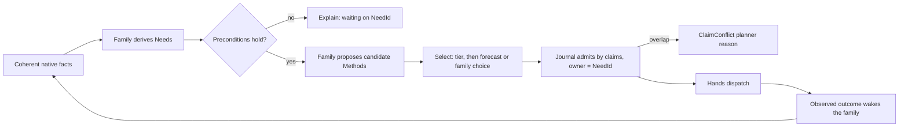
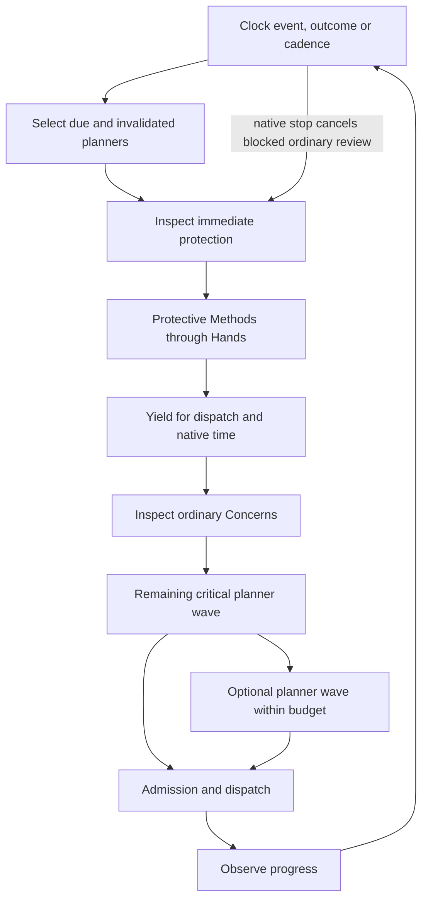
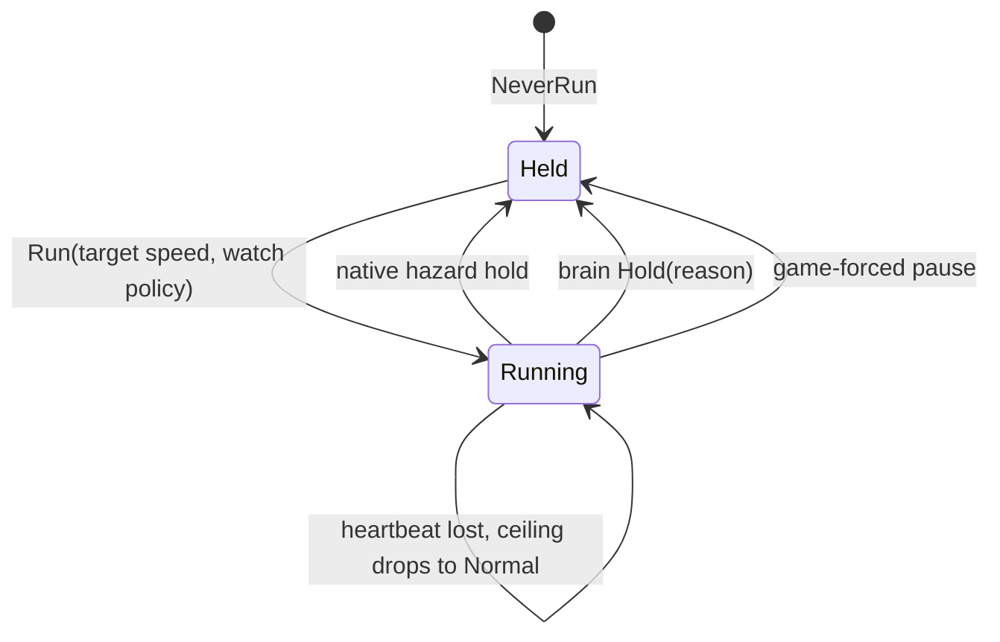
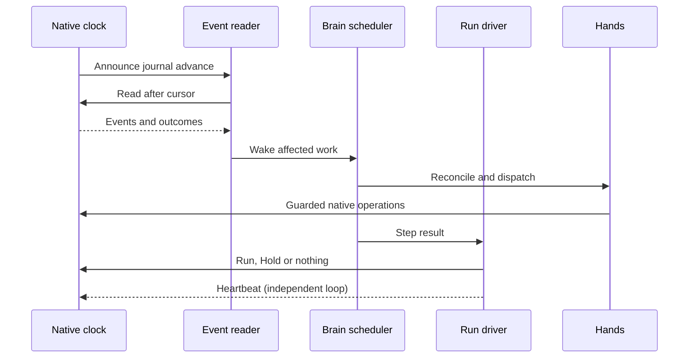

# Control loop

[Architecture](overview.md) · [Controller contracts](../contracts/controller-contracts.md)

The governor inspects the colony, selects bounded work, issues orders and observes
progress. The scheduler and native clock operate independently of launcher refresh.

The loop is moving from Rounds, Concerns and Standards onto Needs, Families and
claimed Methods ([epic #3231](https://github.com/davidarcher/rimgovernor/issues/3231)).
The [target model](#target-model-needs-families-and-claimed-methods) is the
contract every migrating family follows. The
[legacy model](#legacy-rounds-concerns-and-standards) still runs every family
that has not migrated, and is deleted in the final slice.

## Target model: Needs, Families and claimed Methods

Four layers sit between "what does the colony need" and "what work is admitted"
today: the Concern registry, Rounds, durable Standards and per-Concern planners.
The target model keeps what carries weight (observation, per-family policy,
selection, the Method journal, Hands, explain and telemetry keys) and replaces
the rest with three things: Needs derived fresh from facts, Families that propose
work for them, and a Method journal that admits work by what it claims.

### Need

A Need is derived fresh on every review from current facts. Nothing about it is
stored: not its finding, not an episode, not a settled flag. It replaces the
Concern registry row, the Rounds assessment and the Standard episode.

| Field | Meaning |
| --- | --- |
| Id (`NeedId`) | `family/kind[/subject]`, stable across reviews and loads, for example `food-stores/refrigeration` or `medical/critical/<pawn>`. The family segment is the owning Family's id. A subject names one occurrence or target: a pawn, an event, a building. The id must be reproducible from facts alone; never hash a load token or tick into it. |
| Evidence | The facts the finding rests on, with explicit unknowns. |
| Satisfaction predicate | `met`, `unmet` or `unknown` over what stands now. Unknown never counts as met. |
| Deficit | How far from met, in the family's own unit; used by selection and explain. |
| Tier | `SeriousHarm`, `Wellbeing` or `Development`. Selection orders by tier first; `SeriousHarm` Needs also run in the [immediate pass](#scheduling-and-the-immediate-pass). |
| Preconditions | Optional: other NeedIds whose predicate must be met before this Need is proposed for ([below](#preconditions)). |

The old forms map onto this one shape:

- A **Standard** (a held target) is a Need whose predicate is the target.
- An **Incident** is a Need whose subject is the occurrence (a pawn, an event).
  It exists while the occurrence is observed and disappears when it is not.
- A **Once** Standard is a predicate over what stands (the room exists, the
  ritual has been held this year), not a stored "settled" bit.
- A **chore** is a Need whose predicate is "no outstanding work".

There are no Episodes, Settle or Once states. Churn is prevented by stable Need
ids and Method continuation: the same unmet Need yields the same MethodId, and
a request for an open MethodId continues it rather than opening another.

### Family

A Family is one module per domain (`IFamily`). It replaces the Concern
registry rows, Inspect bodies, `Workable` checks, phase latches and per-planner
whole-owner `ExistingWork` guards of the Concerns it absorbs.

| Member | Contract |
| --- | --- |
| Id | The `family` segment of its NeedIds (for example `food-stores`). |
| Fact reads | The fact families it reads, declared like a planner's today; tests reject undeclared reads. |
| `Derive(facts) -> Needs` | Pure. Derives every Need of the family from the current facts. |
| `Propose(needs, facts) -> candidate Methods` | Pure policy. Proposes candidate Methods for unmet Needs whose preconditions hold. |
| SeriousHarm reads | The narrow facts its `SeriousHarm` Needs read in the immediate pass. A family without such Needs declares none. |

A family may keep several internal steps (one per kind of work it owns). They run
in order inside the family's single scheduler entry and share one fact read. A
step files its planner reasons under the NeedId it served, not under a planner
or Concern name. Candidate generation and binding stay family-specific, as
[Method selection and binding](plans-and-hands.md#method-selection-and-binding)
describes.

### Selection

Tier order first (`SeriousHarm`, then `Wellbeing`, then `Development`). Within a
tier, a family with forecast candidates uses the shared ColonyForecast comparator;
any other family makes its own choice. The model adds no selection or valuation
logic: the comparator and its adoption belong to #3124, #3160 and #3166.

### Method journal: claim admission

Need-owned Methods have their own journal owner: `plan_owner` kind `need`, a
`need_methods` table keyed by NeedId and MethodId, and a `NeedOwner : IMethodOwner`
beside the Standard and Incident owners. Adding it moves `Store.SchemaVersion`
from 13 to 14; the journal is replaced on a version change, so there is no
migration. The `need` owner is opted into claim admission; every other owner
keeps the open-work gate until the final slice.

**Implemented (#3250).** Policy `Needs.cs` holds `NeedId`, `Need` (tier,
`Satisfaction` Unknown/Unmet/Met, deficit, evidence, preconditions), `NeedMethod`
and `IFamily<TFacts>` (`Reads`, `SeriousHarmReads`, `Derive`, `Propose`);
`NeedStandings` resolves preconditions within one family, and Unknown never
counts as met. Store `NeedOwner` and `Store.CommitClaimedMethod(NeedId, ...)`
admit a Method (Admitted, Continued or Conflict on a held claim). BuildingRuntime
`FamilyRunner<TFacts>` runs a family as a planner entry
(`ClockPlannerCatalog.WithFamilies`, from `ClockSchedulerConfig.Families`): one
`planner_step` row and one ledger report per Need, and a family with
SeriousHarm reads also runs in the immediate pass on those reads only. No real
family is wired yet; each migrating slice adds its family.

**Implemented (#3279).** The shared building planner takes any work owner: Store
`IWorkOwner` (`StandardState` or `NeedOwner`) with `OwnerMethodPlan`,
`OwnerMethodHistory` and `CommitOwnerWork`. A Standard keeps its episode lookup,
open-work gate and revision check; a Need commits through `CommitClaimedMethod`,
and its "once" check reads the whole `need_methods` history, so a ring, roof,
removal or dig wave committed for a target is not re-issued after release. A
claim conflict or continued MethodId is a verdict (`claim`, open work), never an
exception. Building work runs as the family's async step: `FamilyRunner<TFacts>`
takes an optional `work(NeedWork, facts, ct)` that runs per ready Need after the
pure proposals, with the Need, its `NeedOwner`, the step's `ControlState`, epoch
and arbiter; it calls the planner (`CommitBuildsAsync`, `CommitRoof`,
`ReconcileRoomAsync`, ...) with the owner, and the Methods it added are reported
on the run. The shelter room stays Standard-only. A Need-owned shell records no
material shortfall dependency yet, and Need-owned buildings are not yet in the
construction-claim census (`ConstructionClaimsIn`).

**Claims.** A Method's claims are derived from its actions at admission, never
stored on the Method: `WorkClaimsOf` over the actions yields a `WorkResourceClaims`
(pawns, targets, materials and shared targets). Targets cover the cells, things,
zones and sources the work touches; a building claims its full footprint
(definition size and rotation), not its anchor cell. Shared targets (sleep,
recreation, observed food) admit a second owner up to their capacity. Materials
stay under the existing in-transaction material-budget check. Every action kind a
family can propose must yield its claims (gear, bills, pawn activities,
haul and forage, area edits, apparel policy).

**Admission** for an opted-in owner, inside the commit transaction:

| Request | Result |
| --- | --- |
| MethodId already open for this NeedId | Continue that Method: no new row, no exception. |
| Claims overlap an open Method of any owner | Refused with `ClaimConflict`, naming the holding Method and the overlapping claim; the family records it as a planner reason. No exception. |
| Otherwise | Admitted. A released or completed MethodId may be admitted again when its Need is unmet again. |

This replaces the one-open-Method gate, its eleven `*OpenWorkExempt` carve-outs
and the families' whole-owner guards. Continuation, release and cleanup are
unchanged ([Method continuation](../contracts/method-continuation.md)).

**Implemented (#3249).** An owner opts in by committing through
`Store.CommitClaimedMethod`, which returns a `ClaimCommit` (Admitted, Continued or
Conflict with its `ClaimConflict`). Until the `need` owner lands (#3250), only
tests opt a Standard in. Claims come from `PolicyFunctions.MethodClaimsOf`:

- `WorkClaimsOf(..., footprint: true)` supplies labor pawns, gear-batch benches
  and workers, activity targets and every cell of a building's rotated
  footprint. The footprint is sized from the review's building costs
  (`WorkBuildingCost.Size`); an unpriced definition claims its anchor.
- Each other action kind adds its subject while its work is open: the forage,
  haul or crop source, zone cells, `bill/<bench>/<recipe>`, `area/<name>/x/z`,
  `gear/<pawn>`, `settings/<pawn>`, an assigned bed or throne.

Every open, unretired Method in the same world, of any owner, is compared. The
default `WorkClaimsOf` (anchor cells) is unchanged for work resource admission.
Family admission, Safeguards, the current-review check and work resource
admission still run. The Standard's methods table is keyed by episode, so a
released MethodId is admitted again once the Standard reopens a new episode; in
the same episode reusing it still raises `MethodBoundException`.

### Durable state

Only two kinds of brain state persist in the save:

- player intent, unchanged ([durable policy](../contracts/durable-policy.md));
- keyed family records under `family/*`, which already exist (layout plan,
  soldier squad, combat restoration and others).

`standard/<id>` goes away. A migrating family moves any payload a Standard's
`Record` carried (ideoligion reform, creep joiners, trade requests) into a
`family/*` record. New saves stop writing `standard/<id>` blobs, and the final
slice ignores old ones on load. Saved `trade-mission` blobs are dropped on
upgrade: the economy family re-derives missions from facts. The
[persistence table](../contracts/persistence-contracts.md) is amended by the
slice that changes each of these.

### Scheduling and the immediate pass

A migrated family is **one** due-queue entry in the planner catalog. Its old
planner entries are deleted in the same slice. The entry declares its fact reads,
action kinds and cadence like a planner entry does today, and wakes on:

- invalidation of a fact family it reads;
- outcomes of its own Methods;
- its cadence.

The **immediate pass** runs the `SeriousHarm` Needs of registered families,
reading only their declared narrow facts, beside the legacy `ImmediateConcern`
set. `ImmediateConcern` is deleted when the last immediate Concern migrates.
Immediate-protection behavior does not change; only its bookkeeping moves.

### Preconditions

Ordering between Needs is a precondition: "this Need waits on Need X's
predicate". A Need whose precondition is not met is derived (so explain can show
it) but not proposed for; explain shows it as waiting on that NeedId. An
`unknown` precondition does not hold. Preconditions replace the hard-coded phase
latches (Housing, Comfort, Medical) as their families migrate.

### Forecast owners and coverage

ColonyForecast proposals and essential-service rows already attach to an owner
and are recomputed every review. Under this model the owner is the NeedId. Each
family slice re-keys its `ServiceTarget`s (`EssentialServices.cs`) and its
coupled-candidate gates (`ForecastCoupledCandidates.cs`) from Concern ids to
NeedIds, and keeps coverage honest: an owner that moves must not turn its service
row into Unknown. Moving a family's choice onto the shared comparator stays with
#3124 and #3166.

### Explain, progress and telemetry keys

Explain (`concern_transitions`), launcher progress, the [player API](../contracts/player-api.md),
OTLP attributes and the `rg` ReviewTimeline are keyed by NeedId for a migrated
family and by Concern id for the rest. History restarts for a family when it
migrates. ReviewTimeline drops its Ensure/Maintain prefix filter. A new OTLP kind
or attribute is registered with its reader in [OTEL signals](../contracts/otel-signals.md).

### Migration

The model lands as a strangler, one family at a time, not a big-bang redesign.
The spine lands beside the old machinery in two children: claim admission
(#3249), then the Need/Family contracts, `need` owner and family scheduling
(#3250). Until the final slice the two paths coexist: the legacy path runs every
unmigrated Concern exactly as below, and a migrated family's Concerns leave the
registry.

A family slice:

1. Implements the family's `Derive` and `Propose` with stable NeedIds, tiers and
   preconditions, from the bodies of its Concerns' Inspect functions and planners.
2. Replaces its planner entries with one family entry, and deletes its registry
   rows, Inspect bodies, `Workable` and phase checks and whole-owner guards.
3. Admits its Methods under the `need` owner (claims, not the gate), and deletes
   any `*OpenWorkExempt` only it used.
4. Moves any Standard `Record` payload it owns to a `family/*` record.
5. Re-keys its forecast owners and coupled gates, and its explain, progress and
   telemetry keys.
6. Declares its `SeriousHarm` Needs and their narrow reads, retiring its entries
   from `ImmediateConcern`.

The final slice deletes Rounds, the Concern registry, Standards (with Episodes,
Settle and Once), `standard_methods`, the open-work gate and its exemptions, and
ignores saved `standard/<id>` blobs.

Two decisions travel with the migration rather than any one family:

- **MaintainFireSafety is deleted outright**, not migrated. Pawns fight fires
  natively; firefighter work stays assigned through work assignments, and home
  fires no longer pause development work.
- **Food stores is the first family** (MaintainFoodStorage and
  MaintainRefrigeration): both are Food owners in the forecast with real
  planners, and its slice deletes the ReserveAccess exemption.

**Family map.** The grouping of the first consolidation pass sets the family
boundaries: EnsureCooking and MaintainBabyFeeding join Food, MaintainShelter (the
Safe-area edit) stays its own Need in Shelter, and MaintainPopulation splits
three ways.

| Family | Today's Concerns |
| --- | --- |
| Food stores | MaintainFoodStorage, MaintainRefrigeration |
| Food | EnsureFoodSupply, EnsureCooking, MaintainBabyFeeding, RemoveBlight |
| Home upkeep | MaintainEssentialRepairs, ClearHomeObstructions (MaintainFireSafety deleted) |
| Rooms | MaintainLighting, MaintainFlooring, MaintainArt, EnsureComfort, HoldGatherings |
| Layout | MaintainHomeCoverage, MaintainFirebreak, MaintainStoneShell, MaintainClimateEnvelope, EnsureDefensiveLayout |
| Shelter | MaintainHousing, MaintainShelter, EnsureTemperatureSafety |
| Power | EnsureBasicPower |
| Medical | CriticalMedicine, MaintainMedicalReserves, MaintainSurgery |
| Military | ActiveCombat, RestoreWorkers, EnsureBasicDefense, MaintainEquipment, MaintainTraining, ClearPests |
| Animals | MaintainHerd, MaintainAnimalContainment |
| Ideology | MaintainIdeoRoles, MaintainRituals, ImproveIdeoligion |
| Biotech | MaintainMechs, EnsureMechCharger, MaintainGeneBank, ManagePollution |
| Royalty | MaintainPermits, MaintainPsylink |
| Prisoners | MaintainPopulation (prisoner recruit, custody) |
| Joiners and quests | MaintainPopulation (joiners, quests, letters, ceremonies, decrees, monuments, departures, refugees, grav inspection) |
| Anomaly | MaintainPopulation (entity capture, door, tend, bioferrite, monolith); lance placement is decided when the slice is groomed |
| Economy | EnsureResearch, MaintainResource, MaintainTrade, TradeWithCaravan, trade missions |
| Colony admin | EnsureWorkAssignments, MaintainWorkLedger, MaintainStockpiles, MaintainBurial, ManageSupplySafety, ManageCreepJoiners |
| People | EnsureMood, AnswerDialog |
| Disaster | RecoverDisasterServices |

**Order.** Fire-safety deletion (#3252) is independent. After the spine:
food stores (#3251) first, then food (#3254, after food stores) and home upkeep
(#3253, after fire safety). Rooms, layout, shelter and power, medical, military,
animals and ideology, biotech and royalty, the population split, economy, and
colony admin with people and disaster can then run in parallel, one writer per
family. The deletion slice (#3265) comes last. The epic tracks the live list.

## Legacy: Rounds, Concerns and Standards

This section describes the path that every unmigrated Concern still takes. It is
kept until the deletion slice (#3265); new work follows the
[target model](#target-model-needs-families-and-claimed-methods).

### Concerns and their forms

A **Round** runs **Inspections** on **Concerns**, grouped into **Departments**.
A selected **Method** pursues a Concern through a Plan of actions.
**Safeguards** veto unsafe admission; they pursue no outcome themselves.

| Type | Inspection | Lifecycle |
| --- | --- | --- |
| Standard | Finding: Met, Unmet or Unclear | Maintains a target; a settled target becoming unmet starts a new Episode. A Once Standard (the former Project kinds, trade missions) settles and stays settled until an observed recovery and a new unmet finding open the next Episode. |
| Incident | Situation: Active, Clear or Unclear | One occurrence, opened by a trigger and closed by observed clearance. |

Departments group work in the launcher. They do not allocate exclusive workers.
`policy.ConcernTypeOf` and `policy.DepartmentOf` own the classification, with
tests for unclassified Concerns; do not maintain a second ID inventory in prose.

Durable intent and session Method ownership are defined by the
[persistence contract](../contracts/persistence-contracts.md).
The [glossary](../glossary.md) defines the shared terms.

### The one-open-Method gate

A Standard admits a new Method only while none of its Methods has open work
(`StandardOpenWork`; a refusal is `OpenMethodException`). Eleven
`*OpenWorkExempt` carve-outs in `MethodAdmission.cs` let independent work through
beside open work, and an uncertain trade request does not hold the gate. The gate
is also the only same-MethodId duplicate guard for these owners. Owners opted
into [claim admission](#method-journal-claim-admission) skip it; the gate and its
exemptions are deleted in the final slice.

## Observe and prioritize

Native frames provide coherent facts at an observed tick. Independently fetched
reads can span world changes, so identity and authority still require validation.
Absent or incomplete observations remain unknown; forecast harvest is not stock.

The planner catalog declares required sections, fact families, action kinds and
tick cadence; a migrated family is one such entry
([scheduling](#scheduling-and-the-immediate-pass)). The due queue selects dirty or due planners. Action outcomes wake
their consumers; invalidated fact families wake their readers; authority changes
force reconciliation. Tests reject undeclared planner reads.

Immediate protection precedes development reads: combat and draft cleanup,
emergency tending/rescue, protective areas and active fire use a scoped review
of the native frame. It does not fetch the development planning window. The
same scheduler retains ordinary work on its due queue, yielding the player
gate to Hands before that work can block dispatch. A held clock lets
protective orders take effect before ordinary review runs.

An omitted Concern was not inspected. Its Methods, progress and derived
ordinary facts keep their prior evidence and timestamps. World replacement,
rewind and revoked authority still invalidate unsafe work. The scoped review
does not interpret missing facts as recovery. Ordinary recovery service work,
medical reserves and surgery remain in the ordinary pass.

Critical planners precede optional work within each pass; owed shelter is
critical. Response accounting includes pre-wave review, while the planner
wall budget remains a separate hang guard. There is no calibrated numeric
end-to-end latency gate.

### Routine work admission

Policy selects supported controlled-pawn work and needs. Native priorities do not
choose their voluntary jobs. Concerns do not reserve
exclusive development slots. Method ownership, Safeguards, dependencies and
per-planner bounds prevent duplicate or unsafe admission, together with the
[legacy open-work gate](#the-one-open-method-gate) for unmigrated owners and
[claim overlap](#method-journal-claim-admission) for Need owners.

Explicit pawn activity Methods select exact work through policy and Hands rather
than delegating those choices to vanilla priorities. The live food planner
sequences native reads, pure Method proposal and journal admission. Candidate
generation and binding remain family-specific; ColonyForecast's shared outcome
comparison selects among their alternatives. This does not replace the scheduler
or establish a global labor allocation for every Concern. See
[Method selection and binding](plans-and-hands.md#method-selection-and-binding).

The worker revisits installed activity Methods independently of eligibility to
start new work. Terminal execution and fresh observations permit a productive
continuation while the Concern remains unmet; known recovery permits cleanup.
Missing observations do not prove completion. The existing journal retains
responsibility through replacement or release, as defined by
[Method continuation](../contracts/method-continuation.md#pawn-activity-methods).

Planners claim pawns and entities through a step-scoped first-come claim set
(`StepArbiter.TryClaim`); start order within a wave follows the planner catalog.
These claims are not a complete colony-wide labor forecast. Supply planning accounts for its own labor and lead
times; [resource demand](supply-model.md) feeds material shortfalls back into
acquisition.

Admission is action-specific. Building intent-mode can defer placement/cost
checks to execution; native dispatch still validates current placement.
Do not infer a universal atomic reservation of every future construction cost.

## Execute under supervision

A player can describe the clock in two sentences. With the bot on, the bot owns
the clock and the player's speed keys are off. With the bot off, the bot stops
acting on the colony, the game is paused once and the player is free to unpause.
The toggle is the player Resume/Pause route ([player API](../contracts/player-api.md));
it is not persisted, and `AutoResume` decides at load.

While the bot is on, the clock is in one of two states.

- **Running.** The game advances at the brain's target speed. There are no tick
  budgets, window sizes or per-window admission: time passes continuously unless
  a hold applies. Reads and orders run beside the advancing game. A coherent
  frame binds planner facts to its tick, and dispatch revalidates current context
  and the action's native contract, so a fact that aged while the game ran is
  refused natively rather than guarded by pausing.
- **Held.** The game is paused for one named reason. A hold ends only when the
  brain sends `Run`, and the brain sends it when the reason is finished, not on
  a timer. Native never resumes by itself.

### Who decides what

| Piece | Owns |
| --- | --- |
| Native clock (`NativeClockRuntime`, the supervisor) | The game's speed, the hazard probe, the event journal, the hold itself and the one ceiling. Hazard holds happen on a tick boundary within the [declared bounds](hazard-detection-bounds.md). |
| `ClockScheduler` step | Planning only: one coherent bundle read, the planner wave and the result. It starts and stops nothing. |
| `ClockRunDriver` | The hold state machine, run after every step. It sends `Run`, takes the brain's own holds, acknowledges reviewed holds, keeps the heartbeat and polls the journal. |
| Hands and the Worker | Order dispatch under the running clock. |

The brain only ever asks for a speed. It does not manage a rate, a frame budget
or the player's speed.

### Into Held

| Source | Reason | Examples |
| --- | --- | --- |
| Native | A tick-bounded hazard (`hostile`, `colonist_downed`, `predator_hunt`, `colonist_injury`, `notification_batch`, and the rest of the [hazard table](hazard-detection-bounds.md#declared-bound-per-hazard-class)) | a hostile spawns, a colonist is downed, a stopping letter |
| Native | An armed combat event, only while an admitted fight plan owns the combat | see Combat |
| Native | A game-forced pause (`GAME_FORCED`, dialog and letter pauses) | a force-pausing dialog, a long event |
| Brain `Hold(CoupledOrder)` | A coupled order whose prerequisite just completed, so the next order needs a quiet world | a build order that waits on the haul that fills it |
| Brain `Hold(Autosave)` | A due autosave | see Autosave |
| Brain `Hold(Review)` | The bot stops acting: Pause, a checkpoint save, shutdown, or authority ended under a `Run` the driver sent | the player pressed Pause |

A `Hold` of an already held clock keeps the first reason. `Hold` needs only the
loaded identity, never current authority, so cleanup can always stop play.
Losing the brain's heartbeat is not a hold (see the ceiling below).

### Out of Held

After each planning step the driver reads the clock status and decides:

- A held clock resumes with `Run` when the watch decision
  (`policy.EvaluateClockWatch`) allows it: facts fresh and same-authority, every
  captured journal page reviewed, no unacknowledged interruption or gap, no
  unknown threat. A refused decision leaves the clock held and the next step
  retries (`HeldException`).
- A running clock is never stopped by a refused decision: native holds on what it
  sees. The driver only resends `Run` when the implied watch policy or the speed
  differs from the last one sent. `Run` is idempotent and doubles as the speed
  and policy change.
- Holds that native took (a hazard, a letter) are acknowledged once a step has
  planned against them. The brain finishes the reason, then resumes at its target
  speed.
- A step that follows a driver hold or `Run` repeats at once (a `settled` step,
  never twice in a row) so the planners work against the held world without
  waiting a step interval.

A `Run` carries the speed and a complete watch policy: colony mode, or combat mode
with the live hostiles it acknowledges. The hazard thresholds are the brain's
(see [hazard bounds](hazard-detection-bounds.md#brain-authored-thresholds)); native
holds no literal for them.

### The one ceiling and the heartbeat

Native keeps one ceiling on the tick rate (`ClockCeiling`): the lower of a frame
budget input and a brain-liveness input. A frame whose tick work runs past the
frame budget lowers the rate at once and it recovers in gradual steps. The
brain's driver sends an explicit `Heartbeat` every second; if none arrives within
the tolerance the ceiling drops to Normal and ramps back once the brain is heard
again. Neither input is a hold: the game keeps running at the lower rate. The
[interface contracts](../contracts/interface-contracts.md#clock-speed-and-the-one-ceiling)
give the numbers.

### Target speed

The target speed is a live brain option (`ClockTargetSpeed`, default Ultrafast).
`POST /api/player/clock-speed` changes it; the next step sends `Run` at the new
speed. The acceptance harness sets each launch's speed this way. Ultrafast runs
the game's tick boost under the one ceiling; the boost is a development feature of
the game, so the native tick-rate figures are listed with their caveats in the
[interface contracts](../contracts/interface-contracts.md#clock-speed-and-the-one-ceiling).

### Combat

The brain holds on decision events, not on every combat event. It arms exactly
three native combat events (`HostileArrived`, `Downed`, `SeriousInjury`;
`ClockCombatStops.DecisionEvents`), and only while an admitted fight plan owns the
combat. The other native events (range, melee, shield, explosive, raid phase,
breach, mental break, prison break) are never armed. Between decision events the
fight plan's orders run while the clock runs.

A hold on an armed event marks the defense planner; the immediate-protection
review answers it, and `Run` resumes as soon as that dispatches, without waiting
for ordinary review. A hold with no fight plan to answer it cannot happen: a
colony or unowned watch is disarmed.

Resume latency from hold to the resuming `Run` is a gate
(`ClockCombatStops.ResumeBudget`, logged per hold as `resume_latency_ms` on
`clock_stop` and as p50/p95 on `combat_summary`). When one resume in the current
combat exceeds the budget the gate trips, and for the rest of that fight the
brain asks for the slower `ClockCombatStops.FallbackSpeed` (never above the target
speed) instead of holding more often. The gate clears when the combat closes.

### Autosave

A periodic hold flushes governor state, saves and resumes. Every
`ClockRunConfig.AutosaveEveryTicks` game ticks (default one in-game day, counted
on the game clock from the previous autosave hold) the driver takes
`Hold(Autosave)`, saves into the rotating `Autosave-1..5` slots at the first step
that finds the clock held and paused, and then sends `Run`. No save is made while
the clock runs; a failed save never keeps the clock from running. It is not the
game's own autosave.

### Player keys

While the bot holds the clock, native swallows the player's speed and pause input
(space, 1 to 4 and the time-control buttons) and shows a rate-limited message
saying why. Letter and dialog pauses and the supervisor's own assignments are not
player input and pass. Pause turns the bot off: the driver holds the clock for
`Review` once, the keys work again and the player owns the clock.

### Constants that are not measured

These are conservative guesses, not measurements. The live baseline that would
replace them is #3199; the procedure is in
[Measure brain throughput](../testing/measure-throughput.md#clock-baseline-run) and the
table in [brain host](brain-host.md#live-clock-baseline).

| Constant | Value | Where |
| --- | --- | --- |
| Frame budget | 30 ms of tick work per frame | `ClockCeiling.DefaultFrameBudgetMs` |
| Heartbeat tolerance | 5 s without contact drops the ceiling to Normal | `ClockCeiling.HeartbeatToleranceMs` |
| Heartbeat interval | 1 s | `ClockRunConfig.HeartbeatInterval` (must stay under the tolerance) |
| Combat resume budget | 2 s | `ClockCombatStops.ResumeBudget` |
| Combat fallback speed | Normal | `ClockCombatStops.FallbackSpeed` |
| Autosave cadence | one in-game day | `ClockRunConfig.DefaultAutosaveEveryTicks` |

### What was removed

The earlier model admitted finite tick windows under a renewable wall-clock lease,
with a per-window admission decision, brain and native pace regulators, and
following of the player's own speed. All of it is gone, as are the clock attempt,
epoch and receipt stores. Do not reintroduce a tick budget or a second regulator;
the one ceiling, the target speed and named holds replace them.

### Event delivery

The native journal is authoritative. Each append announces its cursor to the
in-process brain; the brain reads after its own cursor through an unheld
`clock_read_events`. A bounded poll (250 ms, backing off to 2 s after a failure)
catches missed announcements. A load triggers a tail read, and page loss remains
explicit.

Events wake the scheduler and worker. Named action outcomes reconcile first.
A hold may warm admission observations, reusable only when tick, identity,
generation and invalidation state still match.

Routine operation outcomes wake work without holding the clock. A running clock
arms no watch on a completed order; dispatched construction and haul attempts
are evidence only. Coupled orders wake when their prerequisite outcome arrives.

### Step reasons

| Trigger | Work |
| --- | --- |
| `settled`: the step after a driver hold or `Run` | Every planner not waiting on a dependency |
| `full`: the first step, a step after idle, or a `timer` step promoted by the two-minute safety net | Every planner |
| `timer` | Due planner entries; with none due, the driver tail alone |
| `wake` | Outcome or fact wake: affected planners; authority changes expand to all |

`clock_step` records why a step ran. `stop_latency_ms` measures native-hold-to-step
time, not hazard onset to protective effect. `clock_run` records each `Run`, `Hold`
or refusal the driver made. Precise guards live in the
[clock contract](../contracts/clock-recovery.md) and
[hazard bounds](hazard-detection-bounds.md).

## Manual control

Manual authority suspends automation in the current world. Resuming Auto permits
the governor to act on current colony deficits immediately, including work the
player drafted, restricted or placed. There is no per-subsystem ownership grace
period. Forced or queued work can influence preference without excluding a pawn.

Pause retains routine Concerns and open work. Colony/map/load changes or tick
rewinds invalidate old context. Explicit Pause does not undraft pawns; native
auto-undraft applies while authority is inactive. An informational letter
pauses the game but does not suspend automation: the brain resumes the clock
once it has reviewed the hold.

### Drafts

Drafts are plan-owned. The census-based cleanup undrafts colonists no live plan
or open fight needs, while protecting native arrest/capture jobs. A suspended
plan retains drafts needed by unfinished work; subsequent orders still check
that a pawn remains drafted.

### Auto takeover

Under Auto, timetable, diet, Home, allowed-area, bill and standing designation
edits are ordinary colony facts. Their owning planners reconcile them through
the shared action system. Destructive work still requires its explicit
eligibility and opt-in guards. See
[durable policy](../contracts/durable-policy.md).

## Verify progress

Hands tracks action-specific receipts and postconditions. Concern progress tracks
the desired colony outcome and its blocker: no worker, native ineligibility,
uncertain write or unavailable method. Unknown observations cannot settle it.

Observed stalled work can trigger a bounded cooldown or alternate method.
Completion can clear the blocker without replacing the action's evidence.

[Controller contracts](../contracts/controller-contracts.md) define disease,
hunting and combat extensions.
