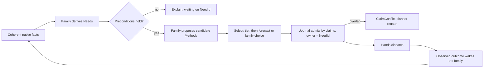
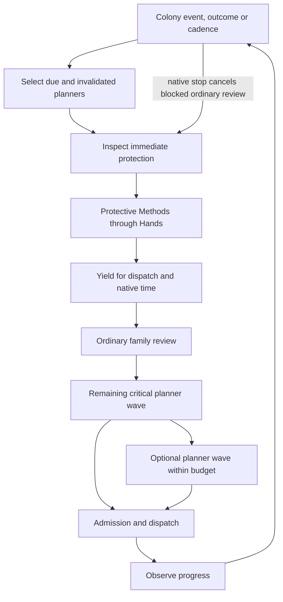
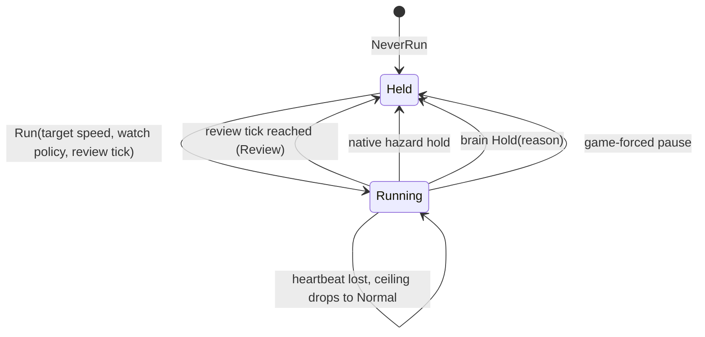

# Control loop

[Architecture](overview.md) · [Controller contracts](../contracts/controller-contracts.md)

The governor inspects the colony, selects bounded work, issues orders and observes
progress. The scheduler and native clock operate independently of launcher refresh.

The loop runs on Needs, Families and claimed Methods
([epic #3231](https://github.com/davidarcher/rimgovernor/issues/3231)). The
[model](#target-model-needs-families-and-claimed-methods) below is the contract
every family follows. The Concern registry, Standards, Incidents and the
one-open-Method gate they used were deleted in #3265.

## Target model: Needs, Families and claimed Methods

Four layers used to sit between "what does the colony need" and "what work is
admitted": the Concern registry, Rounds, durable Standards and per-Concern
planners. The model keeps what carries weight (observation, per-family policy,
selection, the Method journal, Hands, explain and telemetry keys) and replaces the
rest with three things: Needs derived fresh from facts, Families that propose work
for them, and a Method journal that admits work by what it claims.



### Need

A Need is derived fresh on every review from current facts. Nothing about it is
stored: not its finding, not an episode, not a settled flag. It replaces the
Concern registry row, the Rounds assessment and the Standard episode.

| Field | Meaning |
| --- | --- |
| Id (`NeedId`) | `family/kind[/subject]`, stable across reviews and loads, for example `food-stores/refrigeration` or `medical/critical/<pawn>`. The family segment is the owning Family's id. A subject names one occurrence or target: a pawn, an event, a building. The id must be reproducible from facts alone; never hash a load token or tick into it. |
| Evidence | The facts the finding rests on, with explicit unknowns. |
| Satisfaction predicate | `met`, `unmet` or `unknown` over what stands now. Unknown never counts as met. |
| Deficit | How far from met, in the family's own unit; used by selection and explain. |
| Tier | `SeriousHarm`, `Wellbeing` or `Development`. Selection orders by tier first; `SeriousHarm` Needs also run in the [immediate pass](#scheduling-and-the-immediate-pass). |
| Preconditions | Optional: other NeedIds whose predicate must be met before this Need is proposed for ([below](#preconditions)). |

The old forms map onto this one shape:

- A **Standard** (a held target) is a Need whose predicate is the target.
- An **Incident** is a Need whose subject is the occurrence (a pawn, an event).
  It exists while the occurrence is observed and disappears when it is not.
- A **Once** Standard is a predicate over what stands (the room exists, the
  ritual has been held this year), not a stored "settled" bit.
- A **chore** is a Need whose predicate is "no outstanding work".

There are no Episodes, Settle or Once states. Churn is prevented by stable Need
ids and Method continuation: the same unmet Need yields the same MethodId, and
a request for an open MethodId continues it rather than opening another.

### Family

A Family is one module per domain (`IFamily`). It replaces the Concern
registry rows, Inspect bodies, `Workable` checks, phase latches and per-planner
whole-owner `ExistingWork` guards of the Concerns it absorbs.

| Member | Contract |
| --- | --- |
| Id | The `family` segment of its NeedIds (for example `food-stores`). |
| Fact reads | The fact families it reads, declared like a planner's today; tests reject undeclared reads. |
| `Derive(facts) -> Needs` | Pure. Derives every Need of the family from the current facts. |
| `Propose(needs, facts) -> candidate Methods` | Pure policy. Proposes candidate Methods for unmet Needs whose preconditions hold. |
| SeriousHarm reads | The narrow facts its `SeriousHarm` Needs read in the immediate pass. A family without such Needs declares none. |

A family may keep several internal steps (one per kind of work it owns). They run
in order inside the family's single scheduler entry and share one fact read. A
step files its planner reasons under the NeedId it served, not under a planner
or Concern name. Candidate generation and binding stay family-specific, as
[Method selection and binding](plans-and-hands.md#method-selection-and-binding)
describes.

### Selection

Tier order first (`SeriousHarm`, then `Wellbeing`, then `Development`). Within a
tier, a family with forecast candidates (food, needs, planned rooms, clothing,
support, hunting, research) uses the shared ColonyForecast comparator
([portfolio selection](portfolio-selection.md)); any other family makes its own
choice. The model adds no selection or valuation logic of its own; moving a
remaining family onto the comparator is that family's work (#3160 for
development).

### Method journal: claim admission

Every Method has one journal owner: `plan_owner` kind `need`, the
`need_methods` table keyed by NeedId and MethodId, and `NeedOwner`
(`Owners/MethodOwner.cs` holds the plan guard). The journal
is replaced on a `Store.SchemaVersion` change, so there is no migration. Claim
admission applies to every owner. Combat keeps one rule of its own: a second fight
is refused while one is open or held (`CombatOpenWork`,
`CombatWorkOpenException`).

**Implemented (#3250).** Policy `Needs.cs` holds `NeedId`, `Need` (tier,
`Satisfaction` Unknown/Unmet/Met, deficit, preconditions), `NeedMethod`
and `IFamily<TFacts>` (`Reads`, `SeriousHarmReads`, `Derive`, `Propose`);
`NeedStandings` resolves preconditions within one family, and Unknown never
counts as met. Store `NeedOwner` and `Store.CommitClaimedMethod(NeedId, ...)`
admit a Method (Admitted, Continued or Conflict on a held claim). BuildingRuntime
`FamilyRunner<TFacts>` runs a family as a planner entry
(`ClockPlannerCatalog.WithFamilies`, from `ClockSchedulerConfig.Families`): one
`planner_step` row and one ledger report per Need, and a family with
SeriousHarm reads also runs in the immediate pass on those reads only. Each
migrating slice adds its family (food stores, #3251, home upkeep, #3253, and animals and ideology, #3260, are wired).

**Need progress (#3231 decision 18).** A Need reaches launcher progress
(`/api/routines`) as a row in `Rounds.Progress` keyed by `NeedId.FilingKey`; there
is no second progress source. After each wave `PlannerWave.NeedProgress` turns
every returned family run into a `FamilyProgress` (each Need's filed planner note
and the Method it works, from `NeedReport.Method`), and
`Store.RecordPlannerReasons` applies it: an unmet or unknown Need's row is
inserted or updated (the Method label with `Open`, or with no Method the note as
its blocker), a met Need's row is pruned, and a complete run (`FamilyRun.Complete`,
the full pass) prunes its family's rows for Needs it no longer derives. The
immediate pass and a run that judged nothing prune nothing. The review rebuild
(`Store.RoundsProgress`) keeps NeedId rows as they stand. Need rows carry no
deadline or deficit fraction: the family owns rotation through its refusal budget.
A new family needs no progress code.

**Implemented (#3279).** The shared building planner works under the Need owner:
Store `NeedOwner` with `OwnerMethodPlan`,
`OwnerMethodHistory` and `CommitOwnerWork`; a Need commits through
`CommitClaimedMethod`.
A claim conflict or continued MethodId is a verdict (`claim`, open work), never an
exception. A Need's `need_methods` rows are never trimmed (#3310), so its reads stay
bounded at any history length: `OwnerMethodPlan` is its latest attempt of one
MethodId (the once-check and the refusal budget, `AdmitLatestAttempt`), and
`OwnerMethodHistory` is the latest attempt of each of its 256 most recently bound
MethodIds. Only its unretired Methods keep a capacity guard (`LoadNeed`), which the
store-wide bound on unretired plans already implies. Building work runs as the family's async step: `FamilyRunner<TFacts>`
takes an optional `work(NeedWork, facts, ct)` that runs per ready Need after the
pure proposals, with the Need, its `NeedOwner`, the step's `ControlState`, epoch
and arbiter; it calls the planner (`CommitBuildsAsync`, `CommitRoof`,
`ReconcileRoomAsync`, ...) with the owner, and the Methods it added are reported
on the run. A shell records no material shortfall dependency: the dependency
records went with Standards (#3265).

**Re-issue when the product is gone (decision 19, #3301).** The planner's
once-check (`RoundsBuildingPlanner.MethodOnce`) holds a Need's MethodId only
while its latest attempt is open work (`StorePackage.PlanWorkOpen`, a placed
blueprint or frame included) or while what that attempt built still stands.
The family says what stands by passing the construction census of its read;
`BuildingWorkRules.PlanProductGone` judges the attempt's applied buildings
against it: gone when every one is neither built nor a blueprint or frame.
A gone product admits the same MethodId again as the next `need_methods`
attempt; nothing new is stored. An unknown census, a census not passed (the
default), or an attempt that applied no building (a roof, a removal, a dig,
a cancelled wave) holds the MethodId, so unknown never reads as gone. The
building waves of a room reconcile, the generic building step (the
laboratory bench) and the refrigeration cooler pass their census.

**Claims.** A Method's claims are derived from its actions at admission, never
stored on the Method: `WorkClaimsOf` over the actions yields a `WorkResourceClaims`
(pawns, targets, materials and shared targets). Targets cover the cells, things,
zones and sources the work touches; a building claims its full footprint
(definition size and rotation), not its anchor cell. Shared targets (sleep,
recreation, observed food) admit a second owner up to their capacity. Materials
stay under the existing in-transaction material-budget check. Every action kind a
family can propose must yield its claims (gear, bills, pawn activities,
haul and forage, area edits, apparel policy).

**Admission** for every owner, inside the commit transaction:

| Request | Result |
| --- | --- |
| MethodId already open for this NeedId | Continue that Method: no new row, no exception. |
| Claims overlap an open Method of any owner | Refused with `ClaimConflict`, naming the holding Method and the overlapping claim; the family records it as a planner reason. No exception. |
| Otherwise | Admitted. A released or completed MethodId may be admitted again when its Need is unmet again. |

This replaced the one-open-Method gate, its carve-outs and the families'
whole-owner guards, all deleted by #3265. Continuation, release and cleanup are
unchanged ([Method continuation](../contracts/method-continuation.md)).

**Implemented (#3249).** An owner commits through `Store.CommitClaimedMethod`,
which returns a `ClaimCommit` (Admitted, Continued or Conflict with its
`ClaimConflict`). Claims come from `MethodClaimsRules.MethodClaimsOf`:

- `WorkClaimsOf(..., footprint: true)` supplies labor pawns, gear-batch benches
  and workers, activity targets and every cell of a building's rotated
  footprint. The footprint is sized from the review's building costs
  (`WorkBuildingCost.Size`); an unpriced definition claims its anchor.
- Each other action kind adds its subject while its work is open: the forage,
  haul or crop source, zone cells, `bill/<bench>/<recipe>`, `area/<name>/x/z`,
  `gear/<pawn>`, `settings/<pawn>`, an assigned bed or throne.

Every open, unretired Method in the same world, of any owner, is compared. The
default `WorkClaimsOf` (anchor cells) is unchanged for work resource admission.
Family admission, Safeguards, the current-review check and work resource
admission still run.

### Durable state

Only two kinds of brain state persist in the save:

- player intent, unchanged ([durable policy](../contracts/durable-policy.md));
- keyed family records under `family/*`, which already exist (layout plan,
  soldier squad, combat restoration and others).

Saves no longer write `standard/<id>` blobs (governor-state schema 7, #3265).
The payloads a Standard's `Record` carried moved into `family/*` records
(ideoligion reform, creep joiners, defense layout). Loading an older (schema 6)
save still works: its `standard/<id>` blobs are ignored, except that a family
reads its own legacy record once when its `family/*` record is absent. Saved
`trade-mission` blobs are dropped: an in-flight mission is not resumed. The
[persistence table](../contracts/persistence-contracts.md) lists each record.

### Scheduling and the immediate pass

A migrated family is **one** due-queue entry in the planner catalog. Its old
planner entries are deleted in the same slice. The entry declares its fact reads,
action kinds and cadence like a planner entry does today, and wakes on:

- invalidation of a section of a fact family it reads (the zone census only when
  its schedule names it, `FamilySchedule.Sections`, since an invalidation native
  narrows to zone ids dirties that section alone, #3556); a sectionless family
  (world) by name;
- outcomes of its own Methods;
- its cadence: the rounder's unless its schedule sets one (#3556).

The **immediate pass** runs the `SeriousHarm` Needs of registered families,
reading only their declared narrow facts. The legacy immediate Concern set was
deleted when its last entry, the disaster recovery incident, migrated (#3304).
Immediate-protection behavior does not change; only its bookkeeping moves.

### Preconditions

Ordering between Needs is a precondition: "this Need waits on Need X's
predicate". A Need whose precondition is not met is derived (so explain can show
it) but not proposed for; explain shows it as waiting on that NeedId. An
`unknown` precondition does not hold. Preconditions replaced the hard-coded phase
latches (Housing, Comfort, Medical).

### Forecast owners and coverage

ColonyForecast proposals and essential-service rows already attach to an owner
and are recomputed every review. The owner is the NeedId: `ServiceTarget`s
(`EssentialServices.cs`) and the coupled-candidate gates
(`ForecastCoupledCandidates.cs`) are keyed by NeedIds, and coverage stays honest:
an owner that moves must not turn its service row into Unknown. A family whose
choice is not yet on the shared comparator moves there under its own issue.

### Explain, progress and telemetry keys

Explain (`need_transitions`), launcher progress, the [player API](../contracts/player-api.md),
OTLP attributes and the `rg` ReviewTimeline are keyed by a Need's filing key
(`NeedId.FilingKey`); a family or planner that files beside its Needs uses its
own name. Journal schema 20 (#3265) renamed `concern_transitions` to
`need_transitions` (column `need`), so explain history restarted.
ReviewTimeline has no Ensure/Maintain prefix filter. A new OTLP kind
or attribute is registered with its reader in [OTEL signals](../contracts/otel-signals.md).

### Migration

The model landed as a strangler, one family at a time: claim admission (#3249),
the Need owner and family scheduling (#3250), then one slice per family. The
deletion slice (#3265) removed the Concern registry, Standards (with Episodes,
Settle and Once), Incidents, `standard_methods`, the open-work gate and its
exemptions. The review (`Rounds`) still carries what families read: the
progress rows, the combat standing, the recovery selection and the latches the
silver gap and housing labor read. MaintainFireSafety was deleted outright, not
migrated: pawns fight fires natively, firefighter work stays assigned through
work assignments, and home fires no longer pause development work. The paragraphs
below record what each family took over.

**Food stores, storage (#3251).** `MaintainFoodStorage` is now the
`food-stores/storage` Need (`FoodStores.cs`, `FoodStorageNeedOf`), a Wellbeing
Need run by the `food-stores` catalog entry (`FoodStoresRounds.Runner`). It is a
plain threshold with no latch: unmet while reserve access is pending, the reserve
is short outside an emergency, a food stockpile is known missing, a larder corpse
change is due, or less than `TargetStoredFraction` (0.9) of at-risk perishable
nutrition is stored; unknown when the census is unread; otherwise met. Its
Methods are `food-reserve` (at most eight hold/release supply actions) and
`corpse-larder-{allow|forbid}-{corpse}`, admitted under the Need owner with the
supply stacks as claims; `AdmitSupplyMethod` binds the Need owner to the stacks the
review lists. The stock-target meal order and the PreserveFood bill declare to the
ledger under the Need's filing key, and the ledger reads the Need's standing for
them instead of open work.

**Food stores, refrigeration (#3280).** Refrigeration is the
`food-stores/refrigeration` Need (`RefrigerationNeedOf`), a Wellbeing Need of the
same family, derived only when the refrigeration service is composed and with no
precondition on storage. It is a plain threshold (decision 16): unmet while at-risk
perishable nutrition warmer than `ChilledExitC` (5 C) reaches
`AtRiskNutritionThreshold`, while a standing tomb, morgue or meal closet measures
warm, or while the planned meal closet waits for its shell; unknown when the census
is unread; otherwise met. The `Refrigeration` and `RefrigerationSince` latches and
the native cooling time they lent are gone: the cooling window runs only over
coolers the Need itself recently committed in its world (`OwnerMethodHistory`). Its building
work is the family runner's `work` step (`FoodStoresRounds.WorkAsync` calling
`RoundsBuildingPlanner.RefrigerationStepAsync` with the Need owner): the meal
closet ring, a cooler setpoint, the freezer ring and the cooler,
each committed once under the Need while its attempt is open or what it built
stands (a destroyed cooler or ring is committed again, decision 19), and held
apart by claims, not by a whole-owner guard. With refrigeration on, the family reads the room census and
wakes on Building and BuildingTemperature outcomes. The review reads the cooler
and room definitions when `RoundsCapabilities.Needs` lists the Need. The CookAheadFood bill declares
under the Need's filing key and reports the Need's standing.

**Layout family (#3256).** MaintainHomeCoverage, MaintainFirebreak,
MaintainClimateEnvelope and MaintainStoneShell are the `layout` entry's Needs
(`Layout.cs`, `LayoutRounds`), each composed by its own toggle. The layout plan is
unchanged. `layout/home-coverage` (Wellbeing) is unmet while `PlanHomeArea`
leaves a Home diff; its pure Method is the diff's own `MethodId` (AutoHomeArea off
when needed, then the Area set/clear). `layout/firebreak` (Wellbeing) is unmet
while the ring review leaves cut cells or wooden ruins; its pure Method is
`firebreak-<digest>` over the cells it orders, with AreaPlantCut claiming
`cut/x/z` and CoverClearance its cell and thing, so disjoint orders run side by
side. The ring's dwell clock stays in the review (`FirebreakMemory`); a tick the
review did not plan the ring reads unknown. Firebreak has home-coverage as a
precondition (as #3256 decided). `layout/climate-envelope`
(Wellbeing) is unmet while a planned room owes a vent or roof; its work step
reconciles each owed room ring-only and climate-only, one Method per room.
`layout/stone-shell` (Development) is unmet while a flammable owned wall stands;
its work step commits `wall-<digest>` bundles (BuildRoof claims `roof/x/z`,
WallRemoval its cell and original), once per wall while the attempt is open or
its product stands (decision 19). Stone shell has the climate envelope as a
precondition: a wall upgrade needs the interior enclosed and roofed, which the old
clock order (envelope before stone shell) only implied. Either precondition applies
only when the other Need is composed. The HomeCoverage and StoneShell latches and
their codec fields, the inspections, facility detectors, labor rows,
`UpkeepIssuedConcerns` rows, clock slots and the four planners are deleted.

**Layout family, routes (#3265).** `layout/routes` (Development) replaced
the last registry Concern, composed by the `routes` toggle. It
reads the rooms census each run: unmet while a facility some mobile colonist is
listed for is reachable by none, or while a traffic door is owed a hold-open
change; met otherwise, and unknown while the routes census is unread. There is no
latch (decision 16): a framed door makes the facility read reachable, and the
open Method continues by itself until it settles. The work step is the old
door-cut building step run under the Need owner and admitted by claims; the
routes clock slot, its latch and codec field, the inspection and its labor row
are deleted.

**Layout family, defense (#3314).** `layout/defense` (Development) replaced
EnsureDefensiveLayout, composed by the `defensive-layout` toggle. It is met while
the stored layout (`family/defense_layout`) was verified complete in this
process and world, at the map's latest fight and within the re-verify window
(the verification and the siting probe's tick are the Rounder's in-memory
`DefenseVerification`, never saved, #3008: a restart re-verifies), and no open fight
waits in rooms to harden. Otherwise it is unmet; its deficit is 0 while every
tier stands and 1 while a tier is owed. It is unknown while the journal facts
are unread. The family reads combat as facts only (the military/combat Need's
latest `engage-<map>` plan and the open fights); no combat Need is a
precondition. The work step is the old planner run under the Need owner:
fight-time room hardening, then the killbox proposal, re-verification and one
tier at a time (`defense-<tier>-[r<n>-]<attempt>`, `defense-cover-<tick>`,
`defense-wait-<tick>`, `defense-retier-<digest>`, `plan-dig-killbox`), each
admitted by claims (FoundationRemoval claims `foundation/x/z`, Excavation
`dig/x/z`). Tier attempts stay in the record and restart for unbuilt tiers when
the record is from another load or map, as the Need's per-load Method history
does. Combat fights from the saved layout once its firing-line tier, and its
trap corridor when it has one, stood in the last census; it reads no
verification. An older save's `Standard` and `Episode` record fields are read and
ignored. The ConcernId, its inspection and detector, `RoundsPolicy.DefensiveLayout`,
`RoundsFacts.DefensiveLayoutStanding`, the deficit branch and the clock slot are
deleted.

**Economy family, research (#3263).** `economy/research` (Development) replaced
EnsureResearch: unmet while the first unfinished recorded research need (the
workshop ladder's rung, planner waits, fishing and furniture requests, deep
drilling) is unfinished, or while an empty Anomaly knowledge slot has a project
to fund; unknown when the census is unread. Its pure Method is
`research-<project>` (one ResearchSelect, claiming `research/<project>`); a
current project or a bench-locked rung holds the Need. The family's work step
raises the laboratory benches (`laboratory-<def>`, the high-tech bench and the
analyzer) under the same Need owner beside the selection, so the two no longer
serialize. `ConstructionClaimsIn` reads Need-owned building plans too. The bench
step reads the room census, so a destroyed bench is raised again under the same
`laboratory-<def>` as the next attempt (decision 19).

**Economy, resources (#3303).** MaintainResource is now the `economy/resource`
Need (`ResourceNeedOf`), a Wellbeing Need of the same `economy` entry, composed
by the resource-target or acquisition toggle. It is a plain threshold with no
latch: unmet while the worst-covered derived stock target is short or a runway
is known short; unknown while the stock census, or a runway over a day's window
with nothing short, is unread; otherwise met. Its deficit is the worst target's
shortfall fraction raised to a short runway's missing horizon share. While a
recorded research need is unfinished and the colony's works demand nothing a
chop or mine provides, the Need is held on `research` (the economy/research Need
works the project). Its work step runs, under the Need owner and admitted by
claims with no whole-owner guard, the mines, tunnels and deep drills, the stock
acquisitions (chops, forage, hunts), the hay, social and supply-plan fields, and
the production bench (the workshop ladder for resource targets; replacement gear
walks it under military/equipment). The `fields`, `resource`,
`resourceAcquisition` and `workshop` clock slots are deleted. The production ladder's check in `Families.cs` reads the
Need, and the ladder's old concern record is dropped on load. The Comms trade
request holds `unsupported_forecast_trade_request` unless an economy/resource
Method is open.

**Economy, trade (#3316).** The silver-gap trade Concern is now the
`economy/trade` Need: it has no Method of its own, and its export batches are
the work ledger's, filed under the Need (`economy/trade/bills`). The caravan
Incident is now the `economy/caravan` Need: each session phase is a Method
`trade-<phase>-<trader>`, an ended open re-admitted as the MethodId's next
attempt, and claim admission refuses a map or orbital open under it
(`unsupported_shared_trade_labor`). A caravan is settled for the load, not the
occurrence. The trade-mission Standard is now the `economy/trade-mission` Need
over the `family/economy/trade_missions` record (its Methods
`<phase>-<mission id>`); an older save's trade-mission Standard is dropped on
load (decision 12), so an in-flight mission is not resumed. The forecast trade
request hold is the resource Need's work. The `trade` clock slot is deleted.
The trade export bills are filed under `economy/trade` and the workshop resource bills under `economy/resource`, and the Labor table tags the trade Need with the crafting benches' work types.

**Food, cooking (#3254).** EnsureCooking (a Once) is now the `food/cooking` Need
(`Food.cs`, `CookingNeedOf`), a Wellbeing Need of the `food` family entry
(`FoodRounds.Runner`), composed by the cooking or bill toggle. It is a plain
threshold: unmet while no meal of the tier the meal policy picks can be made (an
active bill of the tier's recipe, or a stocked, powered paste dispenser) or a
cooking campfire a stove kitchen supersedes waits to be taken down; unknown while
the cooking fact is unread; otherwise met. It is not a Once: a lost kitchen
reopens the Need on the next review. Its building work (campfire, paste
dispenser and hopper, kitchen shell, stove, the campfire's deconstruction) is the
family's `work` step running the shared building planner under the Need owner,
admitted by claims with no whole-owner guard; a stove or campfire whose work
closed yields to a numbered successor MethodId (`NextSleepingBedMethod`) ahead
of the once-check. The family
reads the room census with the colony's construction claims and wakes on Building
outcomes. The CookFood bill declares under the Need's filing key and reports the
Need's standing; the forecast Cooking owner row is `NeedCoverage` of the same
Need, and the recipe-capability target is `ServiceTarget.ForNeed(food/cooking,
"recipe-capability", "recipe_eligibility_and_inputs")`. The food bill purposes'
verdicts file under subject keys of their Need (`food/cooking/bills`,
`food-stores/storage/bills`, `food-stores/refrigeration/bills`), never a Concern
id.

**Food, supply (#3254).** EnsureFoodSupply is now the `food/supply` Need
(`FoodSupplyNeedOf`), a Wellbeing Need of the same `food` entry, composed by the
acquisition, field or bill toggle. It is a plain threshold over six checks: no
human-food route of the food plan holds nutrition, the runway covers the
foothold's days and the season's target days (no latch), the growing cells cover
the foothold, the fields cover the plan's share, and a butcher bench stands. A
known failing check makes it unmet; otherwise an unread check makes it unknown.
The family read applies the season's field budget to the room census. Its work
step runs, under the Need owner and admitted by claims, the butcher building
planner, the food acquisition planner (forage, hunts, stall withdrawals) and the
food part of the field planner (fishing zones, grower crops, shrinking surplus
zones, new food fields); each step's Methods are independent, so a second field
batch is admitted beside the first, and the old open-work gates (FoodPlanFieldRoom,
FieldBlockingWork, the butcher and hunt exemptions) are deleted. The hay, social
and supply-plan fields are the economy/resource Need's (#3303). Its stall cooldowns live on the Need's progress row and outlive
the run that rebuilds it. The ButcherFood bill reports the Need's standing under
`food/supply/bills`, and the forecast Food owner row and food-plan-gap rows are
keyed to the Need; the coupled-candidate gate reads `RoundsFacts.AvailableNeeds`.

**Food, baby feeding and blight (#3254).** MaintainBabyFeeding and RemoveBlight
are the `food/baby-feeding` and `food/blight` Needs (`BabyFeedingNeedOf`,
`BlightNeedOf`), Wellbeing Needs of the same `food` entry. Baby feeding is
composed by the bill toggle: unmet while babies live, no colonist can breastfeed
and the stock a baby eats is under the low-baby-food floor, unknown while that
review is unread. Its one remedy is the standing baby food bill, which
`BabyFoodDeclarer` declares to the work ledger under the Need's filing key
(nothing while met, an abstain while unread); the family has no Methods of its
own for it, so its work verdict waits on the bill (`baby_food_bill`). Blight is
composed by the blight toggle: unmet while any blighted plant stands (designated
or not, since the cut meets it, not the order), met on an empty census, unknown
unread. Its Method is the family's pure proposal of the next batch of at most
eight eligible, undesignated plants not refused to an open cut,
`cut-<hash of the plants>`, each plant a claim, so batches run side by side and
the same batch continues; with nothing eligible and nothing designated the Need
is held (`no_eligible_plant`). The `blight` clock slot and `RoundsBlightPlanner`
are deleted; the cuts run under the food entry, which wakes on CutPlant outcomes.

**Military, first part (#3259).** `EnsureBasicDefense`, `ClearPests` and
`MaintainTraining` are the `military/defense`, `military/pests` and
`military/training` Needs (`Military.cs`), run by the `military` catalog entry
(`MilitaryRounds.Runner`), which replaces the `equip`, `pestAcquisition` and
`training` planners. Defense (Wellbeing) is met with no hostile standing, the
foothold's armed fighters armed and nobody fighting-capable unarmed; while arming
has no forecast adapter an unmet Need is held as `unsupported_forecast_equipment`.
Pests (Wellbeing) is unmet while the wild-animal census lists a pest or a hunt of
the Need's own has lost its animal; its Method is the next hunt selection,
`pest-hunt-<hash of the rows>`, admitted under the Need owner with each animal as
a claim (`AdmitAcquisitionMethod`), so hunts of other animals run side by side; the
work step cancels hunts whose animal is gone. Training (Development) is unmet
while an assigned combat-capability holder is forecast below requirement; its
work step builds the range and ring rooms under the Need (the review reads their
definitions when `RoundsCapabilities.Needs` lists it). Equipment (Wellbeing)
replaces MaintainEquipment: it is unmet while the gear review finds gear not
recovered, a crafting spot is owed retirement or a mortar is short of shells. Each
unblocked pawn's wanted apparel policy is its own Method claimed by `gear/<pawn>`,
so two pawns are dressed together and a second policy for one pawn is held; the
outfit prune claims `policy/Outfit`. Its work step stands or retires the crafting
spot and runs the gear workshop ladder under the Need, and the gear and armory
ledger orders file under it. Restore-workers (SeriousHarm, #3311) replaced the
RestoreWorkers Concern and the `undraft` planner: it is unmet while a drafted
colonist no live plan needs stands and no hostile does, unknown while the colonist
census is unread, and has no Methods. Its work step is the undraft sweep; the
family is immediate, so the sweep runs in both passes, and its undrafts are logged
under `military/restore-workers`. The family's own kinds widen the protection
watch only on its own SeriousHarm plans.

**Military family, combat (#3311).** `military/combat` replaces the combat incident
incident: a SeriousHarm Need, one per map, unmet while a hostile stands or the held
food plan requests a roster hunt (deficit hostiles plus prey), met when neither does,
unknown while the hostile census is unread. One policy function,
`RoundsRules.CombatSituation`, gives Active, Clear or Unclear for the review's
combat standing (`Rounds.Combat`), the Need's predicate and `CombatCleared`. The
review files the standing while it is active or the Need still holds open work; a
clear cancels the Need's undispatched Methods, and the executor refuses a combat plan
other than the restoration while the standing is not active. The `defense` runner
fights it: its Methods are `engage-<map>`, `subdue-<colonist>`, `strip-<raider>`,
`permit-<hash>`, `batch-<plan>` and `restore-<plan>`, owned through `need_methods`.
The immediate pass carries the held food plan forward, so the hunt prey is read the
same in both passes. A load closes every open fight (an older save's fight belongs
to the retired incident) and keeps `family/combat_restoration`, which the next
defense step restores under the Need.

**Colony admin, creep joiners (#3264).** `ManageCreepJoiners` is now the
`admin/creep-joiners` Need (`ColonyAdmin.cs`, `AdminRounds`), a Wellbeing Need of
the `admin` family entry. Its Standard `Record` moved to the
`family/admin/creep_joiners` record, keyed by colony and map, so the inspection
record is read after a reload. The family's step commits one Method per pawn and
order (`creepjoiner-{isolate|release|inspect|disarm}-<pawn>`) under the Need
owner, writing the record with each inspection it admits; surgery bills claim
`surgery/<patient>/<recipe>/<part>`. A weapon drop stays held as an unsupported
forecast outcome.

**Colony admin, work assignments (#3304).** EnsureWorkAssignments is now the
`admin/work-assignments` Need, a Wellbeing Need of the `admin` entry. It is unmet
while a coupled activity runs, is selected or is deferred, while a hostility
response, nickname, medicine carry or medical care cap is owed, or while a work
type is uncovered or a cleanup pawn idles; unknown while coverage is unread. Its
step (`RoundsWorkPlanner`) commits the work priorities, pawn settings and the
reading, food and drug policies as one Method under the Need owner; each pawn's
settings claim `settings/<pawn>` and each written policy
`policy/{reading,food,drug}/<name>`. Coupled activities commit under the same
Need, and their productive continuation is admitted only while the Need's latest
progress row is unmet; a met Need permits release only. Only this Need may set
work priorities: other Needs' assignments are area-only.

**People, mood (#3304).** EnsureMood and the mood relief planner are now the
`people/mood/<pawn>` Needs of the `people` entry, one Wellbeing Need per tracked pawn
from the review's mood state (one Unknown `people/mood` while the review is of another
world). The step commits nothing: a provisioned pawn waits on its owner Need while that
Need's latest progress row is unmet with a Method; with no measured need relief left it
holds as `unsupported_forecast_mood_cast`; otherwise it waits on the shared need relief.
The thought table's owner column names NeedIds only.

**Prisoners (#3262).** The prisoner half of the old population Concern is the `prisoners`
family (`Prisoners.cs`, runtime `PrisonersRounds`), an Optional entry woken by
PrisonerInteraction, Building and BedUse outcomes. `prisoners/recruit`
(Development) is unmet while any living prisoner is owed an interaction change
(recruit, convert, enslave or release), unknown while the census or any
prisoner's decision facts are unread. Each owed change is its own Method,
`prisoner-<mode>-<pawn>`, claiming `prisoner/<pawn>`: two prisoners' changes run
side by side, and a second change to one prisoner waits on the first's claim.
While the Need is unmet its work step stages the jail (ring and next bed through
the shared building planner, then the prisoner flag on each jail bed) under the
Need owner. `prisoners/custody` (Wellbeing) is unmet while a downed humanlike is
owed a rescue or capture; both are held (`dependent_rescue_incident_owner`,
`unsupported_forecast_population_capture`).

**Joiners and anomaly (#3302).** The rest of the population Concern is two
families, and MaintainPopulation is deleted. `joiners` (`Joiners.cs`, runtime
`JoinersRounds`) is an Optional entry with Development Needs, each unknown while
its census is unread: `joiners/offers` and `joiners/letters` accept the
lowest-id joiner offer (`joiner-accept-<quest>`) or letter
(`joiner-letter-<id>`) while the colony has room; `joiners/ceremony` is held
(`unsupported_forecast_bestowing`); `joiners/quests` accepts the best quest
(`quest-accept-<quest>`) and its work step does the site, hack, expedition and
hospitality work, refugees folding into its predicate; `joiners/decrees`,
`joiners/monuments`, `joiners/departures` and `joiners/grav-inspection` do their
quest work in the step under the Need owner, with stable MethodIds per quest
and target. The decree ledger declares under `joiners/decrees`, and
`MethodAdmission` admits that Need's harvest zones and hunts. `anomaly`
(`AnomalyFamily.cs`, runtime `AnomalyRounds`) is a Critical entry woken by
DoorControl and PawnSettings outcomes: `anomaly/doors` closes each held-open
cell door as its own Method (`entity-door-<x>-<z>`), `anomaly/bioferrite` sets
each owed extract flag (`entity-bioferrite-<pawn>`, claiming
`settings/<pawn>`), and `anomaly/capture`, `anomaly/tend`, `anomaly/monolith`
and `anomaly/lance` are held under their stable subjects; the lance is held
only once the runtime's combat read finds an able wearer. The
`population-joiner` and `population-custody` switches keep their names and now
gate these families.

**Animals and ideology (#3260).** `MaintainHerd` and `MaintainAnimalContainment`
are the `animals` family (`AnimalsFamily.cs`, `RoundsAnimals.cs`): `animals/herd`
(the one husbandry write the choice chain picks, MethodId
`<method>-<animal>[-<trainable>]`; the always-held MethodUnavailable flag is gone),
`animals/containment` (pens, built by the work step through `ReconcileRoomAsync`;
once they stand it waits on native delivery), `animals/ward` (the hospital's animal
beds, built the same way and flagged medical by a `herd-medical-<bed>` BedUse
Method) and `animals/sterilize`, whose precondition is `animals/ward`. The
containment latch (`RoundsLatches.Animals`) is deleted. `MaintainIdeoRoles`,
`MaintainRituals` and `ImproveIdeoligion` are the `ideology` family
(`IdeologyFamily.cs`, `RoundsIdeology.cs`): one `ideorole-<pawn>-<role>` Method per
owed role, rituals held as `unsupported_forecast_ritual`, and the reform Method
`ideoligion-<reform count>`. The pending reform moved from the ImproveIdeoligion
Standard's `Record` to the `family/ideology/reform` record: the work step saves the
intent once its Method is open, the read clears it once the reform is observed or
the ideoligion, count or expected design moves on, and an older save's Standard
record is read once at load when the blob is absent.

**Shelter and power (#3257).** MaintainHousing, MaintainShelter and
EnsureTemperatureSafety are the `shelter` family (`Shelter.cs`, runtime
`ShelterRounds`), one entry (Critical while the sleeping toggle composes it) whose
Needs are derived only for their composed toggles. `shelter/starter` (the starter
shelter and its bunk rungs, `RoundsShelterBunks`) is met while a sleeping and an
indoor place stand for everyone; `shelter/sleeping` (bed ownership, bedrooms and
upgrades) waits on it, and `shelter/expansion` (one spare indoor place) waits on
both: those preconditions replace the Housing phase latch, and the cold, hot and
sleeping latches are deleted. `shelter/temperature` is a plain threshold at the
season's exit bars, unmet too while a heat refuel switch or a venting door is
owed. The three housing planners, the shelter rungs and temperature run their
existing step bodies under the Need owner, admitted by claims; `ShelterSite` takes
any work owner. `shelter/safe-area` (the Safe-area edit, SeriousHarm) keeps its
own Need and runs in the immediate pass reading only the review's planned area
edits (`SafeAreaMemory.Owed`), committing them as the `safe-area` Method; it left
the immediate Concern set. The starter shelter still holds the Construction labor while
it is owed (`ConstructionLaborHeld`, a per-review value, no latch). EnsureBasicPower
is the `power` family (`PowerFamily.cs`, runtime `PowerRounds`): `power/basic` is
met while the grid covers its draw; a solar flare holds it (`power_outage`) without
a Method. Essential-service targets and forecast owners re-key to the Need filing
keys. Known gap: roof actions claim no cells.

**Medical (#3258).** `CriticalMedical`, `MaintainMedicalReserves` and
`MaintainSurgery` are the `medical` family (`Medical.cs`, runtime `MedicalRounds`),
one Critical catalog entry that replaces the `tend`, `rescue`, `hospital`,
`medical` and `surgery` planners. `medical/critical/<pawn>` (SeriousHarm) stands
per critical patient and runs in the immediate pass on the emergency census and the
care candidates' pawn rows; an unread census is one Unknown `medical/critical` Need.
Every patient's Need reads one shared greedy pairing over the pawns no open care
order holds and commits its own `tend-<patient>` or `rescue-<patient>` under the
Need owner; both pawns are claims (`care/<pawn>`), so two patients' tends run side
by side and an order on a held pawn is a claim conflict. The immediate pass
protects only the family's Tend and Rescue work (`FamilySchedule.ProtectionKinds`).
In the ordinary pass a patient's Need first queues a life-saving amputation.
`medical/care` (unmet while a sick colonist rests or is in bad condition; its work
is the hospital bed, built through the shared building planner or flagged medical
once per bed) and `medical/reserves` (unmet below the medicine target, no entry
bar; healroot withdrawals and harvests, the ledger's stock bill) are independent
Wellbeing Needs: the Medical phase latch (`RoundsLatches.Medical`, `Phase.MedicalCare`,
`Phase.MedicalReserves`, `Restocks`) is deleted with no precondition in its place,
since the medicine stock never waited on the sick. `medical/surgery` (Wellbeing) is
unmet while an owed restore, an actionable elective, an organ sale harvest, a part
recovery or a peg-leg step stands; its surgeries claim
`surgery/<patient>/<recipe>/<part>` and the part bill is declared while it is unmet.
The forecast reads the critical census, surgery and reserves rows as Needs, and the
pain and sickness thoughts are owned by `medical/care`. `CriticalMedical` left
the immediate Concern set, as did RestoreWorkers and the combat incident (now
`military/restore-workers` and `military/combat`, #3311), the Safe-area edit (now
`shelter/safe-area`, #3257) and the disaster recovery incident (now
`disaster/sheltering`, #3304), its last entry. The
`MedicalReserve` latch stays: the silver gap and the trade routine still read it.

**Family map.** The grouping of the first consolidation pass set the family
boundaries: cooking and baby feeding join Food, the Safe-area edit stays its own
Need in Shelter (`shelter/safe-area`, SeriousHarm, so the family also runs in the
immediate pass), and the population Concern split three ways (prisoners, joiners,
anomaly).

| Family | Needs |
| --- | --- |
| Food stores | food-stores/storage (was MaintainFoodStorage, #3251), food-stores/refrigeration (#3280) |
| Food | `food`: Needs `supply`, `cooking`, `baby-feeding`, `blight` (#3254; EnsureFoodSupply, EnsureCooking, MaintainBabyFeeding, RemoveBlight deleted) |
| Home upkeep | `home-upkeep`: Needs `repairs`, `clearance` (#3253; MaintainFireSafety deleted) |
| Rooms | `rooms`: Needs `lighting`, `flooring`, `art`, `comfort`, `hosting`, `party-spot`, `gatherings` (#3255; its five Concerns and the comfort phase latch deleted) |
| Layout | `layout`: Needs `home-coverage`, `firebreak`, `stone-shell`, `climate-envelope` (#3256; MaintainHomeCoverage, MaintainFirebreak, MaintainStoneShell, MaintainClimateEnvelope deleted), `defense` (#3314; EnsureDefensiveLayout deleted) |
| Shelter | `shelter`: Needs `starter`, `sleeping`, `expansion`, `temperature`, `safe-area` (#3257; MaintainHousing, MaintainShelter, EnsureTemperatureSafety deleted; the housing phase latch is the `sleeping` and `expansion` preconditions) |
| Power | `power`: Need `basic` (#3257; EnsureBasicPower deleted) |
| Medical | `medical`: Needs `critical/<pawn>`, `care`, `reserves`, `surgery` (#3258; CriticalMedical, MaintainMedicalReserves, MaintainSurgery deleted) |
| Military | `military`: Needs `defense`, `pests`, `training`, `equipment` (#3259), `restore-workers` and `combat` (#3311; RestoreWorkers, the combat incident and the undraft planner deleted) |
| Animals | `animals`: Needs `herd`, `containment`, `ward`, `sterilize` (#3260) |
| Ideology | `ideology`: Needs `roles`, `rituals`, `reform` (#3260) |
| Biotech | `biotech`: Needs `mechs` (waits on `mech-charger`), `mech-charger`, `gene-bank`, `pollution` (#3261) |
| Royalty | `royalty`: Needs `permits`, `psylink` (#3261) |
| Prisoners | `prisoners`: Needs `recruit`, `custody` (#3262) |
| Joiners and quests | `joiners`: Needs `offers`, `letters`, `ceremony`, `quests`, `decrees`, `monuments`, `departures`, `grav-inspection` (#3302) |
| Anomaly | `anomaly`: Needs `doors`, `capture`, `tend`, `lance`, `bioferrite`, `monolith` (#3302) |
| Economy | `economy`: Needs `research` (#3263; EnsureResearch deleted) and `resource` (#3303; MaintainResource deleted), `trade`, `caravan` and `trade-mission` (#3316; the trade Concern, caravan Incident and trade-mission Standard deleted) |
| Colony admin | `admin`: Needs `creep-joiners` (#3264), `supply-safety`, `burial`, `work-ledger`, `stockpiles`, `work-assignments` (#3304) |
| People | `people`: Needs `dialog` and `mood/<pawn>` (#3304; AnswerDialog, EnsureMood and their planners deleted) |
| Disaster | `disaster`: Needs `sheltering` (SeriousHarm) and `services` (waits on `sheltering`) (#3304; the disaster recovery incident Concern, its planner and the immediate Concern set deleted) |

## Observe and prioritize

Native frames provide coherent facts at an observed tick. Independently fetched
reads can span world changes, so identity and authority still require validation.
Absent or incomplete observations remain unknown; forecast harvest is not stock.

The planner catalog declares required sections, fact families, action kinds and
tick cadence; a migrated family is one such entry
([scheduling](#scheduling-and-the-immediate-pass)). The due queue selects dirty or due planners. Action outcomes wake
their consumers; invalidated fact families wake their readers; authority changes
force reconciliation. Tests reject undeclared planner reads.



Immediate protection precedes development reads: combat and draft cleanup,
emergency tending/rescue, protective areas and active fire use a scoped review
of the native frame. It does not fetch the development planning window. The
same scheduler retains ordinary work on its due queue, yielding the player
gate to Hands before that work can block dispatch. A held clock lets
protective orders take effect before ordinary review runs.

A family the pass omitted was not reviewed. Its Methods, progress and derived
ordinary facts keep their prior evidence and timestamps. World replacement,
rewind and revoked authority still invalidate unsafe work. The scoped review
does not interpret missing facts as recovery. Ordinary recovery service work,
medical reserves and surgery remain in the ordinary pass.

Critical planners precede optional work within each pass; owed shelter is
critical. Response accounting includes pre-wave review, while the planner
wall budget remains a separate hang guard. There is no calibrated numeric
end-to-end latency gate.

### Routine work admission

Policy selects supported controlled-pawn work and needs. Native priorities do not
choose their voluntary jobs. Needs do not reserve
exclusive development slots. Method ownership, Safeguards (which veto unsafe
admission and pursue no outcome themselves), per-planner bounds and
[claim overlap](#method-journal-claim-admission) prevent duplicate or unsafe
admission. Durable intent and session Method ownership are defined by the
[persistence contract](../contracts/persistence-contracts.md); the
[glossary](../glossary.md) defines the shared terms.

Explicit pawn activity Methods select exact work through policy and Hands rather
than delegating those choices to vanilla priorities. The live food planner
sequences native reads, pure Method proposal and journal admission. Candidate
generation and binding remain family-specific; ColonyForecast's shared outcome
comparison selects among their alternatives. This does not replace the scheduler
or establish a global labor allocation for every Need. See
[Method selection and binding](plans-and-hands.md#method-selection-and-binding).

The worker revisits installed activity Methods independently of eligibility to
start new work. Terminal execution and fresh observations permit a productive
continuation while the Need remains unmet; known recovery permits cleanup.
Missing observations do not prove completion. The existing journal retains
responsibility through replacement or release, as defined by
[Method continuation](../contracts/method-continuation.md#pawn-activity-methods).

Planners claim pawns and entities through a step-scoped first-come claim set
(`StepArbiter.TryClaim`); start order within a wave follows the planner catalog.
These claims are not a complete colony-wide labor forecast. Supply planning accounts for its own labor and lead
times; [resource demand](supply-model.md) feeds material shortfalls back into
acquisition.

Admission is action-specific. Building intent-mode can defer placement/cost
checks to execution; native dispatch still validates current placement.
Do not infer a universal atomic reservation of every future construction cost.

## Execute under supervision

A player can describe the clock in two sentences. With the bot on, the bot owns
the clock and the player's speed keys are off. With the bot off, the bot stops
acting on the colony, the game is paused once and the player is free to unpause.
The toggle is the player Resume/Pause route ([player API](../contracts/player-api.md));
it is not persisted, and `AutoResume` decides at load.

While the bot is on, the clock is in one of two states.

- **Running.** The game advances at the brain's target speed. There are no tick
  budgets, window sizes or per-window admission: time passes continuously unless
  a hold applies. Reads and orders run beside the advancing game. A coherent
  frame binds planner facts to its tick, and dispatch revalidates current context
  and the action's native contract, so a fact that aged while the game ran is
  refused natively rather than guarded by pausing.
- **Held.** The game is paused for one named reason. A hold ends only when the
  brain sends `Run`, and the brain sends it when the reason is finished, not on
  a timer. Native never resumes by itself.

One rule says who may hold. Native holds the clock for a hazard it probed, a game-forced pause,
the loss of its authority or hooks, and the review tick the last `Run` named, and for nothing
else. The brain holds it for a coupled order, an autosave or a review when the bot stops acting,
and for nothing else. Progress is never a hold and never an invalidation: a pawn
activity completing or failing, or a controlled pawn with no activity, is an attempt outcome the next review
reads (#3556). A zone turning ripe or any other observed fact change is an `ObservationInvalidated` event
that marks planners for the next review while the game keeps running.

The cadence is the clock's (#3556). Every `Run` carries the tick native holds the clock at for
`Review`: `ClockRunConfig.ReviewEveryTicks` (600, ten in-game seconds) past the tick the step
read. The brain's step starts from that hold and ends with the next `Run`, which names the next
review tick from its own read. A hazard hold, a letter, a game-forced pause or a brain hold is an
early review: the `Run` that ends it names the next review from there. Nothing wakes a step while
the clock runs except an authority change or a loss on the event queue; nothing holds the clock
for progress; there is no wall-time step interval and no back-off. A review that finds nothing
dirty or due is a clock read and a `Run`.

The rounds review has a cadence of its own, the second and last number (#3556):
`ClockSchedulerConfig.RoundsEveryTicks` (2500, one in-game hour, the planners' own default
cadence). A review step whose planners are dirty or due runs the rounder first only when the last
committed rounds review has stood an hour; otherwise its planners read the last committed review
from the journal, as every family step already does, and the step reports `rounds` `last` on its
`clock_step` row. An early review (any hold but the review tick) and a step that runs every
planner (a full step, an authority change) review first regardless. The rounds review derives
the colony model, the stock, the planned sites and the coupled search from facts that rarely
change in 600 ticks, and it was the cost of the common review; a need that first appears
between two rounds reviews waits at most an hour for its ranking, while the planners that
already hold a ranking keep acting on it every 600 ticks.

The family entries are due when the rounder is (`PlannerEntry.RoundsCadence`, #3556): an entry
without a cadence of its own derives its Needs from the committed review and the census that
review observed, so the due queue sets its next review tick to the tick the last committed
review stands until (`_lastRoundsTick + RoundsEveryTicks`), whatever tick the entry itself
last ran at, and moves every such entry when the rounder commits a review early (a wake). A
dirty step between two reviews runs its marked entries on the last review and leaves their due
tick where it was, so no entry runs alone on its own hourly clock off the rounder's phase. A
catalog planner (defense) and a family whose schedule sets `Every` keep their own cadence.



### Who decides what

| Piece | Owns |
| --- | --- |
| Native clock (`NativeClockRuntime`, the supervisor) | The game's speed, the hazard probe, the colony event queue, the hold itself and the one ceiling. Hazard holds happen on a tick boundary within the [declared bounds](hazard-detection-bounds.md). |
| `ClockScheduler` step | Planning only: one coherent bundle read, the planner wave and the result. It starts and stops nothing. |
| `ClockRunDriver` | The hold state machine, run after every step. It sends `Run`, takes the brain's own holds, keeps the heartbeat and consumes the colony events native pushes. |
| Hands and the Worker | Order dispatch under the running clock. |

The brain only ever asks for a speed. It does not manage a rate, a frame budget
or the player's speed.

### Into Held

| Source | Reason | Examples |
| --- | --- | --- |
| Native | A tick-bounded hazard (`hostile`, `colonist_downed`, `predator_hunt`, `colonist_injury`, `colonist_need`, `notification_batch`, and the rest of the [hazard table](hazard-detection-bounds.md#declared-bound-per-hazard-class)) | a hostile spawns, a colonist is downed, a stopping letter |
| Native | An armed combat event, only while an admitted fight plan owns the combat | see Combat |
| Native | A game-forced pause (`GAME_FORCED`, dialog and letter pauses) | a force-pausing dialog, a long event |
| Native | The review tick the last `Run` named (`Review`): the brain's cadence, every 600 ticks of running | the ordinary review |
| Brain `Hold(CoupledOrder)` | A coupled order whose prerequisite just completed, so the next order needs a quiet world | a build order that waits on the haul that fills it |
| Brain `Hold(Autosave)` | An autosave that fell due while the clock ran | see Autosave |
| Brain `Hold(Review)` | The bot stops acting: Pause, a checkpoint save, shutdown, or authority ended under a `Run` the driver sent | the player pressed Pause |

A `Hold` of an already held clock keeps the first reason. `Hold` needs only the
loaded identity, never current authority, so cleanup can always stop play.
Losing the brain's heartbeat is not a hold (see the ceiling below).

### Out of Held

After each planning step the driver reads the clock status and decides:

- A held clock resumes with `Run` when the watch decision
  (`policy.EvaluateClockWatch`) allows it: facts fresh and same-authority, the
  colony event queue open and no event or loss delivered since the step read
  a held clock, no unknown threat. A refused decision leaves the clock held and the next step
  retries (`HeldException`).
- The `Run` quotes the hold serial of the step's own read
  (`ClockSchedulerResult.HoldSerial`), never the driver's later status read.
  Native bumps the serial on every hold entry, the brain's own included, and
  refuses a resume whose serial is stale, on the game thread inside `Run`. A
  hold that landed after the step read (a hazard between the step and the
  decision, or the brain's own hold) therefore stays, and the refusal is a
  `HeldException`: the next step re-plans from a fresh read. It is not a fault.
- A running clock is never stopped by a refused decision: native holds on what it
  sees. The driver only resends `Run` when the implied watch policy or the speed
  differs from the last one sent. `Run` is idempotent and doubles as the speed
  and policy change.
- Holds that native took (a hazard, a letter) need no acknowledgement: a step
  that read the hold's serial has planned against it. The brain finishes the
  reason, then resumes at its target speed.
- A step that the driver left with the clock still held (a brain hold it took, a
  combat mark, a `Run` native refused) repeats at once (a `retry` step), so the
  planners work against the held world. A step whose `Run` resumed the clock
  waits for the next hold.

A `Run` carries the speed, a complete watch policy (colony mode, or combat mode
with the live hostiles it acknowledges) and the review tick. The hazard thresholds are the brain's
(see [hazard bounds](hazard-detection-bounds.md#brain-authored-thresholds)); native
holds no literal for them. Native refuses a `Run` without a hold serial or a review
tick (`ValidateTypedRun`). A review tick the clock has already passed holds at the
next tick: an early review, never a lost one.

### The one ceiling and the heartbeat

Native keeps one ceiling on the tick rate (`ClockCeiling`): the lower of a frame
budget input and a brain-liveness input. A frame whose tick work runs past the
frame budget lowers the rate at once and it recovers in gradual steps. The
brain's driver sends an explicit `Heartbeat` every second; if none arrives within
the tolerance the ceiling drops to Normal and ramps back once the brain is heard
again. Neither input is a hold: the game keeps running at the lower rate. The
[interface contracts](../contracts/interface-contracts.md#clock-speed-and-the-one-ceiling)
give the numbers.

### Target speed

The target speed is a live brain option (`ClockTargetSpeed`, default Ultrafast).
`POST /api/player/clock-speed` changes it; the next step sends `Run` at the new
speed. The acceptance harness sets each launch's speed this way. Ultrafast runs
the game's tick boost under the one ceiling; the boost is a development feature of
the game, so the native tick-rate figures are listed with their caveats in the
[interface contracts](../contracts/interface-contracts.md#clock-speed-and-the-one-ceiling).

### Combat

The brain holds on decision events, not on every combat event. It arms exactly
three native combat events (`HostileArrived`, `Downed`, `SeriousInjury`;
`ClockCombatStops.DecisionEvents`), and only while an admitted fight plan owns the
combat. The other native events (range, melee, shield, explosive, raid phase,
breach, mental break, prison break) are never armed. Between decision events the
fight plan's orders run while the clock runs.

A hold on an armed event marks the defense planner; the immediate-protection
review answers it, and `Run` resumes as soon as that dispatches, without waiting
for ordinary review. A hold with no fight plan to answer it cannot happen: a
colony or unowned watch is disarmed.

Resume latency from hold to the resuming `Run` is a gate
(`ClockCombatStops.ResumeBudget`, logged per hold as `resume_latency_ms` on
`clock_stop` and as p50/p95 on `combat_summary`). When one resume in the current
combat exceeds the budget the gate trips, and for the rest of that fight the
brain asks for the slower `ClockCombatStops.FallbackSpeed` (never above the target
speed) instead of holding more often. The gate clears when the combat closes or
another world loads (the driver resets the combat stop metrics when the colony,
map or load token changes; a sweep parks each seed mid-fight, so nothing else
would close the combat).

### Autosave

A periodic save flushes governor state, saves and resumes. Every
`ClockRunConfig.AutosaveEveryTicks` game ticks (default one in-game day, counted
on the game clock from the previous due point) the driver saves into the rotating
`Autosave-1..5` slots at the first step that finds the clock held and paused, then
sends `Run`. Since every step starts from a hold, the save normally runs inside a
review hold; a step that finds it due under a running clock (an authority wake)
takes `Hold(Autosave)` first. No save is made while the clock runs; a failed save
never keeps the clock from running. It is not the game's own autosave.

### Player keys

While the bot holds the clock, native swallows the player's speed and pause input
(space, 1 to 4 and the time-control buttons) and shows a rate-limited message
saying why. Letter and dialog pauses and the supervisor's own assignments are not
player input and pass. Pause turns the bot off: the driver holds the clock for
`Review` once, the keys work again and the player owns the clock.

### Constants that are not measured

These are conservative guesses, not measurements. One in-game day was measured on 2026-10-18 (frame budget and
Ultrafast ticks/s); combat, heartbeat and autosave remain unmeasured (#3199). The procedure is in
[Measure brain throughput](../testing/measure-throughput.md#clock-baseline-run) and the
table in [brain host](brain-host.md#live-clock-baseline).

| Constant | Value | Where |
| --- | --- | --- |
| Frame budget | 30 ms of tick work per frame | `ClockCeiling.DefaultFrameBudgetMs` |
| Heartbeat tolerance | 5 s without contact drops the ceiling to Normal | `ClockCeiling.HeartbeatToleranceMs` |
| Heartbeat interval | 1 s | `ClockRunConfig.HeartbeatInterval` (must stay under the tolerance) |
| Combat resume budget | 2 s | `ClockCombatStops.ResumeBudget` |
| Combat fallback speed | Normal | `ClockCombatStops.FallbackSpeed` |
| Autosave cadence | one in-game day | `ClockRunConfig.DefaultAutosaveEveryTicks` |
| Review cadence | 600 ticks from the step's read to the review hold the `Run` names | `ClockRunConfig.DefaultReviewEveryTicks` |
| Rounds cadence | 2500 ticks (one in-game hour) a committed rounds review stands before a review step runs the rounder again | `ClockSchedulerConfig.DefaultRoundsEveryTicks` |

The review cadence and the rounds cadence are the two chosen numbers of the control loop; the
budget they serve is under 2 wall minutes of brain time per in-game day (about 100 reviews,
0.65 s each on average, a no-op review tens of milliseconds). Their measurement is in
[brain host](brain-host.md#live-clock-baseline).

### What was removed

The earlier model admitted finite tick windows under a renewable wall-clock lease,
with a per-window admission decision, brain and native pace regulators, and
following of the player's own speed. All of it is gone, as are the clock attempt,
epoch and receipt stores. Do not reintroduce a tick budget or a second regulator;
the one ceiling, the target speed and named holds replace them. Pawn-activity completion,
failure and unassigned-pawn holds (`Unavailable` holds raised every 600 ticks, two scheduler
steps each, #3518) are gone too: they were a tick budget by another name, and so is the `pawn_activity`
invalidation that replaced them (#3556): it named a pawn, which no pawn section fits, so it dirtied the whole
Pawns family and selected every pawn-reading family entry at every review tick. An order finishing is an
attempt outcome the review reads. An observed fact change marks planners through an invalidation; it never
stops the clock.

The scheduler's wall-time cadence went with them (#3556): the 1 s step interval, the
back-off to 10 s on an unchanged step, the `settled` repeat after a driver hold or `Run`, the
`timer` step and the mid-run wake on every invalidation. The brain reviewed at wall cadence
while the clock ran at game speed, so a 7 s step was 8000 ticks of game time and a selection
made at one tick was dispatched 16000 ticks later; the colony saw 12 reviews in a day where
the retired activity holds had given about 100.

The review tick is not the tick window coming back. A window was a budget native enforced:
the game could not advance past it until the brain admitted the next one under a lease that
expired on the wall clock, and the admission decision read the colony to decide whether to
grant it. The review tick is one number on each `Run`, and nothing decides anything at it: native
holds, the brain reads and plans from the hold, and the next `Run` names the next tick. There
is no lease to renew, no admission to grant or refuse, no window size to tune per hazard, and
a hazard hold before the tick is the same review earlier. One number, no decision.

### Event delivery

Native pushes each colony event onto a bounded queue it owns
(`ColonyEventChannel`, 1024 events) with a non-blocking `TryWrite` on the game
thread. A full queue drops the event and counts it; any change in the loss
counter makes the next step plan `full`. The brain's consumer opens the queue
through `INativeFacade.OpenColonyEventsAsync`, which swaps in an empty queue,
completes the previous reader (its consumer stops) and clears the counter, so a started or reloaded brain replays no backlog and plans `full`
first. There is no ring, cursor or poll. Each batch is read against the current
world's context: another world's event is ignored, and a context that does not
match the held authority ends it. The OpenTelemetry event rows are written at
the append, independent of the queue.

A held clock resumes only from a step that read the clock after every event and
loss delivered so far, and only once the consumer has opened the queue. The
Run's planned hold serial backs this up for a hold whose event has not arrived.

A hold entry wakes the scheduler's step; an invalidation marks the planners whose
declared sections include a dirtied one (a family entry declares every section of
each family its read observes, [brain host](brain-host.md#family-sections-3556))
for the next review and hints the Worker, which steps at once. An authority change or a loss on the queue wakes a step while the clock
runs. Named action outcomes reconcile first.

Routine operation outcomes mark work without holding the clock. A running clock
arms no watch on a completed order; dispatched construction and haul attempts
are evidence only. A coupled order whose prerequisite outcome arrives is taken at
the next review.

```mermaid
sequenceDiagram
    participant N as Native clock
    participant P as Event consumer
    participant S as Brain scheduler
    participant D as Run driver
    participant H as Hands
    N-->>P: Push events and outcomes (bounded queue)
    P->>S: A hold wakes the step; invalidations mark planners (Full after a loss)
    S->>H: Reconcile and dispatch
    H->>N: Guarded native operations
    S->>D: Step result
    D->>N: Run (naming the next review tick), Hold or nothing
    D-->>N: Heartbeat (independent loop)
```

### Step reasons

| Trigger | Work |
| --- | --- |
| `review`: the review tick the last `Run` named held the clock, and nothing else woke the step | Dirty planners (the invalidations since the last review) and due entries, against the last committed rounds review unless it has stood the rounds cadence; with none, the driver tail alone |
| `wake`: any other hold (a hazard, a letter, a game pause, a brain hold), or an authority change or a loss under a running clock | An early review of everything: the rounder, then every planner not waiting on a dependency; a hold with evidence selects its consumers; authority changes expand to all |
| `retry`: the step after one that did not complete, deferred, or left the clock held | Dirty and due planners, as a review |
| `full`: the first step, a step after idle, a loss on the event queue, or a `review` or `retry` step promoted by the two-minute safety net | The rounder, then every planner |

`clock_step` records why a step ran. `stop_latency_ms` measures native-hold-to-step
time, not hazard onset to protective effect. `clock_run` records each `Run` (with the
review tick it named, `hold_at_tick`), `Hold` or refusal the driver made. Precise guards live in the
[clock contract](../contracts/clock-recovery.md) and
[hazard bounds](hazard-detection-bounds.md).

## Manual control

Manual authority suspends automation in the current world. Resuming Auto permits
the governor to act on current colony deficits immediately, including work the
player drafted, restricted or placed. There is no per-subsystem ownership grace
period. Forced or queued work can influence preference without excluding a pawn.

Pause retains routine Needs and open work. Colony/map/load changes or tick
rewinds invalidate old context. Explicit Pause does not undraft pawns; native
auto-undraft applies while authority is inactive. An informational letter
pauses the game but does not suspend automation: the brain resumes the clock
once it has reviewed the hold.

### Drafts

Drafts are plan-owned. The census-based cleanup (the `military/restore-workers`
work step) undrafts colonists no live plan or open fight needs, while protecting native arrest/capture jobs. A suspended
plan retains drafts needed by unfinished work; subsequent orders still check
that a pawn remains drafted.

### Auto takeover

Under Auto, timetable, diet, Home, allowed-area, bill and standing designation
edits are ordinary colony facts. Their owning planners reconcile them through
the shared action system. Destructive work still requires its explicit
eligibility and opt-in guards. See
[durable policy](../contracts/durable-policy.md).

## Verify progress

Hands tracks action-specific receipts and postconditions. Concern progress tracks
the desired colony outcome and its blocker: no worker, native ineligibility,
uncertain write or unavailable method. Unknown observations cannot settle it.

Observed stalled work can trigger a bounded cooldown or alternate method.
Completion can clear the blocker without replacing the action's evidence.

[Controller contracts](../contracts/controller-contracts.md) define disease,
hunting and combat extensions.
