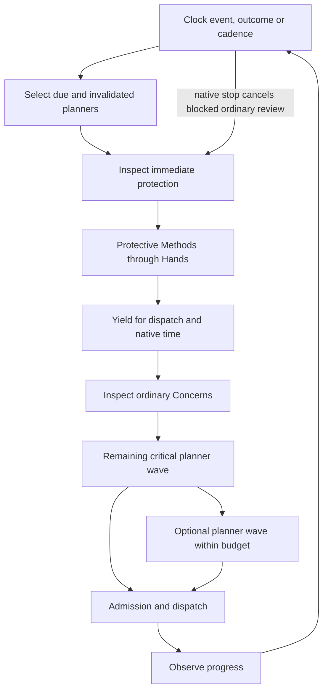
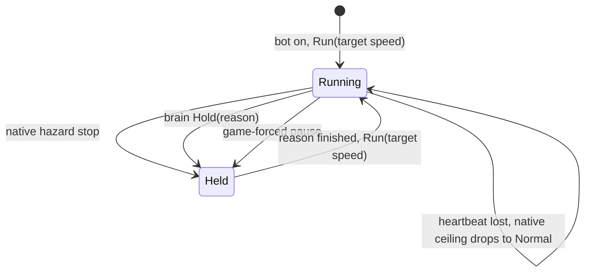
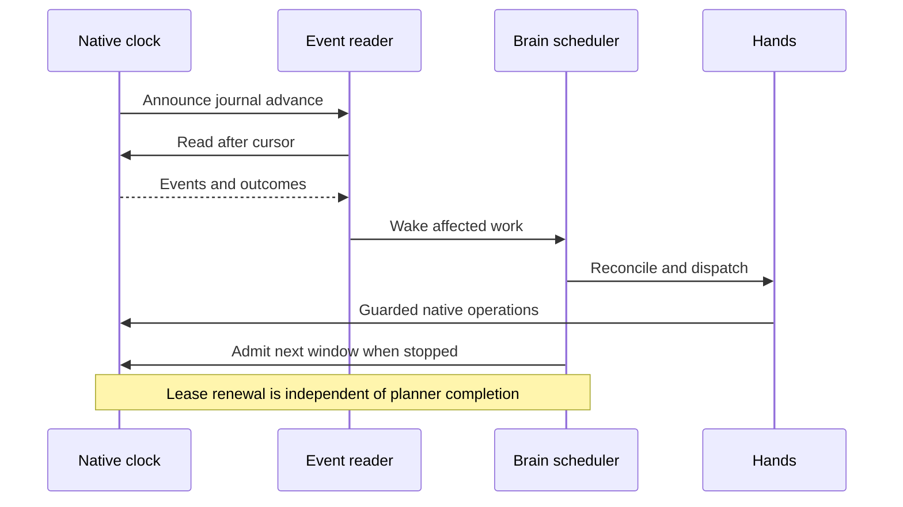

# Control loop

[Architecture](overview.md) · [Controller contracts](../contracts/controller-contracts.md)

The governor inspects the colony, selects bounded work, issues orders and observes
progress. The scheduler and native clock operate independently of launcher refresh.

## Concerns and their forms

A **Round** runs **Inspections** on **Concerns**, grouped into **Departments**.
A selected **Method** pursues a Concern through a Plan of actions.
**Safeguards** veto unsafe admission; they pursue no outcome themselves.

| Type | Inspection | Lifecycle |
| --- | --- | --- |
| Standard | Finding: Met, Unmet or Unclear | Maintains a target; a settled target becoming unmet starts a new Episode. A Once Standard (the former Project kinds, trade missions) settles and stays settled until an observed recovery and a new unmet finding open the next Episode. |
| Incident | Situation: Active, Clear or Unclear | One occurrence, opened by a trigger and closed by observed clearance. |

Departments group work in the launcher. They do not allocate exclusive workers.
`policy.ConcernTypeOf` and `policy.DepartmentOf` own the classification, with
tests for unclassified Concerns; do not maintain a second ID inventory in prose.

Durable intent and session Method ownership are defined by the
[persistence contract](../contracts/persistence-contracts.md).
The [glossary](../glossary.md) defines the shared terms.

## Observe and prioritize

Native frames provide coherent facts at an observed tick. Independently fetched
reads can span world changes, so identity and authority still require validation.
Absent or incomplete observations remain unknown; forecast harvest is not stock.

The planner catalog declares required sections, fact families, action kinds and
tick cadence. The due queue selects dirty or due planners. Action outcomes wake
their consumers; invalidated fact families wake their readers; authority changes
force reconciliation. Tests reject undeclared planner reads.

Immediate protection precedes development reads: combat and draft cleanup,
emergency tending/rescue, protective areas and active fire use a scoped review
of the native frame. It does not fetch the development planning window. The
same scheduler retains ordinary work on its due queue, yielding the player
gate to Hands before that work can block dispatch. A stopped clock can admit
protective native progress before ordinary review runs.

An omitted Concern was not inspected. Its Methods, progress and derived
ordinary facts keep their prior evidence and timestamps. World replacement,
rewind and revoked authority still invalidate unsafe work. The scoped review
does not interpret missing facts as recovery. Ordinary recovery service work,
medical reserves and surgery remain in the ordinary pass.

Critical planners precede optional work within each pass; owed shelter is
critical. Response accounting includes pre-wave review, while the planner
wall budget remains a separate hang guard. There is no calibrated numeric
end-to-end latency gate.

### Routine work admission

Policy selects supported controlled-pawn work and needs. Native priorities do not
choose their voluntary jobs. Concerns do not reserve
exclusive development slots. Method ownership, open work, Safeguards,
dependencies and per-planner bounds prevent duplicate or unsafe admission.

Explicit pawn activity Methods select exact work through policy and Hands rather
than delegating those choices to vanilla priorities. The live food planner
sequences native reads, pure Method proposal and journal admission. Candidate
generation and binding remain family-specific; ColonyForecast's shared outcome
comparison selects among their alternatives. This does not replace the scheduler
or establish a global labor allocation for every Concern. See
[Method selection and binding](plans-and-hands.md#method-selection-and-binding).

The worker revisits installed activity Methods independently of eligibility to
start new work. Terminal execution and fresh observations permit a productive
continuation while the Concern remains unmet; known recovery permits cleanup.
Missing observations do not prove completion. The existing journal retains
responsibility through replacement or release, as defined by
[Method continuation](../contracts/method-continuation.md#pawn-activity-methods).

Planners claim pawns and entities through a step-scoped first-come claim set
(`StepArbiter.TryClaim`); start order within a wave follows the planner catalog.
These claims are not a complete colony-wide labor forecast. Supply planning accounts for its own labor and lead
times; [resource demand](supply-model.md) feeds material shortfalls back into
acquisition.

Admission is action-specific. Building intent-mode can defer placement/cost
checks to execution; native dispatch still validates current placement.
Do not infer a universal atomic reservation of every future construction cost.

## Execute under supervision

Epic #3168 replaces today's windowed clock with a continuous Run/Hold model.
This section records the target design first, then what is built today; the
implementing pieces (#3177 and the #3178 series) cite it as their source of
truth. Where the two differ, the as-built text is current behavior and the
target text is not yet true.

### Target design: Run and Hold

While the bot is on, the clock is in one of two states.

- **Running.** The game advances at the brain's target speed. There are no tick
  budgets, no window sizing and no per-window admission. Time passes
  continuously unless a hold applies. Reads and orders run beside the advancing
  game; a coherent frame still binds planner facts to its tick, and dispatch
  still revalidates current context and the action's native contract.
- **Held.** The game is paused for one named reason (below). The hold ends when
  that reason is finished, not on a timer.

**Into Held.**

| Source | Reason | Examples |
| --- | --- | --- |
| Native | Tick-bounded hazard stop, within the [declared bound](hazard-detection-bounds.md) | hostile spawn, downing, stopping letter |
| Brain request | A coupled order that needs a quiet world | a write checked against a paused snapshot; an order that waits on a prerequisite outcome |
| Brain request | A decision-class event that needs review before time advances | see Combat below |
| Brain request | A due autosave | see Autosave below |
| Game | A game-forced pause | letters, dialogs |

Losing the brain's heartbeat is not a hold. Native lowers the one ceiling
(the [interface contracts](../contracts/interface-contracts.md) describe
`ClockCeiling`) to Normal and the game keeps running; contact ramps it back.
The brain only ever asks for a speed.

**Out of Held.** The brain finishes the reason, then resumes at its target
speed. In a fight it resumes as soon as the immediate review dispatches,
without waiting for ordinary review.

**What the old admission refusals become.** Window admission refused for the
reasons below; the new model replaces each as listed.

| Old refusal | Now |
| --- | --- |
| Stale, Unknown, InvalidLimits, NoWork, NotPaused | Gone. Staleness is a per-family tick tolerance on the facts a planner reads; a window needing a fresh paused status no longer exists |
| Unsafe | A native hazard hold |
| Outstanding | A coupled-order hold |
| Unreviewed, Interrupted | A review hold, scoped to decision events only |

**Combat.** The brain holds on decision events (a hostile appears, a downing,
an injury crossing the severity threshold), not on every combat event. The
brain arms exactly those three native combat events (`HostileArrived`,
`Downed`, `SeriousInjury`), and only while an admitted fight plan owns the
combat; the other native events (range, melee, shield, explosive, raid phase,
breach, mental break, prison break) are never armed. Each hold marks the
defense planner, the immediate review answers it, and Run resumes as soon as
that dispatches.

Resume latency from hold to the resuming Run is a gate
(`ClockCombatStops.ResumeBudget`, logged per hold as `resume_latency_ms` on
`clock_stop` and as p50/p95 on `combat_summary`). When a resume in the current
combat exceeds the budget the gate trips, and for the rest of that fight the
brain asks for the slower `ClockCombatStops.FallbackSpeed` (never above the
target speed) instead of holding more often; the gate clears when the combat
closes. The budget (2 s) and the fallback speed (Normal) are conservative
placeholders and **unmeasured**: the baseline numbers are deferred (#3199; see
the [live clock baseline](brain-host.md#live-clock-baseline)), as is the
heartbeat tolerance. Replace them with the measured budget when the table is
filled.

**Autosave.** A periodic hold flushes governor state, saves, and resumes.

**Native contract.** A new minimal wire contract replaces `StartRequest`, the
epoch and its lease: `Run(target speed)`, `Hold(reason)` and a heartbeat (#3177).
The one ceiling, which merges the frame budget with brain liveness, survives
unchanged beneath it. The toggle itself is the existing player Resume/Pause
route: Resume takes the clock and disables the player's speed keys, Pause stops
the bot, pauses the game once and re-enables the keys. The toggle is not
persisted; `AutoResume` decides at load.

**Deleted and kept.**

| Deleted | Kept |
| --- | --- |
| Tick budgets, finite windows and per-window admission; the 60,000 and 300-tick limits | Native hazard probe and its tick bounds |
| Lease renewal and the clock attempt, epoch and receipt persistence (stores and saves are not migrated) | Native event journal, cursor announcements and the event reader |
| Brain `PaceBackoff`, the 2,500-tick fallback horizon, native blind-tick regulator and `ClockBlindTicks` | The one native ceiling: frame budget plus heartbeat |
| `FollowPlayerSpeed`, `PlayerQuiet`, `RepauseClock`, the `not_paused` refusal, `PlayerSpeedHook` and player-speed seeding | Brain `TargetSpeed` option and `POST /api/player/clock-speed` |
| Native `PlayerAccelerated` as a pacing mode (its clamp becomes the one ceiling) | Immediate-protection review ahead of ordinary review; planner scheduling and Hands dispatch |
| `NativeWorkTicks`, idle lend and `idle_stall` | The player Resume/Pause route and the speed-key block |

### As built

Landed: the brain `TargetSpeed` option (#3170), Resume/Pause owning the clock
(#3172), the speed-key block while the bot holds the clock (#3173), the one
native ceiling with a brain heartbeat (#3171) and the removal of native
`PlayerAccelerated`, `Pace`/`Paced` and the owner's `max_ticks_per_second`
(#3201; Ultrafast tops out at the game's 15x until #3177). Everything else in this section
below still runs as described here until its removal piece lands (#3174 and
#3175 for pacing and player-speed following; #3177 and #3178 for the contract
and the hold state machine).

Native grants bounded tick windows under a renewable wall-clock lease.
A routine window permits up to 60,000 ticks; combat uses a 300-tick backstop.
Native allowances, hazards and player input may stop either earlier. Lease
expiry stops control when the brain becomes unresponsive.

Routine reads and orders can run during a window. Only admitting the next window
requires the stop boundary. A coherent frame binds planner facts to its tick;
dispatch revalidates current context and the action's native contract.

### Event delivery

The native journal is authoritative. Each append announces its cursor to the in-process brain; the brain reads after its own
cursor through an unheld `clock_read_events`. A bounded poll catches missed announcements.
A load triggers a tail read, and page loss remains explicit.

Events wake scheduler and worker. Named action outcomes reconcile first.
A stop may warm admission observations, reusable only when tick, identity,
generation and invalidation state still match.

Routine operation outcomes wake work without stopping simulation. Combat windows
may watch terminal construction/haul attempts, allowing a stop at their outcome
tick. Coupled orders wake when their prerequisite outcome arrives.

### Step reasons

| Trigger | Work |
| --- | --- |
| Settled window, tick advance or safety-net review | Full planner reconciliation |
| Timer | Due planner entries; admission alone when none is due |
| Outcome/fact wake | Affected planners; authority changes expand to all |
| Running window | Live planning and dispatch; no new window admission |

`clock_step` records why a step ran and its admitted window.
`stop_latency_ms` measures native-stop-to-step time, not hazard onset to
protective effect. Precise clock guards live in the
[clock contract](../contracts/clock-recovery.md) and
[hazard bounds](hazard-detection-bounds.md).

## Manual control

Manual authority suspends automation in the current world. Resuming Auto permits
the governor to act on current colony deficits immediately, including work the
player drafted, restricted or placed. There is no per-subsystem ownership grace
period. Forced or queued work can influence preference without excluding a pawn.

Pause retains routine Concerns and open work. Colony/map/load changes or tick
rewinds invalidate old context. Explicit Pause does not undraft pawns; native
auto-undraft applies while authority is inactive. Informational letter pauses
may stop a window without holding automation.

### Drafts

Drafts are plan-owned. The census-based cleanup undrafts colonists no live plan
or open fight needs, while protecting native arrest/capture jobs. A suspended
plan retains drafts needed by unfinished work; subsequent orders still check
that a pawn remains drafted.

### Auto takeover

Under Auto, timetable, diet, Home, allowed-area, bill and standing designation
edits are ordinary colony facts. Their owning planners reconcile them through
the shared action system. Destructive work still requires its explicit
eligibility and opt-in guards. See
[durable policy](../contracts/durable-policy.md).

## Verify progress

Hands tracks action-specific receipts and postconditions. Concern progress tracks
the desired colony outcome and its blocker: no worker, native ineligibility,
uncertain write or unavailable method. Unknown observations cannot settle it.

Observed stalled work can trigger a bounded cooldown or alternate method.
Completion can clear the blocker without replacing the action's evidence.

[Controller contracts](../contracts/controller-contracts.md) define disease,
hunting and combat extensions.
