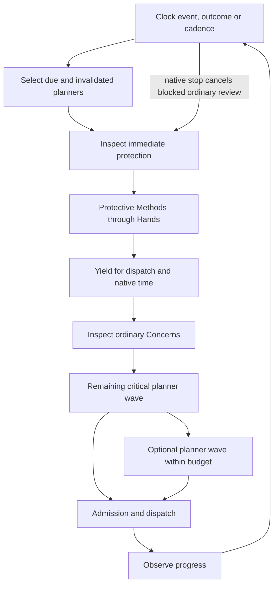
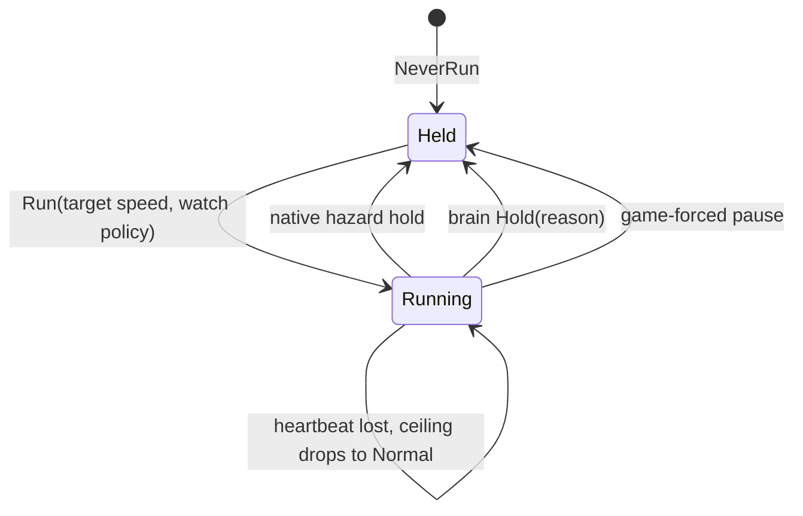
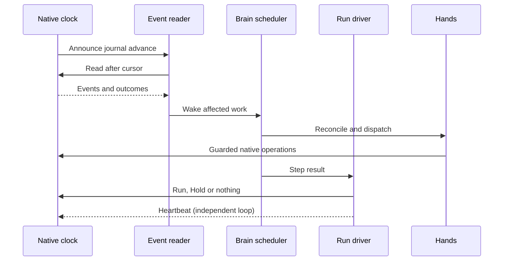

# Control loop

[Architecture](overview.md) · [Controller contracts](../contracts/controller-contracts.md)

The governor inspects the colony, selects bounded work, issues orders and observes
progress. The scheduler and native clock operate independently of launcher refresh.

## Concerns and their forms

A **Round** runs **Inspections** on **Concerns**, grouped into **Departments**.
A selected **Method** pursues a Concern through a Plan of actions.
**Safeguards** veto unsafe admission; they pursue no outcome themselves.

| Type | Inspection | Lifecycle |
| --- | --- | --- |
| Standard | Finding: Met, Unmet or Unclear | Maintains a target; a settled target becoming unmet starts a new Episode. A Once Standard (the former Project kinds, trade missions) settles and stays settled until an observed recovery and a new unmet finding open the next Episode. |
| Incident | Situation: Active, Clear or Unclear | One occurrence, opened by a trigger and closed by observed clearance. |

Departments group work in the launcher. They do not allocate exclusive workers.
`policy.ConcernTypeOf` and `policy.DepartmentOf` own the classification, with
tests for unclassified Concerns; do not maintain a second ID inventory in prose.

Durable intent and session Method ownership are defined by the
[persistence contract](../contracts/persistence-contracts.md).
The [glossary](../glossary.md) defines the shared terms.

## Observe and prioritize

Native frames provide coherent facts at an observed tick. Independently fetched
reads can span world changes, so identity and authority still require validation.
Absent or incomplete observations remain unknown; forecast harvest is not stock.

The planner catalog declares required sections, fact families, action kinds and
tick cadence. The due queue selects dirty or due planners. Action outcomes wake
their consumers; invalidated fact families wake their readers; authority changes
force reconciliation. Tests reject undeclared planner reads.

Immediate protection precedes development reads: combat and draft cleanup,
emergency tending/rescue, protective areas and active fire use a scoped review
of the native frame. It does not fetch the development planning window. The
same scheduler retains ordinary work on its due queue, yielding the player
gate to Hands before that work can block dispatch. A held clock lets
protective orders take effect before ordinary review runs.

An omitted Concern was not inspected. Its Methods, progress and derived
ordinary facts keep their prior evidence and timestamps. World replacement,
rewind and revoked authority still invalidate unsafe work. The scoped review
does not interpret missing facts as recovery. Ordinary recovery service work,
medical reserves and surgery remain in the ordinary pass.

Critical planners precede optional work within each pass; owed shelter is
critical. Response accounting includes pre-wave review, while the planner
wall budget remains a separate hang guard. There is no calibrated numeric
end-to-end latency gate.

### Routine work admission

Policy selects supported controlled-pawn work and needs. Native priorities do not
choose their voluntary jobs. Concerns do not reserve
exclusive development slots. Method ownership, open work, Safeguards,
dependencies and per-planner bounds prevent duplicate or unsafe admission.

Explicit pawn activity Methods select exact work through policy and Hands rather
than delegating those choices to vanilla priorities. The live food planner
sequences native reads, pure Method proposal and journal admission. Candidate
generation and binding remain family-specific; ColonyForecast's shared outcome
comparison selects among their alternatives. This does not replace the scheduler
or establish a global labor allocation for every Concern. See
[Method selection and binding](plans-and-hands.md#method-selection-and-binding).

The worker revisits installed activity Methods independently of eligibility to
start new work. Terminal execution and fresh observations permit a productive
continuation while the Concern remains unmet; known recovery permits cleanup.
Missing observations do not prove completion. The existing journal retains
responsibility through replacement or release, as defined by
[Method continuation](../contracts/method-continuation.md#pawn-activity-methods).

Planners claim pawns and entities through a step-scoped first-come claim set
(`StepArbiter.TryClaim`); start order within a wave follows the planner catalog.
These claims are not a complete colony-wide labor forecast. Supply planning accounts for its own labor and lead
times; [resource demand](supply-model.md) feeds material shortfalls back into
acquisition.

Admission is action-specific. Building intent-mode can defer placement/cost
checks to execution; native dispatch still validates current placement.
Do not infer a universal atomic reservation of every future construction cost.

## Execute under supervision

A player can describe the clock in two sentences. With the bot on, the bot owns
the clock and the player's speed keys are off. With the bot off, the bot stops
acting on the colony, the game is paused once and the player is free to unpause.
The toggle is the player Resume/Pause route ([player API](../contracts/player-api.md));
it is not persisted, and `AutoResume` decides at load.

While the bot is on, the clock is in one of two states.

- **Running.** The game advances at the brain's target speed. There are no tick
  budgets, window sizes or per-window admission: time passes continuously unless
  a hold applies. Reads and orders run beside the advancing game. A coherent
  frame binds planner facts to its tick, and dispatch revalidates current context
  and the action's native contract, so a fact that aged while the game ran is
  refused natively rather than guarded by pausing.
- **Held.** The game is paused for one named reason. A hold ends only when the
  brain sends `Run`, and the brain sends it when the reason is finished, not on
  a timer. Native never resumes by itself.

### Who decides what

| Piece | Owns |
| --- | --- |
| Native clock (`NativeClockRuntime`, the supervisor) | The game's speed, the hazard probe, the event journal, the hold itself and the one ceiling. Hazard holds happen on a tick boundary within the [declared bounds](hazard-detection-bounds.md). |
| `ClockScheduler` step | Planning only: one coherent bundle read, the planner wave and the result. It starts and stops nothing. |
| `ClockRunDriver` | The hold state machine, run after every step. It sends `Run`, takes the brain's own holds, acknowledges reviewed holds, keeps the heartbeat and polls the journal. |
| Hands and the Worker | Order dispatch under the running clock. |

The brain only ever asks for a speed. It does not manage a rate, a frame budget
or the player's speed.

### Into Held

| Source | Reason | Examples |
| --- | --- | --- |
| Native | A tick-bounded hazard (`hostile`, `colonist_downed`, `predator_hunt`, `colonist_injury`, `notification_batch`, and the rest of the [hazard table](hazard-detection-bounds.md#declared-bound-per-hazard-class)) | a hostile spawns, a colonist is downed, a stopping letter |
| Native | An armed combat event, only while an admitted fight plan owns the combat | see Combat |
| Native | A game-forced pause (`GAME_FORCED`, dialog and letter pauses) | a force-pausing dialog, a long event |
| Brain `Hold(CoupledOrder)` | A coupled order whose prerequisite just completed, so the next order needs a quiet world | a build order that waits on the haul that fills it |
| Brain `Hold(Autosave)` | A due autosave | see Autosave |
| Brain `Hold(Review)` | The bot stops acting: Pause, a checkpoint save, shutdown, or authority ended under a `Run` the driver sent | the player pressed Pause |

A `Hold` of an already held clock keeps the first reason. `Hold` needs only the
loaded identity, never current authority, so cleanup can always stop play.
Losing the brain's heartbeat is not a hold (see the ceiling below).

### Out of Held

After each planning step the driver reads the clock status and decides:

- A held clock resumes with `Run` when the watch decision
  (`policy.EvaluateClockWatch`) allows it: facts fresh and same-authority, every
  captured journal page reviewed, no unacknowledged interruption or gap, no
  unknown threat. A refused decision leaves the clock held and the next step
  retries (`HeldException`).
- A running clock is never stopped by a refused decision: native holds on what it
  sees. The driver only resends `Run` when the implied watch policy or the speed
  differs from the last one sent. `Run` is idempotent and doubles as the speed
  and policy change.
- Holds that native took (a hazard, a letter) are acknowledged once a step has
  planned against them. The brain finishes the reason, then resumes at its target
  speed.
- A step that follows a driver hold or `Run` repeats at once (a `settled` step,
  never twice in a row) so the planners work against the held world without
  waiting a step interval.

A `Run` carries the speed and a complete watch policy: colony mode, or combat mode
with the live hostiles it acknowledges. The hazard thresholds are the brain's
(see [hazard bounds](hazard-detection-bounds.md#brain-authored-thresholds)); native
holds no literal for them.

### The one ceiling and the heartbeat

Native keeps one ceiling on the tick rate (`ClockCeiling`): the lower of a frame
budget input and a brain-liveness input. A frame whose tick work runs past the
frame budget lowers the rate at once and it recovers in gradual steps. The
brain's driver sends an explicit `Heartbeat` every second; if none arrives within
the tolerance the ceiling drops to Normal and ramps back once the brain is heard
again. Neither input is a hold: the game keeps running at the lower rate. The
[interface contracts](../contracts/interface-contracts.md#clock-speed-and-the-one-ceiling)
give the numbers.

### Target speed

The target speed is a live brain option (`ClockTargetSpeed`, default Ultrafast).
`POST /api/player/clock-speed` changes it; the next step sends `Run` at the new
speed. The acceptance harness sets each launch's speed this way. Ultrafast runs
the game's tick boost under the one ceiling; the boost is a development feature of
the game, so the native tick-rate figures are listed with their caveats in the
[interface contracts](../contracts/interface-contracts.md#clock-speed-and-the-one-ceiling).

### Combat

The brain holds on decision events, not on every combat event. It arms exactly
three native combat events (`HostileArrived`, `Downed`, `SeriousInjury`;
`ClockCombatStops.DecisionEvents`), and only while an admitted fight plan owns the
combat. The other native events (range, melee, shield, explosive, raid phase,
breach, mental break, prison break) are never armed. Between decision events the
fight plan's orders run while the clock runs.

A hold on an armed event marks the defense planner; the immediate-protection
review answers it, and `Run` resumes as soon as that dispatches, without waiting
for ordinary review. A hold with no fight plan to answer it cannot happen: a
colony or unowned watch is disarmed.

Resume latency from hold to the resuming `Run` is a gate
(`ClockCombatStops.ResumeBudget`, logged per hold as `resume_latency_ms` on
`clock_stop` and as p50/p95 on `combat_summary`). When one resume in the current
combat exceeds the budget the gate trips, and for the rest of that fight the
brain asks for the slower `ClockCombatStops.FallbackSpeed` (never above the target
speed) instead of holding more often. The gate clears when the combat closes.

### Autosave

A periodic hold flushes governor state, saves and resumes. Every
`ClockRunConfig.AutosaveEveryTicks` game ticks (default one in-game day, counted
on the game clock from the previous autosave hold) the driver takes
`Hold(Autosave)`, saves into the rotating `Autosave-1..5` slots at the first step
that finds the clock held and paused, and then sends `Run`. No save is made while
the clock runs; a failed save never keeps the clock from running. It is not the
game's own autosave.

### Player keys

While the bot holds the clock, native swallows the player's speed and pause input
(space, 1 to 4 and the time-control buttons) and shows a rate-limited message
saying why. Letter and dialog pauses and the supervisor's own assignments are not
player input and pass. Pause turns the bot off: the driver holds the clock for
`Review` once, the keys work again and the player owns the clock.

### Constants that are not measured

These are conservative guesses, not measurements. The live baseline that would
replace them is #3199; the procedure is in
[Measure brain throughput](../testing/measure-throughput.md#clock-baseline-run) and the
table in [brain host](brain-host.md#live-clock-baseline).

| Constant | Value | Where |
| --- | --- | --- |
| Frame budget | 30 ms of tick work per frame | `ClockCeiling.DefaultFrameBudgetMs` |
| Heartbeat tolerance | 5 s without contact drops the ceiling to Normal | `ClockCeiling.HeartbeatToleranceMs` |
| Heartbeat interval | 1 s | `ClockRunConfig.HeartbeatInterval` (must stay under the tolerance) |
| Combat resume budget | 2 s | `ClockCombatStops.ResumeBudget` |
| Combat fallback speed | Normal | `ClockCombatStops.FallbackSpeed` |
| Autosave cadence | one in-game day | `ClockRunConfig.DefaultAutosaveEveryTicks` |

### What was removed

The earlier model admitted finite tick windows under a renewable wall-clock lease,
with a per-window admission decision, brain and native pace regulators, and
following of the player's own speed. All of it is gone, as are the clock attempt,
epoch and receipt stores. Do not reintroduce a tick budget or a second regulator;
the one ceiling, the target speed and named holds replace them.

### Event delivery

The native journal is authoritative. Each append announces its cursor to the
in-process brain; the brain reads after its own cursor through an unheld
`clock_read_events`. A bounded poll (250 ms, backing off to 2 s after a failure)
catches missed announcements. A load triggers a tail read, and page loss remains
explicit.

Events wake the scheduler and worker. Named action outcomes reconcile first.
A hold may warm admission observations, reusable only when tick, identity,
generation and invalidation state still match.

Routine operation outcomes wake work without holding the clock. A running clock
arms no watch on a completed order; dispatched construction and haul attempts
are evidence only. Coupled orders wake when their prerequisite outcome arrives.

### Step reasons

| Trigger | Work |
| --- | --- |
| `settled`: the step after a driver hold or `Run` | Every planner not waiting on a dependency |
| `full`: the first step, a step after idle, or a `timer` step promoted by the two-minute safety net | Every planner |
| `timer` | Due planner entries; with none due, the driver tail alone |
| `wake` | Outcome or fact wake: affected planners; authority changes expand to all |

`clock_step` records why a step ran. `stop_latency_ms` measures native-hold-to-step
time, not hazard onset to protective effect. `clock_run` records each `Run`, `Hold`
or refusal the driver made. Precise guards live in the
[clock contract](../contracts/clock-recovery.md) and
[hazard bounds](hazard-detection-bounds.md).

## Manual control

Manual authority suspends automation in the current world. Resuming Auto permits
the governor to act on current colony deficits immediately, including work the
player drafted, restricted or placed. There is no per-subsystem ownership grace
period. Forced or queued work can influence preference without excluding a pawn.

Pause retains routine Concerns and open work. Colony/map/load changes or tick
rewinds invalidate old context. Explicit Pause does not undraft pawns; native
auto-undraft applies while authority is inactive. An informational letter
pauses the game but does not suspend automation: the brain resumes the clock
once it has reviewed the hold.

### Drafts

Drafts are plan-owned. The census-based cleanup undrafts colonists no live plan
or open fight needs, while protecting native arrest/capture jobs. A suspended
plan retains drafts needed by unfinished work; subsequent orders still check
that a pawn remains drafted.

### Auto takeover

Under Auto, timetable, diet, Home, allowed-area, bill and standing designation
edits are ordinary colony facts. Their owning planners reconcile them through
the shared action system. Destructive work still requires its explicit
eligibility and opt-in guards. See
[durable policy](../contracts/durable-policy.md).

## Verify progress

Hands tracks action-specific receipts and postconditions. Concern progress tracks
the desired colony outcome and its blocker: no worker, native ineligibility,
uncertain write or unavailable method. Unknown observations cannot settle it.

Observed stalled work can trigger a bounded cooldown or alternate method.
Completion can clear the blocker without replacing the action's evidence.

[Controller contracts](../contracts/controller-contracts.md) define disease,
hunting and combat extensions.
