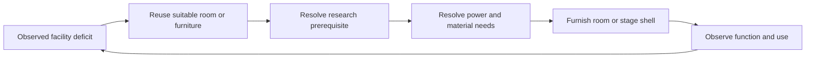

# Facilities

Room functions are the game's own `Room.Role`; the controller never assigns a
role, it only reads which one the game scored. `policy.FacilityCatalog` is the
per-role matrix over every installed RoomRoleDef, and every planner that
pursues a role walks the same ladder. This page is the ladder and the matrix;
[space and resources](space-and-resources.md) covers siting and budgets.

## The ladder

Each rung is a separate deficit under an existing maintained Concern. Shared
admission checks its resources and dependencies; vanilla priorities schedule pawn work.

1. **Reuse**: a room the game already scores as hosting the function, or an
   existing bench, bed or spot that already does the job. Reuse wins over
   building while its capacity suffices, so a colony that has the facility
   gets no second one. The one exception is a production bench kind the work
   dispatcher reports short (`RoundsFacts.UnmetThroughput` reason `no_bench`
   or `benches_exhausted`; slots, ingredient and haul-bound shortfalls never
   count): its standing benches stop counting as reuse and a further bench of
   that kind walks the research, power, bench and workstation-stockpile rungs
   below. A kind is capped at `policy.BenchCap` = `1 + colonists/4`, at most
   4 (`ColonistsPerExtraBench`, `MaxBenchesPerKind`); a further bench that
   cannot be staged leaves the existing bench in use. Each further bench is
   its own `workshop-<def>-<n>` method. The case needs a colony whose demand
   outruns one bench, so it is proven by the nightly tier and the unit tests in
   `workshop_further_test.go`, not by a dedicated `production/ladder` fixture.
2. **Research**: when the first bench that could produce a `MaintainResource`
   deficit is gated only by unfinished research, the workshop planner records
   the projects on the `production_ladder` journal record and steps aside. The
   next rounds read that record as the derived `EnsureResearch`
   target (`policy.ResearchConcern`: the default research ladder follows when no need is
   recorded, see [research](../contracts/research.md)), raises the concern, and
   adds Research to the work requirements so a researcher is assigned;
   `RoundsResearchPlanner` selects the prerequisite chain natively.
   Finishing the project clears the record on the next workshop step.
3. **Power**: a bench that needs power is staged only once a generator
   definition is buildable; standing unpowered it is an ordinary consumer for
   `EnsureBasicPower`, which raises its own deficit and connects it.
4. **Bench**: the first candidate bench the planning census reports available
   and buildable by a builder the colony has (unpowered before powered) is
   furnished into a hosting room, or the starter shell is staged first.
5. **Workstation stockpile**: not a method. Industry declares, for every bench
   with an active bill except the kitchen's and butcher's, one Important
   allow-list store of that bench's recipe ingredients
   (`policy.DeriveBenchInputs`) on the free roofed 2x2 patch in the bench's room
   nearest it; hauling brings the inputs to the bench. All stores are declared by
   their departments and applied by `MaintainStockpiles`: see
   [storage](storage.md). Once ComplexFurniture is researched and no zone edit
   stands, `RoundsStockpilePlanner` upgrades the warehouse (the general store)
   with a Shelf inside it, up to a third of its footprint, one at a time. The
   upgrade runs under the stockpiles planner, so the initial-shelter gate holds
   it. `MaintainStockpiles` patches each built shelf with its zone's filter and
   priority (role `shelf:<buildingID>`). Native storage
   capacity counts a shelf cell's free slots (three stacks per cell).
6. **Bill**: `RoundsResourcePlanner` dispatches the bill and native readback
   of the rising item count carries the deficit to recovery. Native
   applies a bill on an unfueled bench (`UsableForBillsAfterFueling`):
   a bill waiting on the bench is what makes haulers refuel it, and a bench
   with no bill leaves the clock with no work to run those hauls under.

Each rung reports an explicit reason when it cannot proceed
(`workshop_research_needed`, `workshop_bench_unavailable`, `no_space`,
`unknown`) rather than staging something else. A research bench itself is the
Laboratory row: when the research ladder's next rung is locked only for lack
of a bench, `RoundsResearchPlanner` walks the same furnish-or-shell ladder
under `EnsureResearch` for a `SimpleResearchBench` (`routine-laboratory-*`
plans) and selects the rung once it stands. A table still standing in a retiring
shelter is packed with the rest of the retired ground and installed in the
laboratory from stock; no separate pass relocates it.

On a cold map (`ColdMapCurve`) the starter shelter carries an airlock: extra
fields on its `PlannedRoom` (`Airlock`: the vestibule cell outside the shelter
door and the outer door beyond it, with walls either side of the vestibule), not
a separate room role. The ring reconcile, `GroundMatches`, clearance ground and
retirement treat those cells as part of the shelter's ring; the vanilla
auto-roof roofs the enclosed vestibule. It is sited where the ground has room
for it and omitted otherwise (a shelter packed onto a hallway slot has none).
A second wall layer is not built.

### Station catalog

`DefinitionCatalog.StationCatalog()` (`policy.StationCatalog`) lists the
buildable stations the planner places: beds, work tables, storage, tables,
joy and ritual furniture, wall-bound buildings. Each `Station` carries the
`PieceShapes` shape, floor or wall `Access`, `Contributions` (what
`RoomRoleWorker.GetScoreDeltaIfBuildingPlaced` adds per building, with the
`RoleCondition` for instance state such as a medical or prisoner bed),
`Capacity` (sleepers, stored stacks, or one worker with each recipe's work
amount), `Needs` and the defining `Content` package. Membership, capacity and
needs are read from defs, stat parts, place workers and game constants; the
role weights are literals in the game's role workers, so they are the
`roomRoleScores` entry in `DefTables` (keyed by `RoomRoleDef`). The rot curve
and the throne's indoor rule are code, not data, and are not stated.

### Station graph

`policy.BuildStationGraph` (`layout_graph.go`) turns the catalog and the
existing demand models into the planner's input: nodes are station classes with
a count, edges are affinity. Counts: beds are the colonists plus
`HousingSparePlaces` (the spare place `MaintainHousing`'s expansion phase
keeps), with medical, prison, baby and animal beds for the injured, prisoners,
babies and animals, each divided by the bed's sleeping slots; work stations are
the day's work (the colonists' nutrition met by the food recipe with the least
work per nutrition, merged by maximum with the work ledger's orders) over a
worker's day; tables seat at their edge cells; shelves hold the stacks of the
stock demand, perishables in a store that wants cold. Edges are daily flows:
ingredients from store to station, food from station to table, other products
to store, and the meals a sleeper walks to. A station working a perishable
ingredient has a required link to the cold store. Station definitions come from
`RoomFurniture`, `DiningFurniture` and the catalog; a need with no station, or
an item with no stack limit, is an error. The graph adds no `DefTables` entry
and is never persisted. `DefinitionCatalog.StationRecipeFlows` reads the recipe
flows it needs.

### Predicted room role

`policy.PredictRole(catalog, pieces)` is the pure form of the game's
`Room.UpdateRoomStatsAndRole`: the highest role-worker score wins and the
generic `Room` scores 0.99. Additive and flat weights come from each station's
`Contributions`; the bed-set roles (bedroom with `IsBedroom`, barracks, nursery
of two or more baby beds, hospital, prison cell of exactly one bed, prison
barracks) follow their decompiled workers, so a humanlike bed outscores every
bench by orders of magnitude. A tie breaks to the smaller role name, and a
prisoner bed vetoes the hospital whatever the scan order. `policy.LostEffects`
names what a mixed room loses: the intended role's own effect (the
`roleEffects` entry: sleep, patient and prison mood, throne, worship) and each
bench whose `NeedRole` is not the predicted role, at that need's factor (the
x0.8 workbench penalty). Roles without a native consumer are ignored.

### Room groups

`policy.ClusterStations` (`layout_cluster.go`) clusters the station graph into
room groups, the planner's seed; it replaces the role-keyed `affinityClusters`.
Each node is a pool of stations. A pool splits by halves until `PredictRole`
keeps every effect its stations are for (what a station is for is the role the
game gives it alone) and it fits the area limit, so free beds end one per
bedroom while medical beds stay a hospital. Unit pairs then merge by descending
flow weight (required links first) unless the merge loses an effect, joins an
enclosed station with an open-sky one, or exceeds the area limit. A cold room
beside a station that works in a temperature band is not refused: the decision
records the conflict (`Conflict`) for the search to price. Decisions and
groups also carry the throughput a conflict costs as data (`Costs`): the work
ticks a day lost, the graph node's `DailyWork` times (1/Factor - 1) for a bench
outside its `NeedRole` room (x0.8) or a band station in a cold room
(`NeedTemperature`, x0.7); a decision holds what the merge adds to its parts,
a split what the unsplit pool loses. `LostEffects` names the role effects lost
and the sleepers affected; mood magnitudes are unknown until a room is built
and belong to the search (#2878). Cold is met by a
cooling station: the catalog marks coolers (`Station.Cooling`, a temperature
control whose `energyPerSecond` is negative, with its power draw), and a group
that needs cold gets the one drawing the least power per heat moved
(`PurposeCool`) with its footprint and a clearance cell in the area, or an
`unsatisfied` decision (`cluster_no_cooler`) when the catalog has none. Cooler
power and wiring stay with the refrigeration planner; exposure to cold outside
air and the thermal benefit of thick roof belong to the climate envelope
(#2880). Area is the stations'
catalog footprints plus the placer's clearance (one open cell per station and
the door threshold); the limit is the largest room the roof support distance
and the shell bounds (3844 interior, 255 wall cells) allow. A group carries its
stations, area, predicted role, environment requirements (cold, clean,
enclosed, open sky) and links to other groups, required ones marked. Rooms of a
role the game gives no effect (dining beside a stove, storage beside a bench)
share a room with the station that outweighs them.

A butchering order makes the butcher table's node `Filth`
(`StationNode.Filth`, from the recipe's `Butchery` special product on
`RecipeFlow`): `Corpse.ButcherProducts` spawns the corpse's blood at the
butcher's cell (decompiled 1.6; the defs only name the special product), and
the room's cleanliness feeds `RoomStatDefOf.FoodPoisonChance`, which a cook's
meal reads (`CompFoodPoisonable`). Sharing a room with a node that is not
filthy is priced, not refused: `FilthCost` (on the decision and the merged
group, `RoomGroup.Filth`) gives one blood unit's cleanliness shift (the filth's
`Cleanliness` stat, -10 for `Filth_Blood`, over the room's cells, per
`RoomStatWorker_Cleanliness`), the `FoodPoisonChance` curve at that shift and the
units until it leaves zero (the curve is flat from cleanliness -2 up), and the
shift of the `Impressiveness` cleanliness input (`1 + cleanliness / 2.5`); all
read from the defs (`DefinitionCatalog.FilthModel`), the cooks in the room named
as exposed. The seed keeps the pair apart (`cluster_filth_priced`, a keep that
carries the price) unless `ClusterInput.MergeFilth` is set, which the layout
search sets where the walk saved is worth the price. Kept apart, the butcher
stands in a closet of its own, and the group's `Planned` role is `PlannedButchery` when the game reads the closet as a
kitchen (the table scores as one), and `PlannedRoleOfGroup` returns it over the
role mapping. The graph sends the corpses in from, and the meat and leather
back to, the cold and plain stores, with the required cold link a perishable
ingredient implies, so the closet lands beside the freezer and, through the
stove's own meat flow, the kitchen.

### Topology embedding

`policy.Embed` (`layout_embed.go`) places the room groups on the site as
area-sized rectangular blocks, coarsely (tiling to regions is a later stage). It
reuses the siting machinery: SiteCore's obstacle levels (the strictest level
that places every group wins) and candidate seeds, the PlanScore soil, rock,
edge and centre terms per cell (prefix sums, so pricing a block is O(1)),
`planWeights` for every weight and the seeded `searchRand`. The walking term is
`Walk x link weight x (gap - 1)` with the cluster's summed flow weights, so
adjacent (sharing a wall) is free; a required link not adjacent costs
`BadRoutes` and is reported. Each seed builds a Prim-like greedy start (heaviest
group, then the group with most weight to what is placed, on the smallest ring
beside its neighbours) and a local search of `siteSearchIters` moves per block
(beside a linked block, beside any block, a random core cell, a swap) keeps
strict gains; the best start wins. Environment requirements: open sky excludes
rock and mountain roof; cold is no site requirement (the group carries its
cooler, and rock is only the dig cost every group pays); a clean room has no site signal (`embed_no_site_signal`). A group no
position fits is reported unplaceable (`embed_no_ground`,
`embed_open_sky_ground`).

### Station plan and successor rooms

`policy.AdviseStations` (`layout_station_plan.go`) runs graph, clustering and
embedding over the live colony; the old planner stays
authoritative for what it builds. At each layout review
`Rounder.stationAdvice` reads `StationFacts` from the
projection (the unknown stays unknown, never zero): the people (colonists less
babies, the ward from `SelectHospitalBed`'s ill set, held prisoners, the pen
herd), the colonists' nutrition a day (the food census consumers' rates), the
work ledger's orders (only while the ledger is `reconciled`), the resource
demand as stock, and the catalog's recipe flows, stack limits and rot
(`StationItemFacts`). It writes one `layout_stations` decision: `advised` with
each group (stations, footprint, clearance, area, predicted role, costs,
block), the clustering's conflicts and the embedding report; `skipped`
(`facts_unknown`, naming the fact); or `failed`. The chain runs at most once per change of its inputs (`StationFacts.InputsKey` and the survey; a review with them unchanged reads the last advice and writes no row). Cost on the 250x250 baseline map with a 30-colonist plan and 10 recipes ordered: about 85 ms a run, 0.5 ms for the key (`BenchmarkAdviseStationsLarge`).

`MatchGroupRooms` matches the standing planned rooms of a native role
(`BuiltRegions`, through the planned-role to native-role table) to the groups
of that role: both largest first, the n-th group takes the n-th room, and a
surplus room goes to the group most short of floor (ties to the lower id).
`GroupOutgrown` holds when the group's area exceeds the matched rooms' floor; a
group with no built room is not outgrown. A built pair (a room and the successor that replaces it) is one room: `BuiltRegions` leaves the replaced room out.

Successor rooms (`layout_succession.go`, storage and workshop; the other roles
are #2864). `OutgrownSuccession` reads the advice at a layout review: an
outgrown group of those roles whose shortfall (group area less the matched
rooms' floor) holds the footprint plus one open cell of the smallest station
in the group asks for a successor. It replaces the smallest matched storage or
workshop room and is that room's floor plus the shortfall, in the group's
embedded block shape (the block's depth cut to the floor needed) sited by
`SiteRoom` with `Replaces` set. The group most short goes first and none starts
while a predecessor is still in the plan, so one rebuild runs at a time. A
replan sites the successor ahead of the re-siting (`growSuccessor`);
`replanPins` pins both rooms; `retireSurplusRooms` drops the predecessor once
the successor is in `Built`, and clearance takes its ground. A successor with
no embedded block, or no free core slot, is not built: `successor_unsited`.
`StorageRoomsOwed` and the storage department's further-warehouse demand count
a `Replaces` chain as one room, so no twin is added. Stock drains from the old
zone as vanilla re-hauls it; bills and packed furniture are #2881.

## Electrical safety

`EnsureBasicPower` uses `HiddenConduit` for new connections and replaces ordinary
conduits in bounded eight-cell methods. Turret connections use the same safe
definition. Native research, placement, stock and construction checks still apply;
unknown blockers, forbidden conduits and unfinished work cannot be replaced.
The topology census includes ordinary, hidden and waterproof conduits.

Native power facts identify rain-sensitive equipment and whether its whole
footprint is roofed. Exposed equipment and ordinary conduits keep power at
priority 2 even in dry weather. Where a free, observed perimeter exists, the power
planner builds a small enclosure around exposed equipment through shared Hands.
The door precedes the walls in one wave; ordinary colonist roofing has a bounded allowance,
and only an observed roof clears exposure. Blocked sites remain a deficit.
New rain-sensitive equipment requires a finished roof at placement admission.

These are separate hazards: roofing batteries and appliances prevents rain
shorts; roofing ordinary conduits does not prevent the random conduit incident.
See the wiki's [hidden conduit](https://rimworldwiki.com/wiki/Hidden_conduit) and
[battery](https://rimworldwiki.com/wiki/Battery) mechanics, and
[disaster recovery](../contracts/disaster-planning.md) for incident evidence.

## Room capabilities

`policy.FacilityCatalog` is the authoritative per-role capability matrix.
Installed definitions and DLC determine which facilities exist. The sections
below describe their planning contracts; they are not an implementation-status
checklist.

### Child rooms (Biotech)

A baby, toddler or child is owed the room its developmental stage calls for
(`policy.ChildRoomNeeds`, from the pawn row's `biotech` block): a nursery
while a newborn or baby lives, a playroom while a baby or child does, a
classroom while a child does. The roles are the game's own room scores
([Rooms, Roles](https://rimworldwiki.com/wiki/Rooms)): a Nursery scores 0
under two baby beds or beside any other bed, a Playroom scores each toy box
and baby decoration and a Classroom each blackboard and school desk, both
only while the room holds no humanlike bed. Furniture counts follow the
pawns: a bed per newborn or baby (at least the game's two), one toy box and
one decoration, one blackboard and a desk per child.

Furniture is never a def-name list: the native definition catalog gives each
`PlanningDefinition` view its `RoomRoles` (`BabyBed`, `Toy`, `Decoration`, `Board`,
`Desk`, `DeathrestCasket`, `DeathrestAccelerator`; see
[observations.md](../../../contracts/proto/observations.md#room-role-furniture))
and a room's pieces are the catalog definitions carrying the role, the first
available by name placed. The same machinery owes a **deathrest chamber**
while a deathrester lives: a casket per deathrester and, as an optional piece
(left out when no accelerator is available), the accelerators its deathrest
capacity beyond the casket allows.

1. The layout review grows a `nursery`, `playroom` or `classroom` core room
   sized to hold the furniture (`policy.ChildRoomSizes`,
   `policy.ReplanLayoutWithRooms`); existing rooms never move or shrink.
2. `NextChildRoomStep` owes the room a reconcile (`ChildRoomReconcile`)
   whenever its ring or doors differ from the plan or a piece is missing. The
   step carries the template: each role's standing pieces wanted where they
   stand, the missing ones at free slots of the child room template (bands of
   free floor as high as the piece, a free row between bands, the row inside
   the entrance and the entrance column kept free). The shared build side
   does the work (`reconcileRoom`, as for the throne room below): removals,
   installs from packed stock, then doors, walls, floors and furniture built
   on site; there is no shell or place step. Only the template's pieces are
   the room's: other furniture is left alone. Footprints are the native
   definition catalog's; a role whose required furniture is unavailable or has
   no known size is passed over, and any available definition of the role
   answers an unresearched one.
3. Feeding is `MaintainBabyFeeding` (below); play and lessons belong to the
   next children.

### Baby feeding (Biotech)

The game feeds babies itself: a lactating pawn breastfeeds any baby, and a
colonist on Childcare work (pinned for every pawn) bottle-feeds food a baby
can eat, which is baby food, milk or insect jelly
([Baby, Food](https://rimworldwiki.com/wiki/Baby); the def flag is
`IngestibleProperties.babiesCanIngest`, read from the def row by
`DefinitionCatalog.BabyEdible`).
The mother is Urgent and every other pawn Childcare by default. No write
beyond the existing production bill is owed. `MaintainBabyFeeding`
(priority 2, Food domain) is raised while babies live, no colonist can
breastfeed and the shared stock a baby eats (stocks whose eaters include a
baby) is under the game's low-baby-food alert level per baby
(`policy.BabyFoodAlertNutrition`, `Alert_LowBabyFood`). It places one
standing target-count bill for the baby-edible recipe (bulk first) through
`ProductionBillIntent`, sized to the babies' native nutrition per day over
the seasonal food target days, less other baby foods in stock.
Native's human-food test (ColonyFacts census, cooking recipes, food storage
zones) judges each food per eater class: a baby is an eater only of a
`babiesCanIngest` food (the game's `FoodIsSuitable`), so a baby in the colony does
not remove meals from the human food census.

### Polluting-machine siting (Biotech)

A building whose catalog row has `Pollutes` known true (a toxifier,
pollute-over-time or wastepack-producing comp, read natively) is sited by
`policy.PollutionSites`: it ranks the caller's legal candidate footprints by
distance only (no wind term; no sourced rule). Farthest from the nearest field
zone, bedroom, living-room or polluted cell first, then nearest the wastepack
disposal (atomizer) cells, then by cell order. The function is pure: it holds no
reservation and sets no threshold, so a concern (mech gestation, charging) takes the
first ranked site its native placement preview accepts. Unknown or off-map input
is an error, never a guess.

### Worship room (Ideology)

An ideoligion that requires buildings is owed one worship room holding one of
each. `Ideoligion.RequiredBuildings` names them (the ideology section:
building precepts' ThingDefs and the held rituals' required buildings, from
the game's defs; [ideology contracts](../contracts/ideology-contracts.md)),
and `policy.WorshipRoomNeed` turns them into a child room need
(`ChildRoomNeed`, one of each), so the room is grown and reconciled to its
template exactly like the child rooms above. The names are the
ideoligion's and the footprints the definition catalog's: no def is listed
in Go. The review names the required buildings for the catalog and
remembers them for the planners' reads. Without Ideology or a primary
ideoligion, or while any required building is unavailable or has no known
size, no room is owed. The ideology read carries no room-quality
requirement, so none is staged.

### Containment cell (Anomaly)

A living entity the game lets the colony capture (`can_be_captured`, not yet
held) with no standing platform able to hold it owes one containment cell:
its own planned room holding one holding platform, reconciled exactly like the
worship room (`policy.ContainmentCellNeed` returns the `ChildRoomNeed`). The
platform is the catalog's: the `ThingDef` with a
`CompProperties_EntityHolderPlatform` comp and the greatest
`containmentFactor`; no def name is listed in Go. Capture itself is the
capture rule's (below).

A cell is owed only when its predicted strength reaches the demand (the
highest `min_containment_strength` among the entities) plus the capture
margin: the door term of the strength formula, the strength a holder
loses when its door is forced open (`policy.CaptureMargin`).

**Capture rule.** A downed hostile entity is captured only when the
strongest available standing platform's native strength reaches the entity's
`min_containment_strength` plus that margin (`policy.EntityVerdicts`); an
entity the game does not let the colony capture, or no available platform
that strong, is killed (the post-fight finish, `postFightEntities`); an entity
with any needed fact unread (dead, downed, held, capturable, needed strength,
platform census, door hit points) is neither captured nor killed and is
logged at warn (`defense_action` reason `entity_capture_refused`). Capture is a `GiveJobIntent`
Capture whose native side, for a pawn with `CompHoldingPlatformTarget`, sets
the entity's `targetHolder` and gives the carrier `CarryToEntityHolder` to the
available platform of highest strength (the game's own order); MaintainPopulation's
custody step carries it. `ContainmentDefs.Predict` is the game's
`StatWorker_ContainmentStrength` (decompile): the
holder's stat base plus facility offsets plus (lighting + wall + door +
floor, each times 0.9 per other holder, + roof) times the holder's
`containmentFactor`. The defs supply the wall and door `MaxHitPoints`
(`DefinitionCatalog.StatValue` for the shell's wall and door and their
stuff), the factor, the holder's `ContainmentStrength` base (else the stat
def's default), the terrain stat of plain floor (the stat's default) and the
facility offsets with `maxSimultaneous` and `maxDistance`. The worker's own
code constants (10 per glow, 5 for doors, 0.9, -30 open roof, the wall curve
(0,0) (1000,100) (10000,150)) sit in `policy/containment_strength.go`. The
planner has no light plan and builds a roofed room, so it predicts with zero
glow (the least a room has) and no roof penalty. Facilities are not planned
(an unpowered facility's offset is not sourced); a design that falls short
owes nothing and the review logs why. A standing platform's native strength
(`BuildingState.anomaly`) is the check once built: an available platform
that reaches the demand owes no cell. One catalog file,
`bridge/catalog_containment.go`, holds every def lookup. Unread demand, an
unreadable catalog input or an unbuildable platform leaves the cell unowed
with a plain reason.

**Cell floor.** The containment prediction and room reconciliation share the
catalog's containment-floor choice. Accessible stock must pay for uncovered
tiles; terrain already laid and blueprints or frames already ordered inside
that planned containment room count once toward coverage. Spending stock on
the floor therefore does not withdraw the cell's demand. Floors in other rooms
and unknown flooring observations supply no credit. A pending replacement
of a laid floor overrides that terrain when assessing the future cell.

**Cell lamp.** The cell is furnished with one standing lamp beside the
platform (`policy.ContainmentLampDefinition`, an Optional `ChildFurniture` the
child-room staging places like any piece; left out until the catalog offers
it). Power rides the existing power planner: an unpowered, unconnected lamp is
a consumer it joins to a live network with conduit, or feeds from a generator
as for any other consumer; there is no cell-specific conduit or source action.
The predicted strength still counts no glow, so a lamp never makes a cell owed
and the native strength read once built is the check.

**Upkeep and breach response.** MaintainPopulation's custody step,
once no capture or custody is owed, keeps a held entity contained
(`rounds_population_containment.go`, facts in `policy/entity_upkeep.go`).
Doors: the native holder row carries the room's `Building_Door`s
(`EntityHolderState.doors`: open, hold_open, containment_breached,
blocked_open). A holder with a held pawn whose door is held open owes one
`door_control` action per door with hold-open false, which is the existing combat door CLOSE write
(`CombatOrders`, mode CLOSE) for that cell; CLOSE clears the hold. A breached
door that is neither held nor blocked closes by itself (the game's
`ContainmentBreached` is the door staying open past its delay), and a breached
door that stays blocked open is reported only (`defense_action` reason `containment_upkeep_issue`),
since no order clears a blockage. Unread door facts are reported, never
guessed. Bleeding captives: a held, downed, living entity whose health reads
`needs_tend` is tended through the ordinary Tend action (bleeding first, then
by id) with a doctor chosen by `SelectTend`; no eligible pair logs
`defense_action` reason `entity_tend_unavailable`. A breach has no dedicated tactic: an escaped entity
is a live hostile and falls to the existing defense tactics
(`TestEscapedEntityFallsToTheExistingDefense`).

**Study rule.** A held entity is studied through the work type
`DarkStudy` (Anomaly `StudyInteract` work giver; relevant skill Intellectual).
`policy.StudyWork` owes one `DarkStudy` owner to the work planner while any
held entity's `study.currently_studiable` is true; the planner then ranks
owners as for any required work type, and a missing owner reads as a capacity
deficit. The study interval is the game's: `CompStudiable.CurrentlyStudiable`
(decompile) is false for a thing not ever studiable, with study disabled, whose
holding target's containment mode is not Study, or while `frequencyTicks` has
not passed since `lastStudiedTick`, and `WorkGiver_DarkStudyInteract` offers no
job then, so no owner is owed between studies and nothing forces a job.
Capture leaves the mode at Study (`CompHoldingPlatformTarget`); no write sets
a mode. A held entity whose held or studiable fact is unread makes the
requirement unknown: the work review reports `study_work` unavailable and
files a `routine_skip` row (`entity_study_unread`) at warn.

**Monolith rule.** `policy.MonolithAdvanceOwed` advances the void
monolith inside MaintainPopulation's custody step, after custody and
containment upkeep. The game's own `CanActivate` (codex requirement, blocking
conditions) decides every level: an Inactive monolith is investigated
(`InvestigateMonolith`, whose dialog's first option starts the activation) and
every later level activated (`ActivateMonolith`), each as one recovery-service
give-job on `MonolithState.monolith_id`. The activation into VoidAwakened is
the awakening: irreversible, so it is ordered only when defense capacity
reaches `AwakenStrengthFactor` (1.25, the largest points factor of an
`EndGame_VoidAwakening` wave) times the raid points the waves draw from, no
threat stands, no entity is free or escaping and no cell door stands open. The
awakening's confirmation `Dialog_MessageBox` is answered as a dialog; the
rule is inert in Ambient Horror mode, and an unread fact is a
`monolith_advance_unread` row, never a guess.

**Awakening quest.** The same step walks the `EndGame_VoidAwakening`
quest with one more recovery-service give-job, `InteractThing`
(`MonolithInteract`): each `VoidStructure` still interactable
(`pending_void_structure_ids`, 2160 ticks), the Gleaming monolith once
`gleaming_interaction_available` (300 ticks; the colonist is stunned and
skipped into the metal hell pocket map, drafted), then the `VoidNode` there,
touched by a colonist read on that map (`void_node_pawn_ids`; native resolves
target and pawn on the target's map). Node dialog (`VoidNodeDisrupt`,
`VoidNodeEmbrace`, `VoidNodePostpone`) is answered by key through `DialogIntent`:
disrupt only, never embrace; an absent disrupt postpones and logs
`void_node_disrupt_absent` at error, and the per-target attempt cap ends the
retries. Disrupting ends the quest at the Disrupted level, the monolith
collapses and the facts go away. The quest family row for `MonolithMigration`
stays refused for good (that questline ends here).

### Bedrooms and sleeping upkeep

A bedroom step (`NextBedroomStep`, `NextMigrateStep`, the suite claims) owes
a planned room with no bed a `BedroomReconcile`; there is no shell or furnish
step. The runtime (`reconcileBedroom`) picks the bed from the sleeping
ladder, takes its slot from `policy.BedroomTemplate` (the bedroom template's
bed slot, for suites and the shelter too) and hands the room to the shared
build side (`reconcileRoom`, see Throne room below): ring, doors, floor and
the bed, the bed installed from packed stock first. Once the room stands, a
vacant `Bed` left in the starter shell is packed (`packShellBed`) so the next
pass installs it instead of building another. The couple's double bed is the
same: the pack step takes the two single beds up, the install is a
reconcile of the couple's planned room to a `DoubleBed` template
(`CoupleBed.Template`), and a couple whose room is outside the plan is never
packed for. `NextBedroomStep` yields one bedroom per step, the first owed room in
plan order (a Retiring wing is never carried); bedrooms are not batched by
wing, and the native tier gate orders delivery across them (see
[construction tiers](../contracts/construction-tiers.md)). Suites keep their own ring-stock
gate. Move, clear and the bed replacement, sculpture and upgrade levers
are unchanged. The starter shelter's bunk rungs (`rounds_shelter_bunks.go`)
and the stand-in `SleepingSpot` keep their own guard (`standInBed`): the
reconciler leaves a spot alone and the bunks are sited before a ring exists.

### Throne room

A colonist who holds an Empire title, or has the favor to claim the next
one, is owed the throne room of the first title above its own whose
requirement names a throne and a minimum area (`RoyalRung.Throne`, read from
the def mirror's `RoyalTitleDef.throneRoomRequirements`, see the royalty read
in controller-contracts; the largest room any colonist is owed wins).
`policy.ThroneNeed` carries the whole requirement (floor tags, braziers,
columns, instrument, glowing and forbidden buildings); every requirement
below is met from that one need, so a stricter title (the room follows the
title the colony works toward) tightens all of them together. The sleeping
planner raises it under MaintainHousing, like the tomb:

1. The layout review grows a `throne` core room of at least
   `MinArea` cells (`policy.ReplanLayoutWithRooms`); existing
   rooms never move, so a title that outgrows the room adds a larger one.
2. `NextThroneStep` owes the room a reconcile (`ThroneReconcile`) whenever
   its ring or doors differ from the plan, a template piece is missing or a
   forbidden building stands in it. The step carries the template: the
   title's throne at the back-wall slot and each required piece, standing
   ones wanted where they stand. The shared build side then does the work
   (`reconcileRoom`, `policy.ReconcileRoom`): a room's state is
   whatever the diff against the ground leaves, so there is no shell, place
   or blocked step. Per pass it commits one wave: removals first (pack,
   deconstruct, remove floor), then installs from packed stock
   (`packedStock`), then everything built on site (doors, walls, floors from
   the flooring review's `WantedFloors`, furniture). Stock comes first: a
   piece is built only when none is stored. A placement the native preview
   refuses is not ready this pass and the room waits. The ring's removals
   (wall or door out, roof off) are the plan-wide clear side's
   (`PlannedGroundStep`), which now also reconciles standing rooms. The
   throne's footprint is the native definition catalog's size, never a
   constant; an unavailable throne or an unknown size is the named
   `ThroneUnavailable` failure.
3. The standing room gets the title's minimum impressiveness as a room
   quality target (reason `title`), which the room upgrade and beauty
   upgrade fill with end table, dresser, lamp, plant pot and floor.
4. Once the throne stands and the holder holds a title, `NextThroneStep`
   reports `ThroneAssign` while the royalty read's `thrones` list shows the
   standing throne unowned (a throne built after the read waits for the next
   one; one owned by another colonist is left alone). The runtime sends the
   generic `assign` action (`AssignIntent`) with the holder's current throne
   as the expected previous assignment, once per holder and throne per concern
   epoch. The step holds MaintainHousing open until the read lists the holder
   as the throne's owner.
5. The template plans every counted piece of the title in its own slot
   (the braziers of `AnyOfCounts`, the columns and drapes of `Counts`, the
   instrument of `AnyOf`), each from the first available definition of its
   list; pieces that stand are wanted where they stand and only the missing
   ones are built or installed: a room that loses a brazier, column or
   instrument reconciles exactly that piece. A requirement no
   available definition serves plans nothing.
6. The flooring review marks the standing room with the title's `FloorTags`
   (`withThroneFloor`) and plans floors of any available terrain the mirror
   tags so (the throne tier, `FloorTierThrone`). The flooring census lists
   every proper indoor room with a cell in the home area, which a standing
   throne room is (buildings extend the home area), under the same room id
   as the room census; a room the census does not list is left as read.
7. A standing building of a forbidden class (`ForbiddenDefs`: the building
   defs whose `buildingTags` meet `ForbiddenBuildingTags`, plus altars when
   forbidden) inside the room is reconciled away: it is packed
   (uninstalled, stored in the warehouse), or deconstructed when it cannot
   pack, instead of blocking the step. A forbidden throne definition is never
   offered; the room's other buildings (the quality levers' furniture) are
   left alone, since the owner's reconcile only sees the template's pieces and
   the forbidden ones.
8. Once everything stands and is assigned, an unlit light of the title's
   `Glowing` defs inside the room that native measures out of fuel plans a
   `ThroneRefuel`: one `recovery_service` refuel order for the best hauler
   per light per game hour, so the braziers stay lit.

Tests: `go/internal/policy/throne*_test.go` cover each step in the planner;
`go/internal/buildingruntime/rounds_throne_requirements_test.go` drives the
recorded Knight title through the review's own path and asserts a missing
brazier, column or instrument, an unfloored room, a forbidden building (packed,
not blocking) and an unlit brazier each plan their fix; `reconcile*_test.go`
cover the diff, the floor-kept rule and the roof read from the census room. There is no acceptance case.

The royalty read reaches the projection through the optional
`RoyaltyNative` source (like `MapSurveyNative`); without it, or without
Royalty, no throne room is owed.

### Tomb, jail and morgue

The tomb and the morgue are planned from the start in the outskirts cluster
(`layout_outskirts_cluster.go`, #2185): one `ReserveOutskirts` outline of
`OutskirtsSize()` holds fixed slots (`OutskirtsSlots`) for the tomb, morgue,
graveyard and waste yard with its incinerator, so the first corpse has a store.
The morgue is shelled when any human corpse waits (`MorgueWaiting`), cooling
never gates a shell, and `WarmCoolingRooms` owes a cooler to every standing
tomb, morgue and meal closet that measures above `TombMaxC`, empty or not.

The graveyard (`layout_graveyard.go`, #2186) is the cluster's first-slot Outdoor
room: `PlannedGraveyard`, unfenced (`PlannedRoom.Unfenced`: no ring, gate, roof or floor
owed; graves need diggable soil). `GraveyardSlots` is its template: 12
plain graves (`GraveDefinition`, 1x2) in two bands of six on an 11x7 interior,
each beside an aisle column joined by the aisle rows. It never grows; a further
graveyard is the burial concern's request (`RoomDemand.Graveyards`,
`GraveyardsWanted`): while no sarcophagus can be had, when fewer free grave
slots remain than the unburied colonist corpses still owed a grave, or the
graveyards are 0.85 used. `PlannedRole.IsOutdoor` lists the Outdoor roles.

`MaintainBurial` (People, #2196) stages the tomb, graveyard and morgue
(`RoundsBurialPlanner`) and its `burialOwner` declares the tomb and morgue stores
(`policy.StoreOwner`). A plain grave is placed only in the next free
`GraveyardSlots` slot; with no slot free the
body waits in the morgue. The morgue holds every human corpse, fresh or rotten, at
`MorguePriority` (Normal), below the graves and sarcophagi that take a colonist
corpse by vanilla hauling (acceptance case `burial/grave_over_morgue`). Stranger
corpses are owed a fresh sarcophagus too, for the mood memory only, while
fewer than 4 `KnowBuriedInSarcophagus` stacks are live across the colonists (read
from the mood census, `policy.KnowBuriedStacks`) and the next sarcophagus is
funded (`StrangerTomb`: accessible stock net of the MaintainResource floors covers
one allowed stuff's cost list). Over the cap, unfunded or with the thoughts
unread, a stranger waits in the morgue and stays on the butcher-or-incinerate
route (`RouteStranger`); the plain grave never takes one. Once a stranger lies in
a planned tomb's sarcophagus and the memory is live, `NextTombStep` returns
`TombDispose` and MaintainBurial raises the plain Deconstruction of that
sarcophagus (once per sarcophagus per Episode; `StrangerDisposals`): native ejects
the corpse beside the cell, the incinerator's burnable filter takes it once it is
past Fresh, and the slot is free in the plan. A sarcophagus holding a colonist, a
grave or one outside the planned tomb is never touched. The native physics (one
memory per colonist from the first body ever, none from a second burial, the
ejected corpse beside the cell) is acceptance case `burial/stranger_sarcophagus`
.

The waste yard is an unfenced Outdoor plan room (`PlannedWasteYard`: no ring,
roof or floor owed) of 11x7 interior, planned with the cluster. The
incinerator is a walled, unroofed 3x3 room in its far corner (`PlannedIncinerator`,
fireproof ring, permanent, never moved), leaving 52 cells for the dump; it is no
longer sited on demand. `MaintainIncineration` (Sanitation) shells the incinerator,
(`stageDisposal`) and burns a full incinerator (equip, draft,
ignite) and has the ash cleaned. Its zone is a Sanitation store declared through
`incinerationOwner`: the whole interior at Preferred, above the Low dump, refusing
the native not-burnable special (`IncineratorFilter`).

The tomb, the jail and the morgue use the same shared build side as the throne
room (`reconcileRoom`); their steps shrink to a furniture template.
`NextTombStep` reports `TombReconcile` with the next free sarcophagus slot as
the template (`TombFull` stays; a grave is a `TombReconcile` of the graveyard with
the next free grave as the template); `NextJailStep` reports
`JailReconcile` with the next free bed (`JailMark` stays: it flags a standing
bed, found through `CensusRoomIn`); the morgue holds no furniture, so
`MorgueRoomOwed` is just "the ring does not match the ground" and its template
is empty. There are no shell or place steps: the ring, floors and pieces are
whatever the diff leaves, installed from packed stock first. A refused
placement means wait: the jail and the morgue let their concern go on, the tomb
returns the wait. The isolation room is a child-room need (`IsolationRoomNeed`)
and converts with the child rooms.

### Bestowing ceremony and title claim

The royalty read lists each bestowing-ceremony quest (`ceremonies`: quest id,
colonist, bestower, title bestowed, accepted, bestower waiting, started,
spot, attendees). While one is accepted:

- the throne room owed is the bestowed title's (`CeremonyThroneNeed`
  outranks the favor-driven need), so the room stands ready;
- the colonist and the lord's attendees are held off the Sleep timetable
  (`CeremonyHold`, `PlanSchedulesHeld`), which keeps them able to join the
  ritual; rest below the sleep band still sends them to bed.

An offered quest is how a title is claimed: when `NextTitleClaim` says claim
(favor, the next rung's bedroom and throne room met), the review lists the
quest in `RoundsFacts.TitleClaimQuests` and MaintainPopulation's
`SelectEmpireQuestMethod` accepts it through the existing QuestAccept (quest
identified by the read's quest id, not its script def). The ritual starts
only on the player's command (the bestower's Wait toil gizmo): once the
bestower waits and the ritual is known not to have started
(`CeremonyStart`), the same MaintainPopulation planner issues the generic
`Ritual` action (`bestowing`/`start`) and native runs the gizmo's
action. No draft avoidance beyond combat's own rules is applied (a raid
outranks a ceremony).

Content-gated rows are pursued only when their definitions exist in the
planning census. The table is the catalog's own rows; `go test ./internal/policy`
keeps it complete against the installed RoomRoleDefs.

### Training range (RimGovernor mod)

The range is open air: a row of firing stands, a row of dummies facing it, no
shell, no fence, no door and nothing between them. Drill shots cannot hurt
a colonist (the verb is cast with friendly fire prevented and non-target pawns
excluded), so a pawn walking between stand and dummy is safe and nothing needs
guarding. The mod's buildings (`Defs/ThingDefs/TrainingRange.xml`) are
`RimGovernor_TrainingBowStand` (the firing mark) and `RimGovernor_TrainingDummy`,
both `madeFromStuff` (wood, stone or metal; hit points and flammability come
from the vanilla stuff factors) and reusing vanilla textures. The mod defines no
`RoomRoleDef`: nothing scores the range, and the controller reads no role for
it. Melee practice is a separate facility (the sparring ring,
`Defs/ThingDefs/SparringRing.xml`), not part of the range.

**Layout and scaling.** `policy.RangeLayout(room)` is the template: one row of
stands side by side with no gaps and, `RangeDistance` (8) cells away, one row of
dummies directly facing them, one dummy per stand. The room's `Interior` is the
bounding rectangle of the two rows and the ground between them; its `Facing` is
the direction from the stands to the dummies. The stand count is
`RangeStandsFor(capable adults)`: `clamp(ceil(n / 2), 2, 8)`, read from
`TrainingReview.Capable` (every adult colonist who can shoot, not only those under
the skill ceiling, so it does not fall as colonists train). The mod's def names
are `policy.RangeDefNames` and a test keeps them equal to the XML.

The range is a planned room (`PlannedTrainingRange`, `layout_range.go`),
`TierExpand`, `Outdoor` and unfenced (`PlannedRoom.Unfenced`): it owes no fence,
gate, door, roof or floor, so `GroundMatches` is always true, `ShellDoors` is
empty, `RoomGround` is the interior alone and `Reconcile` diffs only the
template and the foreign things on the interior. Its blocked footprint
(`roomWalls`) is the interior with a one-cell margin plus `RangeBackdrop` (4)
cells behind the dummies, so no later room is planned there. It is demand-grown,
like a further graveyard: `RoomDemand.Ranges` (the stand count, merged by the
store department; `StoreView.TrainingStands`) makes `growRanges` site it through
`outskirtsCandidatesAt` with `rangeGap` (2) instead of `outskirtsGap`, on the
nearest site to the core. A site on a side of the core faces away from it; when
the sites on the dummy axis are taken (map edge, cliff, water), a site beside the
core faces along its rows toward the end farther from the core, and none faces
the core. A standing range only grows: a larger demand widens it along its rows
into free ground (the + end, then the - end), keeping every standing piece, and
a smaller demand changes nothing. `RangeTemplate(room)` turns the layout into
the `[]WantedPiece` the room reconciler builds.

`MaintainTraining` (Military, #2619, per-skill since #2707) demands it. Each
adult is judged on the one skill it trains (`policy.TrainingSkill`, mirrored by
native `RangeTraining.TryChoose`: the higher usable level, then the stronger
passion, then Shooting; Shooting is unusable for a Brawler, a skill for a pawn
with it disabled) against that skill's own ceiling: `UnlockedTrainingTier` for
Shooting, `UnlockedSparringTier` for Melee (the best tier whose gate research is
finished in the research census; an unknown census holds at tier 0).
`TrainingReview` counts the pawns below per skill. While a Shooting pawn is
below, the military store declares `RoomDemand.Ranges` (stands: RangeStandsFor
the capable adults; the stockpile review, so with the stockpiles family); while
at least two Melee pawns are below (a lone one has no partner) it declares
`RoomDemand.Rings` (`RingMarkersFor` the capable adults, grow-only).
`RoundsTrainingPlanner` (family `training`) then reconciles `RangeTemplate` and
`RingTemplate` in turn (a room with nothing ready leaves the next its turn) and
takes no further action once they stand. A child and a pawn who can train neither
skill are not counted. No action kind or wire field is involved.

**Shooting tiers.** The drill climbs a research-gated ladder of practice weapons
(the sparring ring has its own, below; both stop teaching at 8, 12, 16 and 20). Every
weapon keeps the 3 s cycle; what changes is the XP per shot and the skill
ceiling at which the weapon stops teaching. The best unlocked tier applies.

| Tier | Weapon | XP/shot | Ceiling | Gate | Projectile |
|---|---|---|---|---|---|
| 0 | `Bow_Training` (practice bow) | 75 | 8 | none | `Arrow_Practice` |
| 1 | `Gun_PracticeRifle` | 112 | 12 | Gunsmithing | `Bullet_PracticeRubber` |
| 2 | `Gun_PracticePulseRifle` | 187 | 16 | ChargedShot | `Bullet_PracticePulse` |
| 3 | `Gun_PracticeBeamEmitter` | 300 | 20 | BeamWeapons (Odyssey) | `Bullet_PracticeBeam` |

(Multipliers 1, 1.5, 2.5 and 4 against tier 0.) The table is owned by the
`TrainingTier` `DefModExtension` on each weapon def in `TrainingRange.xml`, read
natively by [`TrainingTier.cs`](../../../integrations/rimgovernor-native/src/Runtime/Training/TrainingTier.cs)
and mirrored in Go as
[`policy.TrainingTiers`](../../../go/internal/policy/training_tier.go); a Go test
parses the XML and pins every field. `UnlockedTrainingTier` (Go, from the
research census) and `RangeTraining.UnlockedWeapon` (native, from
`ResearchProjectDef.IsFinished`) apply the same rule. The practice weapons have
no recipe, category or trade tag and are never owned: the drill issues and
restores them. Every projectile does exactly 1 damage (`Thing.TakeDamage` returns
early at 0, and damage is an integer). The mod depends on Odyssey (`About.xml`
`modDependencies` and `loadAfter`), so the BeamWeapons project always exists;
research that a census does not list never unlocks its tier.

The research ladder supplies the gates: `DefaultResearchLadder` ends with
Gunsmithing, ChargedShot and BeamWeapons, after Microelectronics and the
multi-analyzer, and the planned laboratory builds the high-tech bench and the
analyzer early (see [research](../contracts/research.md)).

**The drill.** The drill itself is native (#2610, `src/Runtime/Training`).
`WorkGiver_TrainRange` sits under the `RimGovernorTraining` work type
(`Defs/WorkTypeDefs`, `WorkGiverDefs`, `JobDefs`): no relevant skill, so the work
planner gives it the unskilled rank 3 for every capable colonist and the bot, not
the player, owns the priority ([work assignment](../contracts/work-assignment.md));
the lowest natural priority puts it behind every other work of an equal rank. The
giver offers a stand only to an adult colonist who can shoot and whose Shooting is
under the unlocked tier's ceiling (`RangeTraining.Ceiling`), with budget left, for
a stand that is unreserved and unforbidden and a dummy sharing its column (x or z)
within the weapon's range; the range is open air, so there is no room or sight
test. The job (`JobDriver_TrainRange`, `RimGovernor_TrainShooting`) trains
Shooting only.

- **Shooting.** Walk onto the stand, move the pawn's weapon to its inventory,
  equip a fresh practice weapon of the best unlocked tier and fire its real verb
  at the dummy. The finish action runs on every end of the job (completion,
  interruption, drafting, downing, the pawn's death, which despawns it before its
  belongings drop) and restores the weapon and destroys the practice weapon.
- **XP.** Vanilla pays nothing for a non-pawn target (`IsTargetImmobile`), so
  each completed shot (one whose `LastShotTick` advanced) calls direct
  `SkillRecord.Learn` with the weapon's `xpPerShot`. Direct Learn keeps the
  passion factor but skips the 4,000 XP/day soft cap and does not count toward
  `xpSinceMidnight`, so the job bounds itself: at most 3,000 applied XP a pawn a
  day (in memory, reset on a new day or a load), leaving a quarter of the cap's
  headroom to real work and fights. Tiers buy time and a higher ceiling, not a
  higher daily budget. A session is 10 cycles; the giver offers the next while the
  pawn is under the ceiling and the budget.
- **Chatting.** Adjacent drillers are inside vanilla's 6-cell line-of-sight chat
  rule, which does not depend on the job, so neighbours at the stands can chat
  (and rarely quarrel). This is left alone on purpose.

**Dummy wear and mending (#2687).** The dummy has 300 base hit points times the
vanilla stuff factor (wood 0.65, steel 1, granite 1.7, plasteel 2.8). Every
tier's practice projectile does 1 damage, so wear is bounded and the shooter
mends the dummy inside the drill job at `JobDriver_Repair`'s rate (one hit point
per 20 / (ConstructionSpeed x 1.7) ticks, small Construction XP, no materials, no
Construction work type or home-area gate). Before each cycle, if the dummy's hit
points are at or below twice the projectile's damage (the next hit plus one hit
of margin) the shooter stops, mends to full and resumes; it also mends to full at
the end of a session. An interrupted session mends nothing. Vanilla repair still
covers other damage and the room reconciler still rebuilds a destroyed dummy. No
Go state is involved: the range is never held out of the home area.

**Lab cases.** `lab/training-shooting` and the open-air cases in
`nativeaccept/cases/lab/training_range.go` (nightly bulk tier) check what only
the native job shows: `lab/training-midlane` (a colonist standing between stand
and dummy takes no hit and does not stall the shooter), `lab/training-chat`
(adjacent drillers can chat), `lab/training-tiers` (finishing Gunsmithing then
ChargedShot moves the weapon and lifts the ceiling), `lab/training-raid` (a draft
mid-drill restores the real weapon) and `lab/training-fire` (a burning dummy
likewise leaks no practice weapon).

**Sparring ring (#2705, `layout_ring.go`).** A second unfenced Outdoor planned
room (`PlannedSparringRing`, `Unfenced()`), sited beside the range by the same
search (`rangeGap`), on the candidate nearest the range's blocked footprint, or
the core when there is no range. Its shape is fixed: a side-9 interior
(`RingSide`), blocked with a one-cell margin, no facing. Marker slots
(`RingSlot`) sit at fixed positions on the inner edge, one per side in turn, so
slot n is always the same cell. Growth only raises `PlannedRoom.Markers`
(additive, omitempty) to `RoomDemand.Rings` (4 to 12, `RingMarkersFor`) in the
next free slots; nothing moves. `RingTemplate(room)` is one
`RimGovernor_SparringMarker` (`Defs/ThingDefs/SparringMarker.xml`) per marker.
`RoundsTrainingPlanner` reconciles the ring beside the range (see `MaintainTraining`
above); the ring's 4 to 12 markers seat bouts of 2 to 4, one marker per pawn.

**Bout formation (#2708, `Runtime/Training/Sparring/`).** `WorkGiver_Spar`
(`RimGovernorTraining`, job `RimGovernor_Spar`) scans only the marker held for
the asking pawn. `SparringBouts` is a per-map registry keyed on the `Map` object:
runtime only, never saved, empty after a load, and a spar job whose bout is gone
ends Incompletable. The first free eligible pawn to ask forms bouts for every
free eligible pawn with `SparringFormation.Form` (pure): bouts of 2 to 4, the
fewest that fit (5 is 3+2), one marker each. Matchmaking is a preference: a bout
is seeded by the highest Melee left and filled with the nearest levels, those who
fought the seed last bout after the rest; Melee below 3 only ranks last when
markers run short. Eligible is an adult colonist, spawned, not downed or drafted,
violent work enabled, not bleeding, low pain, Melee below `SparringRules.Ceiling`.
A bout gathers (members walk to markers; one that has not arrived in 900 ticks sits
out 1500), then fights once two or more have arrived and none more for 120 ticks,
or a four is full; a pawn that stops being eligible while gathering is dropped.
Teams: pairs and threes free-for-all, a four 2v2 with the highest beside the lowest.
`Opponent` is the nearest standing member of another team, lower id on a tie. The
fight length is `SparringStopRule` (#2709, tuned in #2711). `lab/sparring` proves it; "empty after a
load" holds by construction (the registry is keyed on the `Map`), not by a reload case.

**Watching a bout (#2732, `SparringWatch.cs`).** `JoyGiver_WatchSparring`
(`Defs/JoyGiverDefs/RimGovernorTraining.xml`, joy kind Social) offers
`RimGovernor_WatchSparring` while a bout is fighting; vanilla's joy-time logic
(`JobGiver_GetJoy`) decides who is free and when, so a drafted pawn, a pawn on a
work-only schedule and a pawn in a bout are never offered it. The spectator cell is a
standable, unforbidden, reachable, unreserved cell outside the ring interior (the box
around the bout's ring markers), 3 to 8 cells from the nearest fighter and in line of
sight of one; none means no offer. `JobDriver_WatchSparring` walks there, then ticks
Joy through `JoyUtility.JoyTickCheckEnd` (tolerance included) facing the nearest
fighter, until no bout is fighting, Joy is full or the job def's `joyDuration` (2000)
passes. A watch that ends Succeeded after 300 ticks gains the memory
`RimGovernor_WatchedSparring` (+2 mood, one day, stack 1). It reads the runtime
registry (`SparringBouts.LiveFighting`) only: no saved state, action or wire field.
`lab/sparring-watch` proves it.

**Melee tiers and practice gear (#2703, #2704, `Runtime/Training/SparringTier.cs`).**
The ring climbs a four-rung research-gated ladder with the same ceilings as the
range. The best tier whose gate research is finished applies (`UnlockedSparringTier`
in Go, `SparringRules.UnlockedWeapon` natively; an unknown census holds at tier 0).

| Tier | Weapon | Damage | Ceiling | Gate | Practice apparel |
|---|---|---|---|---|---|
| 0 | `MeleeWeapon_PracticeClub` | Blunt, power 3 | 8 | none | tunic |
| 1 | `MeleeWeapon_PracticeSword` | Cut, power 3 | 12 | Smithing | tunic, helmet, gloves |
| 2 | `MeleeWeapon_PracticeSwordBetter` | Cut, power 3 | 16 | Machining | tunic, helmet, gloves, vest |
| 3 | `MeleeWeapon_PracticeSwordBest` | Cut, power 3 | 20 | Fabrication | tunic, helmet, gloves, vest |

Damage is flat per damage type and every Cut weapon shares one power, so a tier buys
a higher ceiling and nothing else; vanilla pays the XP. The table is owned by the
`SparringTier` `DefModExtension` on each weapon def in `SparringRing.xml` and
mirrored in Go as [`policy.SparringTiers`](../../../go/internal/policy/sparring_tier.go);
a test parses the XML and pins every field. A pawn spars only while its Melee is
under the unlocked tier's ceiling (`SparringRules.Ceiling`), and only if Melee is
the skill it trains (see `MaintainTraining`). The weapons and the
`Apparel_Practice*` pieces have no recipe, category or trade tag and are never
owned: the spar job issues them. When a fight starts, the pawn's real weapon moves to
its inventory and every unlocked worn apparel piece moves there too (still the
pawn's, still counted in its carried mass), then the tier's practice set is worn.
Armor (sharp / blunt): helmet and gloves 2.2 / 2.2, vest 0.8 / 0.5, tunic none. The
finish action undoes the swap on every end of the job (stop rule, bout end, draft,
downing, death, a raid), so real gear is never worn, damaged or lost. A blow does not
make the struck pawn flee or fight back with its real gear: the job def's
`checkOverrideOnDamage` is `Never`, and the `meleeThreat` a partner leaves is cleared
when the job ends. The range trains Shooting only; there is no melee drill there.

**Tuned numbers (#2711).** Measured over about 100 sessions per tier and outfit
(tribal garment, spacer recon armor) by `lab/sparring-risk`, `lab/sparring-xp` and
`lab/sparring-scale` (measure mode of `SparringFixture`: tally each ended session,
heal it to realize scars, reset the pawn).

- **Stop rule** (`SparringStopRule`, per pawn): the pawn leaves the bout at total
  pain 0.4, or bleeding above 1.5, or after 10 swings; the rest of the bout
  continues. The first guesses were wrong: bleed 0.05 ended nearly every sharp
  session after one swing, and Cut power 5 gave about 10 deep cuts and median pain
  0.55 per session. The tuned values are every Cut weapon at power 3 (Blunt club 3)
  and the practice armor above.
- **Outcome.** Across the final 800 sessions (100 per tier and outfit, tribal and
  spacer): zero deaths and zero destroyed parts, nobody left naked, no real armor
  lost or worn, carried mass at most 0.44 of capacity. The cost is injury, not
  maiming: a sharp-tier session is about 8 cuts, and a quarter to a third end early
  on bleeding; the club leaves bruises. Scars are rare, about 1 in 800 sessions (the
  final run had none, an earlier run with the same armor scarred one eye). Rare
  events are below what 100 sessions per stage can resolve, so that rate is an
  estimate.
- **XP.** Vanilla pays it (`Verb_MeleeAttack` pays XP for a pawn target, which a
  dummy never was), through the normal `Learn`, so it counts toward the day's
  `xpSinceMidnight`. At passion Minor a swing pays about 400 XP until
  `xpSinceMidnight` reaches 4,000, then x0.2 (about 80 a swing); saturation is per
  skill. The first 10 swings of a day's first bout cross it, which is why the cap is
  10: that bout pays about 4,000 to 4,400, and later bouts pay about 720 to 1,200 a session.
  Sparring therefore stops teaching Melee quickly each day and leaves the rest to
  real work, much as the shooting drill's 3,000 XP daily budget does.
- **Joy (#2731).** Fighting is recreation: each tick of the fight toil the driver
  gains Joy on the existing Social kind through vanilla's `Need_Joy.GainJoy` (the
  JobDef's `joyKind` and `joyGainRate`, so tolerance applies), about 0.3 Joy over a
  bout. A full Joy need does not end the job as it does a vanilla joy job; the stop
  rule, exchange cap and bout end alone do.
- **Formation.** Seats every pawn at 2 to 12 eligible with no double booking; at
  levels 16 to 20 a lone high pawn pairs with the lowest available and a high-only
  crew pairs among itself. The fixture's colony cap is 12 for these cases.

**Trained with (#2710, `TrainingCompany`).** One memory, `RimGovernor_TrainedWith`
(`Defs/ThoughtDefs/`, +3 mood, one day, stack limit 1), shared by the range and
the ring. Both drivers' finish actions call `TrainingCompany.Finished` after the
gear is restored; it grants the memory only for a completed session (the drill's
cycles, or a spar stop rule, exchange cap or bout end; never a draft, downing,
death or other interruption). A shooter needs another colonist within vanilla's
chat range (6 cells, line of sight) either on a training job or having completed a
session in the last 2,500 ticks (so neighbours who finish a little apart both
get it); a spar member has company by being in the bout. Runtime state only; no
opinion thought and none of the social-fight mental state. Lab:
`lab/training-company`, the lone shooter in `lab/training-shooting`, the draft
in `lab/training-raid`, and the per-member flag in `lab/sparring`.

### Trade goods (MaintainTrade)

Goods made to sell (#2607) need no facility of their own: `MaintainTrade`
declares ledger orders at the benches the ladder already builds, and the trade
planner sells the products from stock. No depot or room is sited for them; see
`work-assignment.md` for the ranking, ownership and sale path.

## Acceptance

The `production/ladder` case (`acceptance run production/ladder`, `go/internal/nativeaccept/cases/production`) opens the
Core tribal baseline; `test/production_ladder_prepare` stages a roofed
starter hut with a sleeping spot per colonist (the room the workshop rung
furnishes, `scripts/fixtures/FixtureHut.cs`), a simple research bench inside
it with a fueled generator, steel, wood and the bench's 12 components loose
beside its door and Fabrication at 97%; the default component floor (10)
drives the ladder, and the case requires live native evidence for every rung:
Fabrication finished, a fabrication bench in a Workshop-hosting room carrying
the component bill, an allow-list stockpile for steel in that room, and the
stored component count above the pre-service baseline.

### Door ownership and passage

`MaintainRoutes` holds observed internal workshop, warehouse and circulation
links open when colonist traffic uses them. Known room roles, temperatures,
ownership, fire and perishable-content facts are required. Custody, containment,
thermal-control boundaries and exposed perimeter links are excluded. Changed
conditions clear the latch. `EnsureTemperatureSafety` may open a safe internal
link from an occupied hot room toward a cooler room, using the existing hot
entry/recovery band. An available occupant receives a plan-owned draft and
ordinary move across the door; without one, existing cooling methods remain.
Both routines yield while a combat fight is open.

A `door_control` action journals the desired hold-open boolean and uses the
existing native combat door operation. `HoldOpen` is a latch, not physical
`Open`: logistics waits for ordinary traffic, and emergency relief requires
passage. Native room observations expose both separately. Temperature recovery
is decided from later observed temperatures rather than action receipts.

Combat can use a current room doorway against suitable melee threats when no
established defense corridor is available. Existing blocker placement and
rotation supply defenders behind the choke; shooters occupy standable cells
inside. The latch remains closed until healthy plan-owned defenders are posted.
A shooter approaches the door only while threats are sufficiently distant and
returns after observed opening. Native line-of-fire checks govern attacks.
Retreat or formation changes clear obsolete holds; combat completion releases
all latches the fight changed before relinquishing ownership. Missing doors and
refusals retire selections rather than repeatedly issuing invalid orders.
