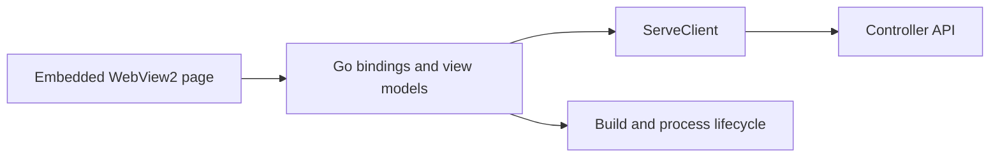

# Launcher

[Architecture](overview.md) · [Player controls](../../players/controls.md)

The Windows launcher is built from [go/cmd/launcher](../../../go/cmd/launcher).
It embeds a WebView2 page without a web server or frontend build. Go owns view
models and API calls; the page renders them through bound functions.

## Data flow

The page uses `SetHtml` and has an opaque origin. `ServeClient` makes HTTP
requests from Go, keeping the controller's origin checks intact. Each feed
retains its last good reading and marks failures stale. A 404 means the route
is not served, as in Observe mode.

Poll cadences live in the client. The page polls only its visible tab and skips
a tick while a request is in flight. The only controller feed is the work ledger.

## Views

| Tab | Source and purpose |
| --- | --- |
| Launch | Launcher process/build state, saved games, settings and colony generation; the Details log of build and start diagnostics; the observability stack toggle and dashboard links |
| Ledger | `/api/ledger`: the work ledger's declared orders (owners, abstain reasons, journaled placement outcomes), orphans, unmet throughput and silver gap with dropped export candidates, read-only ([ledger.go](../../../go/cmd/launcher/ledger.go) builds the tables) |
| Acceptance | Registered case list and one visible native run |

The launcher is the control surface; Grafana is the observation surface. The
Now, Explain, Problems and Log tabs were removed (#2803) and their questions
moved to provisioned dashboards (tab-to-panel map in the
[dashboards README](../../../tools/observability/dashboards/README.md)).
While the stack is healthy the observability section shows one button per
dashboard (`dashboardLinks` in [links.go](../../../go/cmd/launcher/links.go));
`openLink` accepts only those exact URLs, the player guide and the Grafana root.
While the stack is stopped it shows a one-line hint instead. The launcher no
longer reads the flight recorder or the session store.

## Controls

Play passes `serve --resume`, enabling Auto at startup and after loads.
The launcher has no Resume/Pause/Acknowledge buttons. Manual control uses
RimWorld's pause. Default execution uses Ultrafast pacing;
`--follow-player-speed` permits following the native speed selection.

Stop ends the controller; Close game closes this checkout's private game.
Settings are saved in `.rimgovernor/launcher.json`. Journal selection and save
behavior are described in [save and resume](../../players/save-and-resume.md).

## Acceptance tab

The launcher queries `acceptance list` once per process; restart after adding
cases. Runs use its private root, a fresh output directory and
`-headless=false -no-series`. **From scratch** adds `-fresh`; otherwise a
failed run can resume from its checkpoint.

The tab refuses while the controller or game is running. A run installs the
required fixture build; after the game closes, normal launch restores the
production build. Stop ends the runner's process tree; Close game ends the
game it left open. See the [acceptance guide](../testing/acceptance-guide.md).

## New colony panel

[newcolony.go](../../../go/cmd/launcher/newcolony.go) supplies native option
lists, ranges, DLC requirements and progress. The page renders the options
without inventing or filtering them. Its elapsed timer advances between polls;
failed polls mark retained values stale. The spec embeds the HTTP DTO's
scenario parts ([lifecycle_new_parts.go](../../../go/internal/httpapi/lifecycle_new_parts.go))
and the launcher posts `httpapi.NewColonyRequestDTO`, so settings, page and wire
share one shape; the part rows' choice lists are in
[newcolony_parts.go](../../../go/cmd/launcher/newcolony_parts.go).

Go derives a unique save name from scenario, biome and seed. On completion the
page selects it in Saved game. Generation and cancellation behavior are in
[launch](../../players/launch.md#new-colony).

## Diagnostics

The recorder defaults to `<profile>/flight/flight.jsonl`, a 16 × 32 MiB ring.
Observe mode places its recorder beside the state path; `--flight-recorder`
overrides the location. Acceptance readers use
`bridge.TimelineReader`; see [flight rows](../contracts/flight-rows.md).
