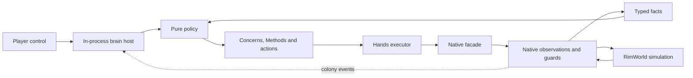
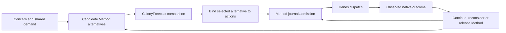
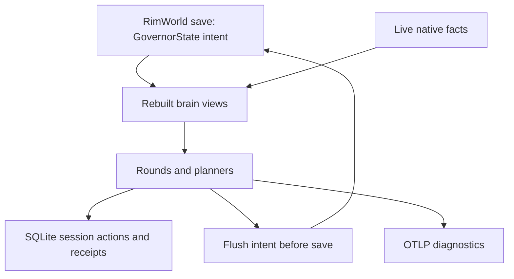

# Architecture

[Developer guide](../README.md) · [Source map](../source-map.md) ·
[Rules](rules.md)

RimGovernor is a deterministic control loop around RimWorld. The brain, a C# library hosted
inside the game process by the mod, chooses work, native code validates and issues game operations, and RimWorld simulates their
effects. Routine play requires no model calls.

Native observations have one record owner in Contracts. Policy reads those records
through the canonical colony census and keyed tables; catalog joins retain references
to those rows and add derived policy values. `ColonyReading.Snapshot` reads the same
census owned by `RoundsFacts.Census`. A review can update its derived facts without
copying native observations into another projection. Required native reads fail the
read; real absence uses the contract's named state. The former Observation project,
generic fact wrappers and hand-decoder layer are removed.

## Ownership

| Component | Owns | Does not decide |
| --- | --- | --- |
| Policy | Findings, forecasts, method choices, tactics and demand | Transport, persistence or wall-clock scheduling |
| Brain host | Planner scheduling, authority, lifecycle, watchdog and composition ([brain host](brain-host.md)) | RimWorld simulation |
| Store | Method admission, action identity, session journal and continuation ownership | Candidate valuation or game orders |
| Hands | Dispatch of admitted actions and write reconciliation | Which Method best serves a Concern |
| Native bridge | Typed observations, operation guards and clock supervision | Colony strategy |
| Native facade | In-process calls into the mod (typed, no serialization) and main-thread dispatch; the loopback HTTP channel serves the launcher and tools | Colony policy |
| RimWorld | Legality, pathing, pawn jobs and physical outcomes | Governor intent |
| Launcher | Starts/stops sessions and presents observed state | Planner execution |

Combat batches use the same Hands ownership: the planner commits the batch to
the journal, then calls `hands.RunBatch`. Uncertain receipts remain explicit.
[#2502](https://github.com/davidarcher/rimgovernor/issues/2502) completed this
unification. New writers must also use Hands.

## The control cycle

1. Read a coherent native frame; required facts fail the read and real absence has a named state.
2. Inspect Concerns and select due or invalidated planners.
3. Validate proposals against current authority, dependencies and claims.
4. Journal admitted actions before dispatch; retain receipts or uncertainty.
5. Observe native outcomes and update Concern progress.

## From a Concern to work

Concerns are being replaced by Needs and Families one family at a time; see the
[target model](control-loop.md#target-model-needs-families-and-claimed-methods).
The flow below holds for both: a migrated family proposes candidates for a Need
instead of a Concern.

A Concern states the desired outcome. A Method is an admitted attempt to achieve
it through a Plan of actions. Candidate generation, forecast comparison and
binding are pure policy steps in choosing that Method, not additional domain
actors or state owners.

The live food path follows this flow: food-specific policy generates alternatives
and concrete target bindings; the shared forecast comparator selects or postpones;
binding constructs exact actions. The existing Method journal owns progress and
revisions, and Hands remains the order writer. A forecast result does not admit a
Method, reserve every resource or prove completed pawn work.

Normal review compares supported food, needs, construction, shelter, clothing and
support alternatives together. It binds selected tasks and bounded no-change
intervals through the WorkAssignments Concern. Native routine priorities and
timetable templates do not choose voluntary jobs for controlled colonists.
An eligible pawn without an authorized activity stops the supervised clock with
an explicit unavailable-control reason. Unsupported states and remaining
independent owners are listed in [voluntary control](../contracts/voluntary-control.md).
Hunting is the same comparison: the food plan prices hunt rosters (solos, pairs,
a third gunner, a retriever) from an analytic estimate of the game's combat
formulas over the observed pawns, drafts exactly the chosen roster and releases it on
explicit triggers ([hunt comparison](../contracts/forecast-contracts.md#coherent-coupled-observation-frame));
the offline [encounter predictor](../contracts/encounter-prediction.md) checks that estimate. The estimate's known
limits travel with the choice as uncertainty, never as a hidden safety claim.
See [Method selection and binding](plans-and-hands.md#method-selection-and-binding)
for the ownership boundaries and [live policy stages](colony-forecast.md#live-activity-policy-stages)
for the implementation, enforced dependencies and current bounds.

Routine planning can run while the supervised game window is advancing.
Native hazard holds and the one tick-rate ceiling (frame budget plus brain heartbeat) protect the game independently of
planner completion. Detection time, scheduler wake time and time to a useful
protective effect are distinct measurements.

## State and evidence

The [persistence table](../contracts/persistence-contracts.md) defines each
fact's home. Loading a save restores that timeline's intent and invalidates old
execution context. SQLite is the session journal, not a second colony save.

An accepted construction order may complete its action contract while the
Concern still waits for a finished building. Unknown facts never prove recovery.

## Read next

- [Control loop](control-loop.md): the Need/Family/claimed-Method target model and its migration, legacy Rounds, scheduling, native events and Manual.
- [Plans and Hands](plans-and-hands.md): admission, dispatch and completion.
- [Sessions and recovery](sessions-and-recovery.md): saves, authority and uncertain writes.
- [Space and resources](space-and-resources.md), [supply](supply-model.md),
  [facilities](facilities.md) (the station chain and the tiled layout plan, with the
  [layout planner contract](../contracts/spatial-contracts.md#layout-planner)) and
  [storage](storage.md): physical colony planning.
- [Hazard bounds](hazard-detection-bounds.md) and [combat](combat-game-ai.md):
  native timing and tactical responsibilities.
- [Expert-play roadmap](expert-play-assessment.md): proposed guarantees and their
  evaluation criteria.
- [ColonyForecast](colony-forecast.md): inventory accounting,
  coupled consequences and production selection boundaries.
