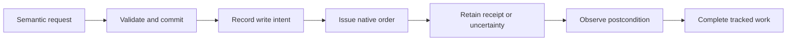

# Plans and Hands

[Architecture](overview.md) · [Player API](../contracts/player-api.md)

Player requests and routine automation share admission checks, resource accounting
and completion tracking. A Need owns the outcome being pursued; an admitted
Method associates that attempt with its Plan of actions. Hands deterministically
executes accepted work. Advisers cannot commit game orders. Safeguards veto
proposals at admission, and a Method is admitted by
[claim overlap](control-loop.md#method-journal-claim-admission).

## Method selection and binding

The live food policy separates three responsibilities within the existing
Concern/Method model:

1. **Generate alternatives.** Family-specific policy supplies forecast activities,
   dependencies, eligible options and concrete target bindings for candidate
   Methods. These are temporary proposals, without admitted Method ownership.
2. **Compare alternatives.** ColonyForecast's shared outcome comparator owns bounded
   search, scheduling, valuation and postponement. Family code does not run a
   parallel winner-selection loop. Unknown estimates and omitted alternatives
   remain visible in the result.
3. **Bind the selection.** Family-specific binding resolves the selected outcome
   into exact actions. It cannot substitute its own winner. Runtime submits the
   proposal through normal journal admission and Safeguards; Hands dispatches it.

The forecast graph describes hypothetical work. The Plan describes proposed or
admitted actions. Neither is a second Method lifecycle. The journal owns the
admitted Method's identity, revisions and execution responsibility. Observations
drive continuation, rebinding or release through that same owner; an accepted
write alone does not complete the Concern.

For food, the live comparison covers bounded same-pawn harvest/delivery
alternatives and, after observed harvest, raw delivery versus one cooking iteration.
It does not yet compare the complete raw-versus-cooked portfolio
against all colony work. The [live stage contract](colony-forecast.md#live-activity-policy-stages)
owns class responsibilities, the local objective and search limits. `RGARCH009`
enforces its dependency boundaries without a baseline; it is not universal
enforcement for older planners or proof of exhaustive candidate generation.

## Keep intent and progress separate

The specification records what is wanted. Progress records attempted writes,
created native objects, uncertainty and completion. Stable step identities connect
them across reviews and restarts. Partially ordered construction retains known
blueprints and sends only the remaining admissible work.

Admission applies the action-specific ownership, dependency and resource checks.
Building intent-mode can defer cost and placement checks to execution; it does not
reserve every future cost atomically. Native dispatch validates current legality.
Acknowledging a request establishes acceptance; completion requires the
[action's native postcondition](../contracts/action-contracts.md).

## Recover and cancel precisely

A refusal before writing can be reconsidered when conditions change. A lost reply
after dispatch may conceal an accepted order: retain intent and inspect the game
before retrying. Recovery preserves action identity and requires fresh context.
See [sessions and recovery](sessions-and-recovery.md).

Cancelling a concern stops pursuit while retaining issued game orders. Removing
construction is a separate explicit request against exact pending objects;
completed buildings and neighboring or replacement objects remain protected.

Clearance reads standing removal designations before selecting writes. Designated
buildings and floors remain a clearance deficit and lend game time to native jobs;
they are not reissued. Batch roof safety and phase ordering still consider the
standing targets. It retries through the shared refusal budget
(`policy.RefusalBudget`): a permanent native refusal of a batch gives it up under native's
reason, a transient one waits for the world to change, and successful designation writes spend
nothing.

Manual stops routine automation but permits current explicit player work through
Hands while paused. It does not resume simulation. Direction and colony/map/load
changes invalidate work prepared under the previous context. Dispatch is
journaled before any native write, so a prepared but undispatched action has no
write outstanding: when the native generation moves under it (a cancelled
dispatch, a re-acquired authority) it is prepared again under the current authority
rather than left stranded.

Implementation: [Brain.Domain](../../../brain/src/RimGovernor.Brain.Domain) (plans/concerns),
[Brain.Store](../../../brain/src/RimGovernor.Brain.Store) and
[Brain.Executor](../../../brain/src/RimGovernor.Brain.Executor).
