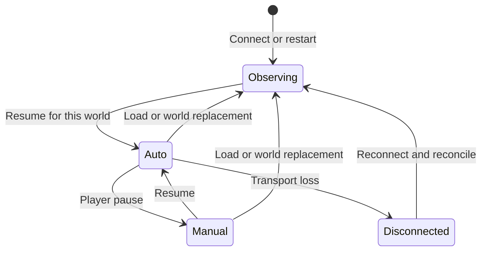

# Sessions and recovery

[Architecture](overview.md) · [Persistence contract](../contracts/persistence-contracts.md)

Colony and map identity scope intent; the load token identifies the current
world instance. Authority also checks native tick, order generation and whether
control is paused. Observation refreshes do not grant authority.

## Save, load and restart

Ordinary RimWorld saves carry the brain intent in opaque `GovernorState` blobs.
Before a save, native's `pre_save` handshake lets the brain flush the blobs in one
batch. A save made while the brain is disconnected retains the last flushed intent.
The SQLite journal is not a paired player save.

A load creates a new token. The brain rebuilds views from the save before reviewing,
invalidates old bindings and cancels undispatched work; uncertain dispatched work
retains its recovery requirement. Methods are planned against the loaded world.

`AutoResumer` offers each fresh world one resume through the same control intent the resume
route submits, unless the launcher started the game with Observe. The player's Resume or Pause
stands afterwards. Restart can revoke stale native authority and grant a fresh lease.

## Game process and connection

The launcher (or the acceptance harness) starts the game with `-rimgovernor-inproc`; the brain
runs inside that process ([brain host](brain-host.md)), so there is no separate process to
reconnect and no transport to lose. The launcher finds the game through the
`http-endpoint.json` file the mod writes. Main-thread game operations remain scheduled by
native code; clock-journal reads are unheld and follow advance announcements.

If the brain faults or stalls, the host suspends authority and the game keeps running; native
revokes authority when its lease lapses. Only the player's Resume clears a suspension, and a
player's Pause stands.

## Uncertain writes and read retries

A lost reply may conceal an accepted order. Retain its action identity and
inspect the world before deciding what remains; never automatically replay an
ambiguous non-idempotent mutation. A new load or tick rewind invalidates the old
attempt's context.

Read/preview retries are bounded. Transport recovery is not mutation retry.
Prepared but undispatched work can be prepared under fresh authority because
it has no outstanding native write.

## Cleanup

Each worker owns its brain, private root and game process. Stop by root or
verified PID. Stop games using a private copy before replacing its DLLs; never
modify Steam or a peer's copy. See the [runbook](../agent-runbook.md).

Player instructions: [save and resume](../../players/save-and-resume.md).
